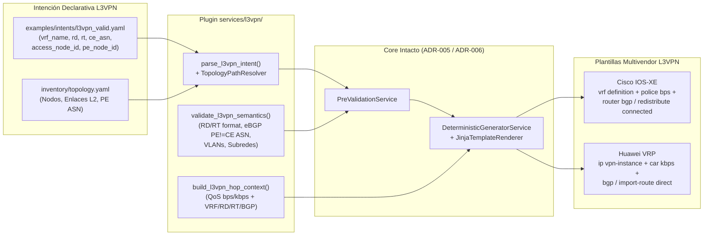

# ADR-008: Extensión del servicio L3VPN (Modelo, BGP redistribute connected y Golden Configs)

- **Estado:** Proposed
- **Etapa:** E2
- **Depende de:** ADR-006, ADR-007
- **Referencias:** IETF RFC 4364 (BGP/MPLS IP Virtual Private Networks — VRF, Route Distinguisher `RD`, Route Target `RT`, MP-BGP VPNv4); IETF RFC 4271 (BGP-4 PE-CE); Documentación oficial Cisco IOS-XE 17.x (`vrf definition`, `router bgp <asn> / address-family ipv4 vrf <vrf>`, `redistribute connected`) y Huawei VRP (`ip vpn-instance`, `bgp <asn> / ipv4-family vpn-instance <vrf>`, `import-route direct`).
- **Walkthrough:** `docs/walkthroughs/ADR-008.md`

---

## PARTE A — DECISIÓN (congelada al aceptar)

### 1. Contexto

Con el corte vertical de `DIA` (`ADR-003` a `ADR-006`) y el desacoplamiento topológico mediante `inventory/topology.yaml` (`ADR-007`) completados y verificados en el repositorio[cite: 1, 3], corresponde abordar el segundo servicio del portafolio del framework en la Etapa `E2`: **L3VPN (BGP/MPLS IP VPN, RFC 4364)**[cite: 2, 4].

A diferencia de `DIA` —donde el enrutamiento PE-CE se resuelve mediante una ruta estática dentro de una VRF preexistente y la validación posdespliegue solo requiere verificar conectividad local entre el switch de acceso y el PE—, el aprovisionamiento y la posterior validación de una **L3VPN corporativa multivendor** enfrentan tres desafíos técnicos y operativos específicos del proyecto:

1. **Aprovisionamiento del plano de control VPNv4 y sesión eBGP PE-CE:** En cada PE (`Cisco C8200L` con IOS-XE 17.x y `Huawei AR5710` con VRP V600) el servicio requiere:
   * Definir o asegurar la instancia VRF (`vrf_name`) con su *Route Distinguisher* (`rd`, formato `ASN:nn` o `IP:nn`) y sus *Route Targets* de importación y exportación (`rt_import`, `rt_export`) para el intercambio de prefijos VPNv4 por MP-iBGP entre PEs[cite: 2].
   * Configurar la subinterfaz Dot1Q hacia el tramo de agregación L2 (`encapsulation dot1Q <vlan_id>` / `dot1q termination vid <vlan_id>`), asociarla a la VRF, asignar el direccionamiento WAN `/30` (`.1` en PE, `.2` hacia CE) y aplicar la política de QoS garantizada en base decimal 1000 (`bps` en Cisco IOS-XE, `kbps` en Huawei VRP)[cite: 2].
   * Configurar el protocolo de enrutamiento **eBGP PE-CE** bajo la familia IPv4 de la VRF (`address-family ipv4 vrf <vrf_name>` en Cisco; `ipv4-family vpn-instance <vrf_name>` en Huawei) apuntando al vecino `.2` con su `ce_asn`[cite: 2, 4].
2. **Garantía de verificabilidad del plano de control MP-BGP sin router CE físico (Regla 6 del Contexto Maestro):** En el laboratorio de la Universidad de Lima no se emplean routers CE físicos adicionales detrás de los switches de acceso[cite: 2, 4]. En ausencia de un CE que establezca la sesión eBGP, el proceso BGP del PE no anunciaría ningún prefijo hacia el PE remoto a menos que inyecte explícitamente la subred WAN `/30` directamente conectada[cite: 2]. Por ello, la Regla 6 exige que las plantillas de `L3VPN` en el PE incluyan **`redistribute connected`** (Cisco IOS-XE) e **`import-route direct`** (Huawei VRP) dentro de la familia IPv4 de la VRF[cite: 2]. Esto garantiza que, apenas la subinterfaz WAN levante en estado `up/up`, el prefijo `/30` local sea exportado como ruta VPNv4 con su `RT` y aprendido en la tabla VRF del PE remoto, permitiendo en `ADR-011` la validación multicapa y el estado dual (`OPERATIONAL` vs. `READY_FOR_SERVICE`)[cite: 2].
3. **Compatibilidad con el pipeline unificado de saltos (`hops`) y los tramos L2 (`access` y `transit`):** En los switches de acceso (`C9300L` / `S5735`) y tránsito (`C9300L` / `S5735`), el transporte L2 de la VLAN de demarcación hacia el PE es idéntico al de `DIA` (creación de VLAN con `description`, puerto de cliente en modo `access`, puertos de agregación en modo `trunk` y limpieza en `teardown`)[cite: 2, 4]. Sin embargo, el generador (`DeterministicGeneratorService`) y el pre-validador (`PreValidationService`) operan sobre una secuencia lineal de saltos `intent.hops` (`AccessHop -> TransitHop* -> ProviderEdgeHop`)[cite: 1, 2]. Es necesario definir cómo se estructura `L3VpnIntent` para integrarse limpiamente con `PluginCatalog`, `PreValidationService`, `TopologyPathResolver` y `DeterministicGeneratorService` sin duplicar lógica ni romper los contratos establecidos en `ADR-001` a `ADR-007`[cite: 1, 2].

### 2. Alternativas

1. **Alternativa 1 — Modelo `L3VpnIntent` multi-sitio anidado (`sites: tuple[L3VpnSite, ...]`) que modifica `PreValidationService` y `DeterministicGeneratorService` para iterar sobre listas de sitios en lugar de `intent.hops`:**
   * *Descripción:* Definir `L3VpnIntent` sin el atributo `hops` de primer nivel, introduciendo una jerarquía `intent.sites[i].hops` donde cada intent obliga a declarar 2 o más sedes simultáneamente, y alterar `PreValidationService` (`application/pre_validation.py`) y `DeterministicGeneratorService` (`application/generation.py`) con condicionales `if intent.service_type == "L3VPN": ...` para aplanar o recorrer múltiples cadenas `access -> transit -> pe`.
   * *Ventajas:* Agrupa múltiples sedes en un único archivo YAML/JSON.
   * *Desventajas:* Viola el principio Abierto/Cerrado (OCP) de `ADR-004` al introducir ramificaciones por tipo de servicio dentro de `application/pre_validation.py` y `application/generation.py`; rompe el invariante estructural de `PreValidationService._validate_hop_roles` que exige exactamente un cadena `ACCESS -> TRANSIT* -> PE` en `intent.hops`[cite: 1]; y acopla el aprovisionamiento de una sede al de otra (cuando en operación carrier cada acceso/punta L3VPN hacia su PE local se aprovisiona o da de baja mediante una orden de servicio independiente asociada a la misma VRF/RD/RT, o bien en par mediante dos intenciones vinculadas a la misma VRF).

2. **Alternativa 2 — Modelo `L3VpnIntent` por extremo de servicio (un tramo `access -> transit* -> pe` resuelto por `TopologyPathResolver`) con soporte de `pe_asn` desde topología, parámetros MPLS/BGP explícitos (`vrf_name`, `rd`, `rt_import`, `rt_export`, `ce_asn`, `lan_network` opcional) y plantillas `provision`/`teardown` con `redistribute connected` / `import-route direct`:**
   * *Descripción:*
     * Modelar `L3VpnIntent` en `src/intentfabric/domain/intent.py` manteniendo la misma interfaz estructural que `DiaIntent` (`service_type: str = "L3VPN"`, `description`, `vlan_id`, `wan_network`, `bandwidth_mbps`, `qos_policy`, `hops: tuple[ServiceHop, ...]`, `derived: DiaDerivedParameters`) y añadiendo los atributos específicos de L3VPN MPLS/BGP:
       * `vrf_name: str`
       * `rd: str` (Route Distinguisher en formato `ASN:nn` o `IPv4:nn`, ej. `"65000:100"`)
       * `rt_import: str` y `rt_export: str` (Route Targets en formato `ASN:nn` o `IPv4:nn`, permitiendo en el YAML/JSON un campo abreviado `route_target` cuando import y export son simétricos, o `rt_import` / `rt_export` explícitos)
       * `pe_asn: int` (resuelto automáticamente desde `TopologyNode.asn` del `pe_node_id` en `inventory/topology.yaml`, o declarado explícitamente si se usa modo sin catálogo)
       * `ce_asn: int` (ASN privado o público del CE, en rango `1..4294967294`, distinto de `pe_asn` para garantizar sesión eBGP)
       * `lan_network: IPv4Network | None = None` (opcional en L3VPN dado que las redes LAN del cliente se aprenden dinámicamente por BGP, a diferencia de DIA donde es obligatorio para la ruta estática).
     * Implementar en `src/intentfabric/services/l3vpn/` los tres componentes del plugin de servicio siguiendo exactamente el contrato de `ADR-004`, `ADR-005`, `ADR-006` y `ADR-007`:
       1. `intent_parser.py` (`parse_l3vpn_intent`): resuelve la ruta `access -> transit* -> pe` mediante `TopologyPathResolver` a partir de `access_node_id`, `access_interface` y `pe_node_id`, extrae `pe_asn` del nodo PE en `TopologyCatalog` (si no se sobreescribe), valida formato de `rd` y `rt_import`/`rt_export`, y calcula `derived` en base 1000.
       2. `validator.py` (`validate_l3vpn_semantics`): valida reglas semánticas específicas de L3VPN (`INVALID_RD_FORMAT`, `INVALID_RT_FORMAT`, `INVALID_ASN_RANGE`, `SAME_PE_CE_ASN` cuando `pe_asn == ce_asn`, `RESERVED_CISCO_VLAN`, `WAN_LAN_OVERLAP` si `lan_network` está presente).
       3. `context_builder.py` (`build_l3vpn_hop_context`): construye el diccionario determinista para `access`, `transit` y `pe` incluyendo `vrf_name`, `rd`, `rt_import`, `rt_export`, `pe_asn`, `ce_asn`, `wan_pe_ip`, `wan_ce_ip`, `wan_netmask` y las tasas QoS por fabricante (`build_cisco_qos_context` / `build_huawei_qos_context`).
     * Incorporar las 12 plantillas Jinja2 en `vendors/cisco/templates/l3vpn/{provision,teardown}/{access,transit,pe}.j2` y `vendors/huawei/templates/l3vpn/{provision,teardown}/{access,transit,pe}.j2` junto con sus 12 Golden Files en `tests/golden/l3vpn/`:
       * En **Cisco IOS-XE (`pe.j2` provision)**: definición de VRF (`vrf definition {{ vrf_name }}`, `rd {{ rd }}`, `address-family ipv4`, `route-target export {{ rt_export }}`, `route-target import {{ rt_import }}`), `policy-map {{ qos_policy }}` en `bps`, subinterfaz Dot1Q con `vrf forwarding {{ vrf_name }}`, y bloque `router bgp {{ pe_asn }}` $\rightarrow$ `address-family ipv4 vrf {{ vrf_name }}` con `redistribute connected` y `neighbor {{ wan_ce_ip }} remote-as {{ ce_asn }}` + `neighbor {{ wan_ce_ip }} activate`.
       * En **Huawei VRP (`pe.j2` provision)**: `ip vpn-instance {{ vrf_name }}` (`ipv4-family`, `route-distinguisher {{ rd }}`, `vpn-target {{ rt_export }} export-extcommunity`, `vpn-target {{ rt_import }} import-extcommunity`), `traffic classifier/behavior/policy {{ qos_policy }}` en `kbps`, subinterfaz Dot1Q con `ip binding vpn-instance {{ vrf_name }}` y `arp broadcast enable`, y bloque `bgp {{ pe_asn }}` $\rightarrow$ `ipv4-family vpn-instance {{ vrf_name }}` con `import-route direct` y `peer {{ wan_ce_ip }} as-number {{ ce_asn }}`.
       * En **`teardown/pe.j2`**: eliminación limpia del vecino BGP y/o familia VRF, subinterfaz (`no interface {{ pe_subinterface }}` / `undo interface {{ pe_subinterface }}`) y política/instancia VRF del servicio para restituir el PE a su estado base de laboratorio.
   * *Ventajas:* Cumple al 100% con el contrato de extensión `PluginCatalog` (`ADR-004`) sin modificar ni una sola línea de `PreValidationService` (`application/pre_validation.py`) ni de `DeterministicGeneratorService` (`application/generation.py`); reutiliza `TopologyPathResolver` y `normalize_interface_name` (`ADR-007`); satisface las Reglas 1, 2, 3, 4 y 6 del Contexto Maestro; y permite aprovisionar tanto un extremo individual como ambos extremos de una L3VPN (ej. Sede A en `PE2-TEST` Cisco y Sede B en `PE1-TEST` Huawei compartiendo `vrf_name`, `rd` y `rt`).
   * *Desventajas:* Cuando se aprovisionan dos sedes extremo a extremo en el laboratorio, el operador ejecuta dos archivos de intención declarativos (uno por sede/demarcación, ej. `l3vpn_site_a_cisco.yaml` y `l3vpn_site_b_huawei.yaml`), lo cual es consistente con el diseño modular de órdenes de servicio por circuito de acceso.

### 3. Criterios de elección

* **Cumplimiento del Principio Abierto/Cerrado (`ADR-004`):** La incorporación del segundo servicio (`L3VPN`) debe probar empíricamente que la arquitectura de plugins permite añadir un nuevo servicio registrando su parser, validador semántico, constructor de contexto y plantillas en `bootstrap.py`, sin alterar el motor de validación previa (`application/pre_validation.py`) ni el motor de generación (`application/generation.py`)[cite: 1, 2].
* **Soporte para Validación Multicapa sin CE Físico (Regla 6 del Contexto Maestro):** La inclusión obligatoria de `redistribute connected` (Cisco IOS-XE) e `import-route direct` (Huawei VRP) bajo la familia IPv4 de la VRF en BGP asegura que la subred WAN `/30` se inyecte en MP-BGP apenas la subinterfaz pase a estado `up/up`, habilitando la verificación cruzada de rutas VPNv4 entre el PE Cisco (`PE2-TEST`) y el PE Huawei (`PE1-TEST`) incluso cuando el vecino eBGP `.2` permanezca en `Active`/`Idle` (`READY_FOR_SERVICE`)[cite: 2].
* **Aprovechamiento del Catálogo Topológico (`ADR-007`):** El ASN del PE (`pe_asn`) no tiene por qué repetirse manualmente en cada intención si ya está definido en `inventory/topology.yaml` (`asn: 65000` en `PE1-TEST` y `PE2-TEST`), manteniendo la opción de declararlo o validarlo contra el catálogo[cite: 1, 2].

### 4. Decisión

Adoptamos la **Alternativa 2**: implementar el plugin completo del servicio `L3VPN` en `src/intentfabric/services/l3vpn/` (`intent_parser.py`, `validator.py`, `context_builder.py`), extender `src/intentfabric/domain/intent.py` con el modelo inmutable `L3VpnIntent`, incorporar las 12 plantillas Jinja2 (`provision`/`teardown` para `access`, `transit` y `pe` en Cisco IOS-XE y Huawei VRP) incluyendo `redistribute connected` / `import-route direct` en la familia BGP de la VRF, registrar el servicio en `src/intentfabric/bootstrap.py` y verificar su determinismo mediante Golden Configs en `tests/golden/l3vpn/`.

### 5. Sustento

1. **Demostración de extensibilidad real para el jurado de tesis:** Al mantener `PreValidationService` y `DeterministicGeneratorService` cerrados a la modificación y abiertos a la extensión vía `PluginCatalog`, `ADR-008` valida en la práctica la tesis arquitectónica de `ADR-001` y `ADR-004`.

2. **Simetría semántica entre Cisco IOS-XE y Huawei VRP en el borde MPLS:** Aunque la sintaxis CLI difiere sustancialmente entre ambos fabricantes (`vrf definition` + `vrf forwarding` + `redistribute connected` en IOS-XE vs. `ip vpn-instance` + `ip binding vpn-instance` + `import-route direct` en VRP), ambas configuraciones se generan a partir de exactamente el mismo contrato declarativo `L3VpnIntent` y el mismo constructor de contexto normalizado.

3. **Limpieza determinista de laboratorio (`teardown`):** En un entorno compartido de laboratorio universitario, los servicios `L3VPN` crean estado adicional respecto a `DIA` (instancia VRF con RD/RT, subinterfaz, política QoS y familia/vecino BGP). Las plantillas `teardown` de `L3VPN` remueven en orden inverso la sesión/familia BGP de la VRF, la subinterfaz, la política QoS y la definición de la VRF, dejando los routers `PE1-TEST` y `PE2-TEST` limpios entre corridas experimentales.

### 6. Consecuencias y riesgos aceptados

* **Aislamiento de VRF por servicio en `teardown`:** Dado que en `L3VPN` cada cliente corporativo posee su propia VRF dedicada (`vrf_name`, `rd`, `rt_import`, `rt_export`), la plantilla `teardown/pe.j2` de `L3VPN` sí elimina la entrada de la VRF en BGP, la subinterfaz, la política de QoS del servicio y la definición de la VRF (`no vrf definition {{ vrf_name }}` en Cisco / `undo ip vpn-instance {{ vrf_name }}` en Huawei), a diferencia de `DIA` donde la VRF global de Internet preexiste en Día-0.
* **Reutilización de estructuras de salto (`AccessHop`, `TransitHop`, `ProviderEdgeHop`) y derivaciones (`DiaDerivedParameters`):** Para evitar duplicación innecesaria en `domain/intent.py`, `L3VpnIntent` reutiliza `DiaDerivedParameters` (que ya encapsula `wan_pe_ip`, `wan_ce_ip`, `pe_subinterface`, `cir_kbps`, `pir_kbps`, `cir_bps`, `pir_bps`), pudiendo exportarse un alias `ServiceDerivedParameters = DiaDerivedParameters` para claridad semántica sin romper retrocompatibilidad con `ADR-003` y `ADR-006`.

---