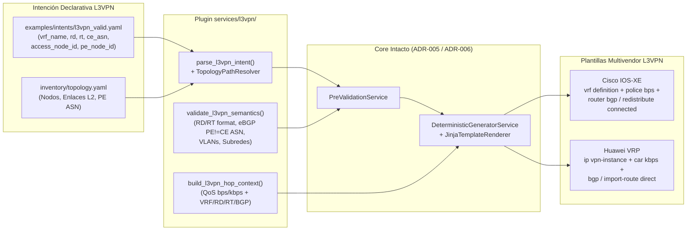

# ADR-008: Extensión del servicio L3VPN (Modelo, BGP redistribute connected y Golden Configs)

- **Estado:** Accepted (aprobado el 29-10-2026)
- **Etapa:** E2
- **Depende de:** ADR-006, ADR-007
- **Referencias:** IETF RFC 4364 (BGP/MPLS IP Virtual Private Networks — VRF, Route Distinguisher `RD`, Route Target `RT`, MP-BGP VPNv4); IETF RFC 4271 (BGP-4 PE-CE); Documentación oficial Cisco IOS-XE 17.x (`vrf definition`, `router bgp <asn> / address-family ipv4 vrf <vrf>`, `redistribute connected`) y Huawei VRP (`ip vpn-instance`, `bgp <asn> / ipv4-family vpn-instance <vrf>`, `import-route direct`).
- **Walkthrough:** `docs/walkthroughs/ADR-008.md`

---

## PARTE A — DECISIÓN (congelada al aceptar)

### 1. Contexto

Con el corte vertical de `DIA` (`ADR-003` a `ADR-006`) y el desacoplamiento topológico mediante `inventory/topology.yaml` (`ADR-007`) completados y verificados en el repositorio, corresponde abordar el segundo servicio del portafolio del framework en la Etapa `E2`: **L3VPN (BGP/MPLS IP VPN, RFC 4364)**.

A diferencia de `DIA` —donde el enrutamiento PE-CE se resuelve mediante una ruta estática dentro de una VRF preexistente y la validación posdespliegue solo requiere verificar conectividad local entre el switch de acceso y el PE—, el aprovisionamiento y la posterior validación de una **L3VPN corporativa multivendor** enfrentan tres desafíos técnicos y operativos específicos del proyecto:

1. **Aprovisionamiento del plano de control VPNv4 y sesión eBGP PE-CE:** En cada PE (`Cisco C8200L` con IOS-XE 17.x y `Huawei AR5710` con VRP V600) el servicio requiere:
   * Definir o asegurar la instancia VRF (`vrf_name`) con su *Route Distinguisher* (`rd`, formato `ASN:nn` o `IP:nn`) y sus *Route Targets* de importación y exportación (`rt_import`, `rt_export`) para el intercambio de prefijos VPNv4 por MP-iBGP entre PEs.
   * Configurar la subinterfaz Dot1Q hacia el tramo de agregación L2 (`encapsulation dot1Q <vlan_id>` / `dot1q termination vid <vlan_id>`), asociarla a la VRF, asignar el direccionamiento WAN `/30` (`.1` en PE, `.2` hacia CE) y aplicar la política de QoS garantizada en base decimal 1000 (`bps` en Cisco IOS-XE, `kbps` en Huawei VRP).
   * Configurar el protocolo de enrutamiento **eBGP PE-CE** bajo la familia IPv4 de la VRF (`address-family ipv4 vrf <vrf_name>` en Cisco; `ipv4-family vpn-instance <vrf_name>` en Huawei) apuntando al vecino `.2` con su `ce_asn`.
2. **Garantía de verificabilidad del plano de control MP-BGP sin router CE físico (Regla 6 del Contexto Maestro):** En el laboratorio de la Universidad de Lima no se emplean routers CE físicos adicionales detrás de los switches de acceso. En ausencia de un CE que establezca la sesión eBGP, el proceso BGP del PE no anunciaría ningún prefijo hacia el PE remoto a menos que inyecte explícitamente la subred WAN `/30` directamente conectada. Por ello, la Regla 6 exige que las plantillas de `L3VPN` en el PE incluyan **`redistribute connected`** (Cisco IOS-XE) e **`import-route direct`** (Huawei VRP) dentro de la familia IPv4 de la VRF. Esto garantiza que, apenas la subinterfaz WAN levante en estado `up/up`, el prefijo `/30` local sea exportado como ruta VPNv4 con su `RT` y aprendido en la tabla VRF del PE remoto, permitiendo en `ADR-011` la validación multicapa y el estado dual (`OPERATIONAL` vs. `READY_FOR_SERVICE`).
3. **Compatibilidad con el pipeline unificado de saltos (`hops`) y los tramos L2 (`access` y `transit`):** En los switches de acceso (`C9300L` / `S5735`) y tránsito (`C9300L` / `S5735`), el transporte L2 de la VLAN de demarcación hacia el PE es idéntico al de `DIA` (creación de VLAN con `description`, puerto de cliente en modo `access`, puertos de agregación en modo `trunk` y limpieza en `teardown`). Sin embargo, el generador (`DeterministicGeneratorService`) y el pre-validador (`PreValidationService`) operan sobre una secuencia lineal de saltos `intent.hops` (`AccessHop -> TransitHop* -> ProviderEdgeHop`). Es necesario definir cómo se estructura `L3VpnIntent` para integrarse limpiamente con `PluginCatalog`, `PreValidationService`, `TopologyPathResolver` y `DeterministicGeneratorService` sin duplicar lógica ni romper los contratos establecidos en `ADR-001` a `ADR-007`.

### 2. Alternativas

1. **Alternativa 1 — Modelo `L3VpnIntent` multi-sitio anidado (`sites: tuple[L3VpnSite, ...]`) que modifica `PreValidationService` y `DeterministicGeneratorService` para iterar sobre listas de sitios en lugar de `intent.hops`:**
   * *Descripción:* Definir `L3VpnIntent` sin el atributo `hops` de primer nivel, introduciendo una jerarquía `intent.sites[i].hops` donde cada intent obliga a declarar 2 o más sedes simultáneamente, y alterar `PreValidationService` (`application/pre_validation.py`) y `DeterministicGeneratorService` (`application/generation.py`) con condicionales `if intent.service_type == "L3VPN": ...` para aplanar o recorrer múltiples cadenas `access -> transit -> pe`.
   * *Ventajas:* Agrupa múltiples sedes en un único archivo YAML/JSON.
   * *Desventajas:* Viola el principio Abierto/Cerrado (OCP) de `ADR-004` al introducir ramificaciones por tipo de servicio dentro de `application/pre_validation.py` y `application/generation.py`; rompe el invariante estructural de `PreValidationService._validate_hop_roles` que exige exactamente un cadena `ACCESS -> TRANSIT* -> PE` en `intent.hops`; y acopla el aprovisionamiento de una sede al de otra (cuando en operación carrier cada acceso/punta L3VPN hacia su PE local se aprovisiona o da de baja mediante una orden de servicio independiente asociada a la misma VRF/RD/RT, o bien en par mediante dos intenciones vinculadas a la misma VRF).

2. **Alternativa 2 — Modelo `L3VpnIntent` por extremo de servicio (un tramo `access -> transit* -> pe` resuelto por `TopologyPathResolver`) con soporte de `pe_asn` desde topología, parámetros MPLS/BGP explícitos (`vrf_name`, `rd`, `rt_import`, `rt_export`, `ce_asn`, `lan_network` opcional) y plantillas `provision`/`teardown` con `redistribute connected` / `import-route direct`:**
   * *Descripción:*
     * Modelar `L3VpnIntent` en `src/intentfabric/domain/intent.py` manteniendo la misma interfaz estructural que `DiaIntent` (`service_type: str = "L3VPN"`, `description`, `vlan_id`, `wan_network`, `bandwidth_mbps`, `qos_policy`, `hops: tuple[ServiceHop, ...]`, `derived: DiaDerivedParameters`) y añadiendo los atributos específicos de L3VPN MPLS/BGP:
       * `vrf_name: str`
       * `rd: str` (Route Distinguisher en formato `ASN:nn` o `IPv4:nn`, ej. `"65000:100"`)
       * `rt_import: str` y `rt_export: str` (Route Targets en formato `ASN:nn` o `IPv4:nn`, permitiendo en el YAML/JSON un campo abreviado `route_target` cuando import y export son simétricos, o `rt_import` / `rt_export` explícitos)
       * `pe_asn: int` (resuelto automáticamente desde `TopologyNode.asn` del `pe_node_id` en `inventory/topology.yaml`, o declarado explícitamente si se usa modo sin catálogo)
       * `ce_asn: int` (ASN privado o público del CE, en rango `1..4294967294`, distinto de `pe_asn` para garantizar sesión eBGP)
       * `lan_network: IPv4Network | None = None` (opcional en L3VPN dado que las redes LAN del cliente se aprenden dinámicamente por BGP, a diferencia de DIA donde es obligatorio para la ruta estática).
     * Implementar en `src/intentfabric/services/l3vpn/` los tres componentes del plugin de servicio siguiendo exactamente el contrato de `ADR-004`, `ADR-005`, `ADR-006` y `ADR-007`:
       1. `intent_parser.py` (`parse_l3vpn_intent`): resuelve la ruta `access -> transit* -> pe` mediante `TopologyPathResolver` a partir de `access_node_id`, `access_interface` y `pe_node_id`, extrae `pe_asn` del nodo PE en `TopologyCatalog` (si no se sobreescribe), valida formato de `rd` y `rt_import`/`rt_export`, y calcula `derived` en base 1000.
       2. `validator.py` (`validate_l3vpn_semantics`): valida reglas semánticas específicas de L3VPN (`INVALID_RD_FORMAT`, `INVALID_RT_FORMAT`, `INVALID_ASN_RANGE`, `SAME_PE_CE_ASN` cuando `pe_asn == ce_asn`, `RESERVED_CISCO_VLAN`, `WAN_LAN_OVERLAP` si `lan_network` está presente).
       3. `context_builder.py` (`build_l3vpn_hop_context`): construye el diccionario determinista para `access`, `transit` y `pe` incluyendo `vrf_name`, `rd`, `rt_import`, `rt_export`, `pe_asn`, `ce_asn`, `wan_pe_ip`, `wan_ce_ip`, `wan_netmask` y las tasas QoS por fabricante (`build_cisco_qos_context` / `build_huawei_qos_context`).
     * Incorporar las 12 plantillas Jinja2 en `vendors/cisco/templates/l3vpn/{provision,teardown}/{access,transit,pe}.j2` y `vendors/huawei/templates/l3vpn/{provision,teardown}/{access,transit,pe}.j2` junto con sus 12 Golden Files en `tests/golden/l3vpn/`:
       * En **Cisco IOS-XE (`pe.j2` provision)**: definición de VRF (`vrf definition {{ vrf_name }}`, `rd {{ rd }}`, `address-family ipv4`, `route-target export {{ rt_export }}`, `route-target import {{ rt_import }}`), `policy-map {{ qos_policy }}` en `bps`, subinterfaz Dot1Q con `vrf forwarding {{ vrf_name }}`, y bloque `router bgp {{ pe_asn }}` $\rightarrow$ `address-family ipv4 vrf {{ vrf_name }}` con `redistribute connected` y `neighbor {{ wan_ce_ip }} remote-as {{ ce_asn }}` + `neighbor {{ wan_ce_ip }} activate`.
       * En **Huawei VRP (`pe.j2` provision)**: `ip vpn-instance {{ vrf_name }}` (`ipv4-family`, `route-distinguisher {{ rd }}`, `vpn-target {{ rt_export }} export-extcommunity`, `vpn-target {{ rt_import }} import-extcommunity`), `traffic classifier/behavior/policy {{ qos_policy }}` en `kbps`, subinterfaz Dot1Q con `ip binding vpn-instance {{ vrf_name }}` y `arp broadcast enable`, y bloque `bgp {{ pe_asn }}` $\rightarrow$ `ipv4-family vpn-instance {{ vrf_name }}` con `import-route direct` y `peer {{ wan_ce_ip }} as-number {{ ce_asn }}`.
       * En **`teardown/pe.j2`**: eliminación limpia del vecino BGP y/o familia VRF, subinterfaz (`no interface {{ pe_subinterface }}` / `undo interface {{ pe_subinterface }}`) y política/instancia VRF del servicio para restituir el PE a su estado base de laboratorio.
   * *Ventajas:* Cumple al 100% con el contrato de extensión `PluginCatalog` (`ADR-004`) sin modificar ni una sola línea de `PreValidationService` (`application/pre_validation.py`) ni de `DeterministicGeneratorService` (`application/generation.py`); reutiliza `TopologyPathResolver` y `normalize_interface_name` (`ADR-007`); satisface las Reglas 1, 2, 3, 4 y 6 del Contexto Maestro; y permite aprovisionar tanto un extremo individual como ambos extremos de una L3VPN (ej. Sede A en `PE2-TEST` Cisco y Sede B en `PE1-TEST` Huawei compartiendo `vrf_name`, `rd` y `rt`).
   * *Desventajas:* Cuando se aprovisionan dos sedes extremo a extremo en el laboratorio, el operador ejecuta dos archivos de intención declarativos (uno por sede/demarcación, ej. `l3vpn_site_a_cisco.yaml` y `l3vpn_site_b_huawei.yaml`), lo cual es consistente con el diseño modular de órdenes de servicio por circuito de acceso.

### 3. Criterios de elección

* **Cumplimiento del Principio Abierto/Cerrado (`ADR-004`):** La incorporación del segundo servicio (`L3VPN`) debe probar empíricamente que la arquitectura de plugins permite añadir un nuevo servicio registrando su parser, validador semántico, constructor de contexto y plantillas en `bootstrap.py`, sin alterar el motor de validación previa (`application/pre_validation.py`) ni el motor de generación (`application/generation.py`).
* **Soporte para Validación Multicapa sin CE Físico (Regla 6 del Contexto Maestro):** La inclusión obligatoria de `redistribute connected` (Cisco IOS-XE) e `import-route direct` (Huawei VRP) bajo la familia IPv4 de la VRF en BGP asegura que la subred WAN `/30` se inyecte en MP-BGP apenas la subinterfaz pase a estado `up/up`, habilitando la verificación cruzada de rutas VPNv4 entre el PE Cisco (`PE2-TEST`) y el PE Huawei (`PE1-TEST`) incluso cuando el vecino eBGP `.2` permanezca en `Active`/`Idle` (`READY_FOR_SERVICE`).
* **Aprovechamiento del Catálogo Topológico (`ADR-007`):** El ASN del PE (`pe_asn`) no tiene por qué repetirse manualmente en cada intención si ya está definido en `inventory/topology.yaml` (`asn: 65000` en `PE1-TEST` y `PE2-TEST`), manteniendo la opción de declararlo o validarlo contra el catálogo.

### 4. Decisión

Adoptamos la **Alternativa 2**: implementar el plugin completo del servicio `L3VPN` en `src/intentfabric/services/l3vpn/` (`intent_parser.py`, `validator.py`, `context_builder.py`), extender `src/intentfabric/domain/intent.py` con el modelo inmutable `L3VpnIntent`, incorporar las 12 plantillas Jinja2 (`provision`/`teardown` para `access`, `transit` y `pe` en Cisco IOS-XE y Huawei VRP) incluyendo `redistribute connected` / `import-route direct` en la familia BGP de la VRF, registrar el servicio en `src/intentfabric/bootstrap.py` y verificar su determinismo mediante Golden Configs en `tests/golden/l3vpn/`.



### 5. Sustento

1. **Demostración de extensibilidad real para el jurado de tesis:** Al mantener `PreValidationService` y `DeterministicGeneratorService` cerrados a la modificación y abiertos a la extensión vía `PluginCatalog`, `ADR-008` valida en la práctica la tesis arquitectónica de `ADR-001` y `ADR-004`.
2. **Simetría semántica entre Cisco IOS-XE y Huawei VRP en el borde MPLS:** Aunque la sintaxis CLI difiere sustancialmente entre ambos fabricantes (`vrf definition` + `vrf forwarding` + `redistribute connected` en IOS-XE vs. `ip vpn-instance` + `ip binding vpn-instance` + `import-route direct` en VRP), ambas configuraciones se generan a partir de exactamente el mismo contrato declarativo `L3VpnIntent` y el mismo constructor de contexto normalizado.
3. **Limpieza determinista de laboratorio (`teardown`):** En un entorno compartido de laboratorio universitario, los servicios `L3VPN` crean estado adicional respecto a `DIA` (instancia VRF con RD/RT, subinterfaz, política QoS y familia/vecino BGP). Las plantillas `teardown` de `L3VPN` remueven en orden inverso la sesión/familia BGP de la VRF, la subinterfaz, la política QoS y la definición de la VRF, dejando los routers `PE1-TEST` y `PE2-TEST` limpios entre corridas experimentales.

### 6. Consecuencias y riesgos aceptados

* **Aislamiento de VRF por servicio en `teardown`:** Dado que en `L3VPN` cada cliente corporativo posee su propia VRF dedicada (`vrf_name`, `rd`, `rt_import`, `rt_export`), la plantilla `teardown/pe.j2` de `L3VPN` sí elimina la entrada de la VRF en BGP, la subinterfaz, la política de QoS del servicio y la definición de la VRF (`no vrf definition {{ vrf_name }}` en Cisco / `undo ip vpn-instance {{ vrf_name }}` en Huawei), a diferencia de `DIA` donde la VRF global de Internet preexiste en Día-0.
* **Reutilización de estructuras de salto (`AccessHop`, `TransitHop`, `ProviderEdgeHop`) y derivaciones (`DiaDerivedParameters`):** Para evitar duplicación innecesaria en `domain/intent.py`, `L3VpnIntent` reutiliza `DiaDerivedParameters` (que ya encapsula `wan_pe_ip`, `wan_ce_ip`, `pe_subinterface`, `cir_kbps`, `pir_kbps`, `cir_bps`, `pir_bps`), pudiendo exportarse un alias `ServiceDerivedParameters = DiaDerivedParameters` para claridad semántica sin romper retrocompatibilidad con `ADR-003` y `ADR-006`.

---

## PARTE B — ESPECIFICACIÓN DE IMPLEMENTACIÓN (para el agente)

### 7. Alcance y fuera de alcance

* **Incluye:**
  * Extensión de `src/intentfabric/domain/intent.py` con el modelo inmutable `L3VpnIntent` (heredando de `ServiceIntent` con `service_type: ClassVar[str] = "L3VPN"` y los atributos de ruta `access: AccessHop`, `transits: tuple[TransitHop, ...]`, `provider_edge: ProviderEdgeHop` + propiedad `hops`), el alias `ServiceHop = AccessHop | TransitHop | ProviderEdgeHop` y las funciones puras de validación de formato RFC 4364 para *Route Distinguisher* / *Route Target* (`is_valid_route_distinguisher_or_target`) y rango ASN (`is_valid_asn`), y exportación de `WanAddresses` y `QosRates` en `src/intentfabric/domain/__init__.py`.
  * Creación del paquete `src/intentfabric/services/l3vpn/` con `intent_parser.py` (`parse_l3vpn_intent`, `L3VpnIntentParser`, `create_l3vpn_intent_parser`), `validator.py` (`validate_l3vpn_semantics`) y `context_builder.py` (`build_l3vpn_hop_context`).
  * Creación de las 12 plantillas Jinja2 para `L3VPN`:
    * `src/intentfabric/vendors/cisco/templates/l3vpn/provision/{access,transit,pe}.j2`
    * `src/intentfabric/vendors/cisco/templates/l3vpn/teardown/{access,transit,pe}.j2`
    * `src/intentfabric/vendors/huawei/templates/l3vpn/provision/{access,transit,pe}.j2`
    * `src/intentfabric/vendors/huawei/templates/l3vpn/teardown/{access,transit,pe}.j2`
  * Actualización de `VENDOR_DEFINITION` en `src/intentfabric/vendors/cisco/__init__.py` y `src/intentfabric/vendors/huawei/__init__.py` añadiendo las 6 `TemplateKey` de `"L3VPN"` (`provision` y `teardown` para `access`, `transit` y `pe`, con `variant="default"`).
  * Registro del servicio `"L3VPN"` en `src/intentfabric/bootstrap.py` (`build_plugin_catalog` / `create_default_catalog`) y normalización de despacho insensible a mayúsculas/minúsculas para servicios registrados en `src/intentfabric/application/intent_parsing.py` (`IntentParserRegistry.parse`), sin tocar `src/intentfabric/application/pre_validation.py` ni `src/intentfabric/application/generation.py`.
  * Creación de los ejemplos declarativos `examples/intents/l3vpn_valid.json` y `examples/intents/l3vpn_valid.yaml`, y de los 12 archivos Golden en `tests/golden/l3vpn/`.
  * Actualización de `docs/specs/context-master.md` para marcar `ADR-008` como `Accepted` y creación de las suites de pruebas unitarias y de regresión Golden (`tests/unit/test_l3vpn_intent_parser.py`, `tests/unit/test_l3vpn_golden.py`, además de ampliar `tests/unit/test_intent_models.py`, `tests/unit/test_pre_validation.py`, `tests/unit/test_intent_examples.py`, `tests/unit/test_plugin_bootstrap.py`, `tests/unit/test_intent_bootstrap.py` y `tests/contract/test_vendor_contract.py`).

* **NO incluye:**
  * Modificación de `src/intentfabric/application/pre_validation.py` ni `src/intentfabric/application/generation.py` (deben permanecer intactos para demostrar el cumplimiento del principio Abierto/Cerrado de `ADR-004`).
  * Creación de nuevos archivos en `src/intentfabric/domain/`.
  * Modelos o plantillas de `L2VPN` (`ADR-009`) o adaptadores de transporte SSH (`ADR-010`).

### 8. Pasos de implementación

1. **[Paso 1 — Modelo de dominio `L3VpnIntent` y validadores RFC 4364 en `domain/intent.py`]**
  * **Archivos:**
    * `src/intentfabric/domain/intent.py` (modificar)
    * `src/intentfabric/domain/__init__.py` (modificar)
    * `docs/specs/context-master.md` (modificar: cambiar estado de `ADR-008` a `Accepted` en la tabla de la sección 6)
    * `tests/unit/test_intent_models.py` (modificar)
  * **Cambios / Firmas:**
    * En `src/intentfabric/domain/intent.py`, usando exclusivamente `stdlib` (`dataclasses`, `ipaddress`, `re`, `typing`):
      * Exportar el alias `ServiceHop = AccessHop | TransitHop | ProviderEdgeHop`.
      * Definir las funciones auxiliares puras:
        * `def is_valid_asn(value: int) -> bool`: retorna `True` si `type(value) is int and 1 <= value <= 4294967294`.
        * `def is_valid_route_distinguisher_or_target(value: str) -> bool`: valida que `isinstance(value, str)` sin espacios al inicio/final ni internos (`value == value.strip()` y sin whitespace) cumpla el formato RFC 4364 `admin:assigned` con exactamente un `:` donde:
          * Tanto `admin` (cuando es numérico) como `assigned` son dígitos decimales ASCII sin signo ni ceros a la izquierda ambiguos (`part == "0" or not part.startswith("0")`).
          * Formato Tipo 0 / Tipo 2 (`ASN:nn`): `admin` es un entero en `1..65535` (con `0 <= nn <= 4294967295`) o `admin` es un entero en `65536..4294967295` (con `0 <= nn <= 65535`).
          * Formato Tipo 1 (`IPv4:nn`): `admin` es una dirección `IPv4Address` válida y `nn` es un entero en `0..65535`.
      * Definir `@dataclass(frozen=True) class L3VpnIntent(ServiceIntent)` siguiendo exactamente la convención estructural de `DiaIntent` para compatibilidad directa con `PreValidationService` y `DeterministicGeneratorService`:
        * `service_type: ClassVar[str] = "L3VPN"`
        * `vlan_id: int`
        * `vrf_name: str`
        * `wan_network: IPv4Network`
        * `bandwidth_mbps: int`
        * `qos_policy_name: str`
        * `rd: str`
        * `rt_import: str`
        * `rt_export: str`
        * `pe_asn: int`
        * `ce_asn: int`
        * `access: AccessHop`
        * `transits: tuple[TransitHop, ...]`
        * `provider_edge: ProviderEdgeHop`
        * `lan_network: IPv4Network | None = None`
      * Agregar en `L3VpnIntent` las propiedades de solo lectura:
        * `@property def hops(self) -> tuple[AccessHop | TransitHop | ProviderEdgeHop, ...]: return (self.access, *self.transits, self.provider_edge)`
        * `@property def qos_policy(self) -> str: return self.qos_policy_name`
      * *Nota de diseño:* Al igual que `DiaIntent`, `L3VpnIntent` hereda `description: str` de `ServiceIntent`, mantiene `service_type` como `ClassVar[str] = "L3VPN"` (no como campo de instancia) y no bloquea en `__post_init__` la construcción en memoria con valores semánticamente inválidos (ej. `vlan_id=0`, `pe_asn=ce_asn` o `rd` malformado) para permitir probar acumulativamente todas las reglas de `PreValidationService` en `tests/unit/test_pre_validation.py`.
    * Exportar `AccessHop`, `DiaIntent`, `L3VpnIntent`, `ProviderEdgeHop`, `ServiceHop`, `ServiceIntent`, `TransitHop`, `is_valid_asn`, `is_valid_route_distinguisher_or_target`, `QosRates`, `WanAddresses`, `derive_qos_rates`, `derive_subinterface_name` y `derive_wan_addresses` en `src/intentfabric/domain/__init__.py`.
  * **Verificación del paso:** `.venv\Scripts\python -m pytest tests/unit/test_intent_models.py tests/unit/test_architecture.py`

2. **[Paso 2 — Plugin del servicio `L3VPN` (`services/l3vpn/`): parser, validador semántico y constructor de contexto]**
  * **Archivos:**
    * `src/intentfabric/services/l3vpn/__init__.py` (crear)
    * `src/intentfabric/services/l3vpn/intent_parser.py` (crear)
    * `src/intentfabric/services/l3vpn/validator.py` (crear)
    * `src/intentfabric/services/l3vpn/context_builder.py` (crear)
    * `src/intentfabric/application/intent_parsing.py` (modificar: normalizar `service_type.strip().upper()` en `IntentParserRegistry.parse` para cualquier servicio registrado)
    * `tests/unit/test_l3vpn_intent_parser.py` (crear)
    * `tests/unit/test_pre_validation.py` (modificar y ampliar con casos L3VPN)
  * **Cambios / Firmas:**
    * En `src/intentfabric/application/intent_parsing.py`:
      * En `IntentParserRegistry.parse`, normalizar `normalized = service_type.strip().upper()` y usar `service_type = normalized` cuando `normalized in self._parsers` o `normalized == "DIA"`, de modo que `"L3VPN"`, `"l3vpn"` o `" L3Vpn "` despachen al parser registrado `"L3VPN"` sin mutar el diccionario de entrada y preservando intacto el mensaje de error cuando el servicio no está registrado.
    * En `src/intentfabric/services/l3vpn/intent_parser.py`:
      * Implementar `def parse_l3vpn_intent(payload: Mapping[str, object], *, topology: TopologyCatalog | None = None) -> L3VpnIntent`, la clase `class L3VpnIntentParser` (con `service_type: str = "L3VPN"`, `__init__(self, known_vendors: frozenset[str], *, topology: TopologyCatalog | None = None) -> None` y `def parse(self, raw: Mapping[str, Any]) -> L3VpnIntent`) y la factoría `def create_l3vpn_intent_parser(topology: TopologyCatalog) -> ServiceIntentParser`, siguiendo el mismo contrato y formato de mensajes `IntentParseError(f"{campo}: {detalle}")` de `src/intentfabric/services/dia/intent_parser.py`.
      * Esquema declarativo aceptado en `payload` (rechazando cualquier llave desconocida con `IntentParseError(f"{unknown[0]}: campo desconocido")` en orden determinista):
        * Llaves requeridas base: `"service_type"`, `"description"`, `"vlan_id"`, `"bandwidth_mbps"`, `"vrf_name"`, `"rd"`, `"ce_asn"`, `"access_node_id"`, `"pe_node_id"`.
        * Pares de alias requeridos (exactamente uno de cada par; si faltan ambos lanzar `IntentParseError(f"{canonical}: campo faltante")`, si se envían ambos lanzar `IntentParseError(f"{canonical}: alias duplicado {alias}")`):
          * `("wan_subnet", "wan_network")`
          * `("qos_policy_name", "qos_policy")`
          * `("access_interface", "client_interface")`
        * Llaves de Route Target (exactamente una de las dos modalidades):
          * Modalidad simétrica: `"route_target"` (asigna el mismo valor a `rt_import` y `rt_export`), **o**
          * Modalidad explícita: `"rt_import"` y `"rt_export"` (ambas requeridas si no se envía `"route_target"`).
          * Si se mezcla `"route_target"` con `"rt_import"` y/o `"rt_export"`, lanzar `IntentParseError("route_target: no combine route_target con rt_import o rt_export")`. Si no se envía `"route_target"` y falta `"rt_import"` o `"rt_export"`, lanzar `IntentParseError("rt_import: campo faltante")` o `IntentParseError("rt_export: campo faltante")` según corresponda.
        * Llaves opcionales:
          * `"pe_asn"`: entero estricto opcional.
          * `"lan_subnet"` o `"lan_network"` (opcional; si se envían ambos simultáneamente lanzar `IntentParseError("lan_subnet: alias duplicado lan_network")`).
      * Validaciones estrictas en `parse_l3vpn_intent` (todas lanzando `IntentParseError(f"{field}: ...")` con un único argumento posicional string):
        * `service_type`: texto que tras `.strip().upper()` sea `"L3VPN"`.
        * `description`, `vrf_name`, `qos_policy_name`/`qos_policy`: texto no vacío (`isinstance(v, str) and v.strip() != ""`).
        * `vlan_id`: entero estricto (`type(v) is int`) en `1..4094`.
        * `bandwidth_mbps`: entero estricto (`type(v) is int`) en `1..100000`.
        * `wan_subnet`/`wan_network`: `IPv4Network(v, strict=True)` con `prefixlen == 30`.
        * `lan_subnet`/`lan_network` (si está presente y no es `None`): `IPv4Network(v, strict=True)` con `8 <= prefixlen <= 30` y `not wan_network.overlaps(lan_network)`.
        * `rd`, `rt_import`, `rt_export` (o `route_target`): texto válido según `is_valid_route_distinguisher_or_target(...)` (si falla, reportar el nombre exacto del campo de entrada: `rd`, `route_target`, `rt_import` o `rt_export`).
        * `ce_asn`: entero estricto válido según `is_valid_asn(ce_asn)`.
        * Exigir `topology is not None` (si `topology is None`, lanzar `IntentParseError("topology: inyecte un TopologyCatalog para resolver la ruta L3VPN")`, igual que DIA).
        * Resolver la ruta mediante `access, *transits, provider_edge = TopologyPathResolver(topology).resolve_access_to_pe_hops(access_node_id=access_node_id, access_interface=interface, pe_node_id=pe_node_id)` traduciendo `TopologyPathResolutionError` a `IntentParseError(f"{field}: {error.code}; {error}")` con la misma regla de mapeo de campos de `parse_dia_intent`.
        * Resolución y validación de `pe_asn`: obtener `pe_node = topology.get_node(provider_edge.node_id)`. Si `"pe_asn"` no está en `raw` (o es `None`), tomar `pe_asn = pe_node.asn` (validando `is_valid_asn(pe_asn)`). Si `"pe_asn"` fue provisto en `raw`, validar que sea entero estricto con `is_valid_asn(pe_asn)` y que coincida con `pe_node.asn` (si difiere, lanzar `IntentParseError(f"pe_asn: ASN {pe_asn} no coincide con el inventario de {provider_edge.node_id} ({pe_node.asn})")`).
        * Verificar sesión eBGP PE-CE: si `pe_asn == ce_asn`, lanzar `IntentParseError("ce_asn: debe ser distinto de pe_asn para eBGP PE-CE")`.
      * En `L3VpnIntentParser.parse(self, raw: Mapping[str, Any]) -> L3VpnIntent`: invocar `parse_l3vpn_intent(raw, topology=self._topology)` y verificar que `hop.vendor in self._known_vendors` para cada salto en `intent.hops` (lanzando `IntentParseError(f"hops[{index}].vendor: vendor no registrado {hop.vendor!r}; registrados: {registered}")`, idéntico a `DiaIntentParser`).
    * En `src/intentfabric/services/l3vpn/validator.py`:
      * Implementar `def validate_l3vpn_semantics(intent: L3VpnIntent) -> tuple[ValidationIssue, ...]` (con alias `validate_l3vpn_intent_semantics = validate_l3vpn_semantics`) verificando acumulativamente con `stage=ValidationStage.STATIC_OFFLINE`:
        1. `INVALID_VLAN_RANGE`: si `not (1 <= intent.vlan_id <= 4094)` (`field_path="vlan_id"`).
        2. `RESERVED_CISCO_VLAN`: por cada salto con `hop.vendor == "cisco"` cuando `intent.vlan_id in {1, 1002, 1003, 1004, 1005}` (`field_path="vlan_id"`, `node_id=hop.node_id`).
        3. `INVALID_WAN_PREFIX_LENGTH`: si `intent.wan_network.prefixlen != 30` (`field_path="wan_network"`).
        4. `INVALID_LAN_PREFIX_LENGTH`: si `intent.lan_network is not None` y `not (8 <= intent.lan_network.prefixlen <= 30)` (`field_path="lan_network"`).
        5. `WAN_LAN_OVERLAP`: si `intent.lan_network is not None` y `intent.wan_network.overlaps(intent.lan_network)` (`field_path="lan_network"`).
        6. `MANAGEMENT_IP_OVERLAPS_SERVICE_NETWORK`: por cada salto `hop` en `intent.hops` si `hop.management_ip in intent.wan_network` o (`intent.lan_network is not None and hop.management_ip in intent.lan_network`) (`field_path=f"hops[{index}].management_ip"`, `node_id=hop.node_id`).
        7. `BANDWIDTH_EXCEEDS_PORT_CAPACITY`: si `intent.bandwidth_mbps > 1000` (`field_path="bandwidth_mbps"`).
        8. `INVALID_RD_FORMAT`: si `not is_valid_route_distinguisher_or_target(intent.rd)` (`field_path="rd"`).
        9. `INVALID_RT_FORMAT`: si `not is_valid_route_distinguisher_or_target(intent.rt_import)` (`field_path="rt_import"`) y/o si `not is_valid_route_distinguisher_or_target(intent.rt_export)` (`field_path="rt_export"`).
        10. `INVALID_ASN_RANGE`: si `not is_valid_asn(intent.pe_asn)` (`field_path="pe_asn"`) y/o si `not is_valid_asn(intent.ce_asn)` (`field_path="ce_asn"`).
        11. `SAME_PE_CE_ASN`: si `is_valid_asn(intent.pe_asn)` y `is_valid_asn(intent.ce_asn)` y `intent.pe_asn == intent.ce_asn` (`field_path="ce_asn"`).
    * En `src/intentfabric/services/l3vpn/context_builder.py` (importando exclusivamente de `stdlib` y `domain/`, **nunca** de `vendors/` ni de `services/dia/` para cumplir `tests/unit/test_architecture.py`):
      * Implementar `def build_l3vpn_hop_context(intent: L3VpnIntent, hop_index: int, operation: Operation) -> dict[str, object]`:
        * Validar `if type(hop_index) is not int or not 0 <= hop_index < len(intent.hops): raise ValueError("hop_index: se requiere un indice entero dentro de la ruta")`.
        * Variables base comunes a todo salto: `"service_type": intent.service_type`, `"operation": operation.value`, `"description": intent.description`, `"vlan_id": intent.vlan_id`, `"vendor": hop.vendor`, `"role": hop.role.value`, `"node_id": hop.node_id`, `"management_ip": str(hop.management_ip)`.
        * Si `isinstance(hop, AccessHop)`: añadir `"client_interface": hop.customer_port`, `"uplink_interface": hop.uplink_interface`.
        * Si `isinstance(hop, TransitHop)`: añadir `"downstream_interface": hop.downstream_interface`, `"upstream_interface": hop.upstream_interface`, `"ingress_interface": hop.downstream_interface`, `"egress_interface": hop.upstream_interface`.
        * Si `isinstance(hop, ProviderEdgeHop)`: calcular `wan = derive_wan_addresses(intent.wan_network)` y `pe_subinterface = derive_subinterface_name(hop.parent_interface, intent.vlan_id)` (desde `intentfabric.domain.derivations`) y añadir `"pe_interface": hop.parent_interface`, `"parent_interface": hop.parent_interface`, `"pe_subinterface": pe_subinterface`, `"vrf_name": intent.vrf_name`, `"rd": intent.rd`, `"rt_import": intent.rt_import`, `"rt_export": intent.rt_export`, `"pe_asn": intent.pe_asn`, `"ce_asn": intent.ce_asn`, `"qos_policy": intent.qos_policy_name`, `"bandwidth_mbps": intent.bandwidth_mbps`, `"wan_network": str(intent.wan_network)`, `"wan_netmask": wan.netmask`, `"wan_prefixlen": wan.prefix_length`, `"wan_pe_ip": str(wan.pe_address)`, `"wan_ce_ip": str(wan.ce_address)`. Si `intent.lan_network is not None`, añadir `"lan_network": str(intent.lan_network)`, `"lan_network_address": str(intent.lan_network.network_address)`, `"lan_netmask": str(intent.lan_network.netmask)`, `"lan_prefixlen": intent.lan_network.prefixlen`.
        * *Nota de arquitectura sobre QoS:* `build_l3vpn_hop_context` **no** importa ni invoca `build_cisco_qos_context` / `build_huawei_qos_context`; `PluginCatalog.build_hop_context` (`src/intentfabric/application/plugin_catalog.py:L99-L101`) ya inyecta automáticamente las llaves de QoS del fabricante (`cir_bps`, `pir_bps` en Cisco; `cir_kbps`, `pir_kbps` en Huawei) cuando `isinstance(hop, ProviderEdgeHop)`.
    * Exportar `L3VpnIntentParser`, `build_l3vpn_hop_context`, `create_l3vpn_intent_parser`, `parse_l3vpn_intent`, `validate_l3vpn_intent_semantics` y `validate_l3vpn_semantics` en `src/intentfabric/services/l3vpn/__init__.py`.
  * **Verificación del paso:** `.venv\Scripts\python -m pytest tests/unit/test_l3vpn_intent_parser.py tests/unit/test_pre_validation.py tests/unit/test_architecture.py`

3. **[Paso 3 — Plantillas Jinja2 Multivendor L3VPN (`vendors/`), registro en `bootstrap.py` y Golden Configs (`tests/golden/l3vpn/`)]**
  * **Archivos:**
    * `src/intentfabric/vendors/cisco/__init__.py` (modificar: añadir las 6 `TemplateKey` de `"L3VPN"` a `VENDOR_DEFINITION`)
    * `src/intentfabric/vendors/huawei/__init__.py` (modificar: añadir las 6 `TemplateKey` de `"L3VPN"` a `VENDOR_DEFINITION`)
    * `src/intentfabric/vendors/cisco/templates/l3vpn/provision/access.j2` (crear)
    * `src/intentfabric/vendors/cisco/templates/l3vpn/provision/transit.j2` (crear)
    * `src/intentfabric/vendors/cisco/templates/l3vpn/provision/pe.j2` (crear)
    * `src/intentfabric/vendors/cisco/templates/l3vpn/teardown/access.j2` (crear)
    * `src/intentfabric/vendors/cisco/templates/l3vpn/teardown/transit.j2` (crear)
    * `src/intentfabric/vendors/cisco/templates/l3vpn/teardown/pe.j2` (crear)
    * `src/intentfabric/vendors/huawei/templates/l3vpn/provision/access.j2` (crear)
    * `src/intentfabric/vendors/huawei/templates/l3vpn/provision/transit.j2` (crear)
    * `src/intentfabric/vendors/huawei/templates/l3vpn/provision/pe.j2` (crear)
    * `src/intentfabric/vendors/huawei/templates/l3vpn/teardown/access.j2` (crear)
    * `src/intentfabric/vendors/huawei/templates/l3vpn/teardown/transit.j2` (crear)
    * `src/intentfabric/vendors/huawei/templates/l3vpn/teardown/pe.j2` (crear)
    * `src/intentfabric/bootstrap.py` (modificar)
    * `examples/intents/l3vpn_valid.json` (crear)
    * `examples/intents/l3vpn_valid.yaml` (crear)
    * `tests/golden/l3vpn/cisco_provision_access.txt` (crear)
    * `tests/golden/l3vpn/cisco_provision_transit.txt` (crear)
    * `tests/golden/l3vpn/cisco_provision_pe.txt` (crear)
    * `tests/golden/l3vpn/cisco_teardown_access.txt` (crear)
    * `tests/golden/l3vpn/cisco_teardown_transit.txt` (crear)
    * `tests/golden/l3vpn/cisco_teardown_pe.txt` (crear)
    * `tests/golden/l3vpn/huawei_provision_access.txt` (crear)
    * `tests/golden/l3vpn/huawei_provision_transit.txt` (crear)
    * `tests/golden/l3vpn/huawei_provision_pe.txt` (crear)
    * `tests/golden/l3vpn/huawei_teardown_access.txt` (crear)
    * `tests/golden/l3vpn/huawei_teardown_transit.txt` (crear)
    * `tests/golden/l3vpn/huawei_teardown_pe.txt` (crear)
    * `tests/unit/test_l3vpn_golden.py` (crear)
    * `tests/unit/test_intent_examples.py` (modificar)
    * `tests/unit/test_plugin_bootstrap.py` (modificar)
    * `tests/unit/test_intent_bootstrap.py` (modificar)
    * `tests/contract/test_vendor_contract.py` (modificar si aplica)
  * **Cambios / Plantillas exactas:**
    * Las plantillas `access.j2` y `transit.j2` (`provision` y `teardown`) de `l3vpn` en Cisco y Huawei tienen exactamente el mismo contenido que las plantillas `access.j2` y `transit.j2` de `dia` (usando `{{ client_interface }}`, `{{ uplink_interface }}`, `{{ ingress_interface }}`, `{{ egress_interface }}`, `{{ vlan_id }}` y `{{ description }}`).
    * **`src/intentfabric/vendors/cisco/templates/l3vpn/provision/pe.j2`** (usa `{{ cir_bps }}` y `{{ pir_bps }}` provistos por `build_cisco_qos_context`):
        ```jinja2
        vrf definition {{ vrf_name }}
         description {{ description }}
         rd {{ rd }}
         !
         address-family ipv4
          route-target export {{ rt_export }}
          route-target import {{ rt_import }}
         exit-address-family
        !
        policy-map {{ qos_policy }}
         class class-default
          police rate {{ cir_bps }} bps peak-rate {{ pir_bps }} bps
        !
        interface {{ pe_subinterface }}
         description {{ description }}
         encapsulation dot1Q {{ vlan_id }}
         vrf forwarding {{ vrf_name }}
         ip address {{ wan_pe_ip }} {{ wan_netmask }}
         service-policy input {{ qos_policy }}
         service-policy output {{ qos_policy }}
         no shutdown
        !
        router bgp {{ pe_asn }}
         address-family ipv4 vrf {{ vrf_name }}
          redistribute connected
          neighbor {{ wan_ce_ip }} remote-as {{ ce_asn }}
          neighbor {{ wan_ce_ip }} description {{ description }}
          neighbor {{ wan_ce_ip }} activate
         exit-address-family
        ```

    * **`src/intentfabric/vendors/cisco/templates/l3vpn/teardown/pe.j2`**:
        ```jinja2
        router bgp {{ pe_asn }}
         no address-family ipv4 vrf {{ vrf_name }}
        !
        no interface {{ pe_subinterface }}
        !
        no policy-map {{ qos_policy }}
        !
        no vrf definition {{ vrf_name }}
        ```

    * **`src/intentfabric/vendors/huawei/templates/l3vpn/provision/pe.j2`** (usa `{{ cir_kbps }}` y `{{ pir_kbps }}` provistos por `build_huawei_qos_context`):
        ```jinja2
        ip vpn-instance {{ vrf_name }}
         description {{ description }}
         ipv4-family
          route-distinguisher {{ rd }}
          vpn-target {{ rt_export }} export-extcommunity
          vpn-target {{ rt_import }} import-extcommunity
        #
        traffic classifier {{ qos_policy }}_CLASS operator or
         if-match any
        #
        traffic behavior {{ qos_policy }}_BEHAVIOR
         car cir {{ cir_kbps }} pir {{ pir_kbps }}
        #
        traffic policy {{ qos_policy }}
         classifier {{ qos_policy }}_CLASS behavior {{ qos_policy }}_BEHAVIOR
        #
        interface {{ pe_subinterface }}
         description {{ description }}
         dot1q termination vid {{ vlan_id }}
         ip binding vpn-instance {{ vrf_name }}
         ip address {{ wan_pe_ip }} {{ wan_netmask }}
         arp broadcast enable
         traffic-policy {{ qos_policy }} inbound
         traffic-policy {{ qos_policy }} outbound
         undo shutdown
        #
        bgp {{ pe_asn }}
         ipv4-family vpn-instance {{ vrf_name }}
          import-route direct
          peer {{ wan_ce_ip }} as-number {{ ce_asn }}
          peer {{ wan_ce_ip }} description {{ description }}
        ```

    * **`src/intentfabric/vendors/huawei/templates/l3vpn/teardown/pe.j2`**:
        ```jinja2
        bgp {{ pe_asn }}
         undo ipv4-family vpn-instance {{ vrf_name }}
        #
        undo interface {{ pe_subinterface }}
        #
        undo traffic policy {{ qos_policy }}
        undo traffic behavior {{ qos_policy }}_BEHAVIOR
        undo traffic classifier {{ qos_policy }}_CLASS
        #
        undo ip vpn-instance {{ vrf_name }}
        ```

    * En `src/intentfabric/bootstrap.py`:
        * En `build_plugin_catalog(topology: TopologyCatalog | None = None) -> PluginCatalog`: registrar `L3VpnIntentParser(known_vendors=catalog.vendor_ids(), topology=topology)`, `validate_l3vpn_semantics` y `build_l3vpn_hop_context` para `L3VpnIntentParser.service_type` (`"L3VPN"`). Mantener los alias `create_default_catalog = build_plugin_catalog` y `create_default_generator = build_generator`.
    * En `examples/intents/l3vpn_valid.json` y `examples/intents/l3vpn_valid.yaml`:
        * Crear el ejemplo oficial para la ruta `S3-9306-TEST` (`GigabitEthernet1/0/1`) $\rightarrow$ `S1-9306-TEST` $\rightarrow$ `PE2-TEST` con:
            * `service_type: "L3VPN"`
            * `description: "L3VPN-CORP-000001"`
            * `vlan_id: 110`
            * `wan_network: "172.16.10.0/30"`
            * `bandwidth_mbps: 100`
            * `vrf_name: "VRF_CORP_A"`
            * `qos_policy: "QOS_L3VPN_100M"`
            * `rd: "65000:110"`
            * `rt_import: "65000:110"`
            * `rt_export: "65000:110"`
            * `ce_asn: 65110`
            * `access_node_id: "S3-9306-TEST"`
            * `access_interface: "GigabitEthernet1/0/1"`
            * `pe_node_id: "PE2-TEST"`

    * En `tests/unit/test_l3vpn_golden.py` y `tests/golden/l3vpn/*.txt`:
        * Verificar determinismo byte a byte y hash SHA-256 sobre las dos rutas mixtas reales de `inventory/topology.yaml` (igual que `tests/unit/test_dia_golden.py`):
            * **Ruta 1 (`S3-9306-TEST` [cisco access] $\rightarrow$ `S1-9306-TEST` [huawei transit] $\rightarrow$ `PE2-TEST` [huawei pe]):** usando `examples/intents/l3vpn_valid.json` y `l3vpn_valid.yaml`, compara cada artefacto contra `{artifact.vendor}_{operation.value}_{artifact.role.value}.txt` (`cisco_provision_access.txt`, `huawei_provision_transit.txt`, `huawei_provision_pe.txt` y sus 3 `teardown`).
            * **Ruta 2 (`S3-4505-TEST` [huawei access] $\rightarrow$ `S1-4505-TEST` [cisco transit] $\rightarrow$ `PE1-TEST` [cisco pe]):** con `description: "L3VPN-CORP-000002"`, `vlan_id: 210`, `wan_network: "172.16.20.0/30"`, `bandwidth_mbps: 200`, `vrf_name: "VRF_CORP_A"`, `qos_policy: "QOS_L3VPN_200M"`, `rd: "65000:210"`, `rt_import: "65000:110"`, `rt_export: "65000:110"`, `ce_asn: 65210`, `access_node_id: "S3-4505-TEST"`, `access_interface: "GigabitEthernet0/0/1"`, `pe_node_id: "PE1-TEST"`, compara cada artefacto contra `{artifact.vendor}_{operation.value}_{artifact.role.value}.txt` (`huawei_provision_access.txt`, `cisco_provision_transit.txt`, `cisco_provision_pe.txt` y sus 3 `teardown`).
  * **Verificación del paso:** `.venv\Scripts\python -m pytest` y `.venv\Scripts\python scripts/check_env.py`

### 9. Criterios de aceptación

1. **Extensibilidad Abierto/Cerrado demostrada (`ADR-004`):** El servicio `L3VPN` se integra end-to-end (parsing, pre-validación Fase 1A y generación determinista Fase 2) sin modificar `src/intentfabric/application/pre_validation.py` ni `src/intentfabric/application/generation.py`, y cumpliendo el análisis estático de capas en `tests/unit/test_architecture.py`.
2. **Resolución de ruta y `pe_asn` desde topología (`ADR-007`):** `parse_l3vpn_intent` y `L3VpnIntentParser` resuelven automáticamente la cadena `AccessHop -> TransitHop -> ProviderEdgeHop` desde `TopologyCatalog` y toman `pe_asn = 65000` desde el nodo PE en `inventory/topology.yaml` cuando no se especifica en el archivo de intención, aceptando tanto `"route_target"` simétrico como `"rt_import"` / `"rt_export"` explícitos y rechazando `rd`/`rt` malformados, `pe_asn` discordante con el inventario o `pe_asn == ce_asn` con `IntentParseError` (verificado en `tests/unit/test_l3vpn_intent_parser.py`).
3. **Validación semántica acumulativa L3VPN:** `PreValidationService.validate()` detecta y acumula defectos en intenciones `L3VPN` incluyendo `INVALID_RD_FORMAT`, `INVALID_RT_FORMAT`, `INVALID_ASN_RANGE`, `SAME_PE_CE_ASN`, `RESERVED_CISCO_VLAN`, `WAN_LAN_OVERLAP`, `MANAGEMENT_IP_OVERLAPS_SERVICE_NETWORK` y `BANDWIDTH_EXCEEDS_PORT_CAPACITY` (verificado en `tests/unit/test_pre_validation.py`).
4. **Cumplimiento de Regla 3 (QoS base 1000) y Regla 6 (`redistribute connected` / `import-route direct`) en Golden Configs:** Las 12 configuraciones renderizadas para las dos rutas reales del laboratorio (`S3-9306-TEST -> S1-9306-TEST -> PE2-TEST` y `S3-4505-TEST -> S1-4505-TEST -> PE1-TEST`) coinciden byte a byte con `tests/golden/l3vpn/*.txt`, verificando que Cisco IOS-XE incluya `police rate <cir_bps> bps peak-rate <pir_bps> bps`, `vrf definition <vrf>` y `redistribute connected` bajo `address-family ipv4 vrf <vrf>`, y que Huawei VRP incluya `car cir <cir_kbps> pir <pir_kbps>`, `ip vpn-instance <vrf>` e `import-route direct` bajo `ipv4-family vpn-instance <vrf>` (verificado en `tests/unit/test_l3vpn_golden.py`).
5. **No regresión y limpieza de entorno:** Toda la suite de pruebas del repositorio (`.venv\Scripts\python -m pytest`) y `scripts/check_env.py` pasan al 100% en verde.

### 10. Registro de cambios de la Parte B

| Fecha | Archivos afectados | Cambio / Implementación | Resultado / Validación | Motivo |
| --- | --- | --- | --- | --- |
| 2026-10-29 | `docs/adr/ADR-008.md` | Correccion de contratos en Parte B (secciones 7, 8 y 9) alineados con ADR-006 y ADR-007 | Especificacion verificada contra contratos vigentes en `domain/`, `application/`, `services/dia/` y `vendors/` | Resolver bloqueos de contrato reportados antes de ejecutar la implementacion de L3VPN |
| 2026-10-29 | `domain/intent.py`, `domain/__init__.py`, `docs/specs/context-master.md`, `tests/unit/test_intent_models.py` | Paso 1: modelo L3VPN inmutable, alias ServiceHop, validadores ASN/RD/RT y exportaciones | pytest modelos + arquitectura: 153 passed (temporales en carpeta permitida) | Contratos de dominio compatibles con DIA y limites RFC 4364 |
| 2026-10-29 | `services/l3vpn/`, `application/intent_parsing.py`, `tests/unit/test_l3vpn_intent_parser.py`, `tests/unit/test_pre_validation.py` | Paso 2: parser topologico, despacho normalizado, contexto neutral y validador acumulativo | pytest parser + prevalidacion + arquitectura: 279 passed; suite completa: 783 passed (temporales permitidos) | Extension por plugins sin cambios en los motores de prevalidacion y generacion |
| 2026-10-29 | `vendors/{cisco,huawei}/`, `bootstrap.py`, `examples/intents/l3vpn_valid.{json,yaml}`, `tests/golden/l3vpn/`, `tests/unit/test_l3vpn_golden.py`, pruebas de bootstrap/ejemplos/contrato | Paso 3: registro end-to-end, 12 plantillas y 12 Golden para las dos rutas mixtas aprobadas | pytest: 818 passed; check_env.py: exit 0; motores y arquitectura intactos; TEMP/TMP redirigidos a carpeta permitida | Demostrar extensibilidad, determinismo SHA-256, QoS decimal y redistribucion conectada multivendor |
