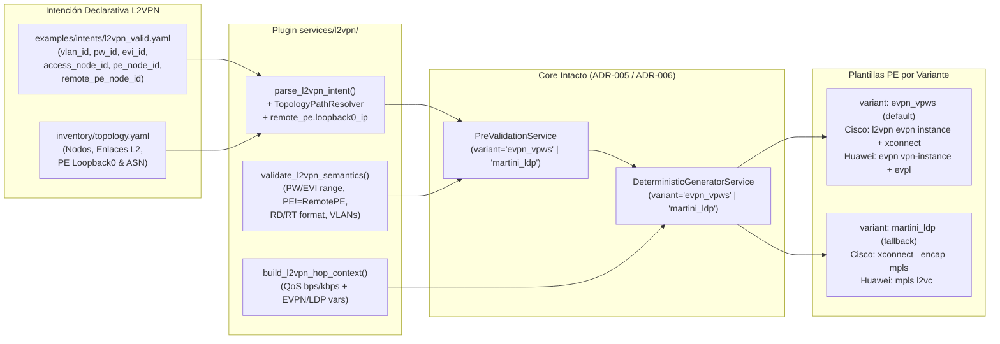

# ADR-009: Extensión del servicio L2VPN con soporte dual (`evpn_vpws` / `martini_ldp`)

- Estado: Proposed
- Etapa: E2
- Depende de: ADR-006, ADR-007
- Referencias: IETF RFC 8214 (Virtual Private Wire Service Support in Ethernet VPN — EVPN-VPWS); IETF RFC 7432 (BGP MPLS-Based Ethernet VPN); IETF RFC 4447 (Pseudowire Setup and Maintenance Using Label Distribution Protocol — Martini Draft); Documentación oficial Cisco IOS-XE 17.x (`l2vpn evpn instance <id> point-to-point`, `l2vpn xconnect context`, `xconnect <ip> <vcid> encapsulation mpls`) y Huawei VRP (`evpl instance <id>`, `ip vpn-instance` / `evpn vpn-instance`, `mpls l2vc <ip> <vcid>`).
- Walkthrough: docs/walkthroughs/ADR-009.md

---
## PARTE A — DECISIÓN (congelada al aceptar)

### 1. Contexto
Con los servicios de Capa 3 (`DIA` en `ADR-006` y `L3VPN` en `ADR-008`) y el catálogo topológico (`ADR-007`) consolidados, corresponde completar el portafolio de servicios MPLS de la Etapa `E2` con **L2VPN punto a punto (VPWS / Pseudowire Ethernet sobre MPLS)**.

A diferencia de `DIA` y `L3VPN` —donde el PE termina la capa IP en una subinterfaz con dirección `/30` y enrutamiento estático o BGP—, un servicio `L2VPN` punto a punto transporta tramas Ethernet etiquetadas (`802.1Q`) de extremo a extremo entre dos demarcaciones a través del core MPLS sin direccionamiento IP en el circuito de cliente (`AC`, *Attachment Circuit*). Su diseño e integración multivendor en el laboratorio de la Universidad de Lima presenta tres retos arquitectónicos y de plano de control:

1. **Interoperabilidad de señalización entre Cisco IOS-XE 17.x (`C8200L`) y Huawei VRP V600 (`AR5710`) (Regla 7 del Contexto Maestro):**
   * En redes Carrier modernas, el plano de control preferido para servicios L2 punto a punto es **EVPN-VPWS (RFC 8214)** sobre la familia `l2vpn evpn` de MP-BGP, que emplea una instancia EVPN con *Route Distinguisher* (`rd`), *Route Targets* (`rt_import`, `rt_export`) e identificadores de circuito local y remoto (`local_service_id`, `remote_service_id` / `pw_id`).
   * Sin embargo, en despliegues multivendor reales entre Cisco IOS-XE y Huawei VRP (y dependiendo del licenciamiento o capacidades de negociación de *Ethernet A-D per EVI/ES routes* en las imágenes de laboratorio), el operador requiere contar con el mecanismo clásico de contingencia **Martini LDP (RFC 4447, Targeted LDP Pseudowire)** (`xconnect <remote_pe_ip> <pw_id> encapsulation mpls` en Cisco IOS-XE; `mpls l2vc <remote_pe_ip> <pw_id>` en Huawei VRP) apuntando al `Loopback0` del PE remoto.
2. **Agnosticismo del modelo de intención frente a la variante de señalización:** Si la elección entre `evpn_vpws` y `martini_ldp` obligara a definir dos tipos de servicio distintos (`service_type: "L2VPN_EVPN"` vs. `service_type: "L2VPN_LDP"`), el operador tendría que reescribir la intención de negocio ante un cambio en el mecanismo de señalización del core. Por el contrario, `ADR-004` y `ADR-006` ya introdujeron el eje `variant: str` dentro de `TemplateKey(service_type, operation, role, variant)`.
3. **Compatibilidad con el pipeline lineal (`AccessHop -> TransitHop* -> ProviderEdgeHop`) y el catálogo topológico (`ADR-007`):** En los switches de acceso y tránsito (`C9300L` y `S5735`), el transporte L2 de la VLAN del cliente hacia el puerto troncal del PE es idéntico al de `DIA` y `L3VPN`. En el PE, sin embargo, no existe subred WAN `/30`, pero sí se requiere identificar el circuito virtual (`pw_id` / `vc_id`), los parámetros de señalización EVPN (`evi_id` / instancia, `rd`, `rt_import`, `rt_export`, `local_ac_id`, `remote_ac_id`) y la dirección `Loopback0` del PE remoto (`remote_pe_ip`, resoluble desde `remote_pe_node_id` en `inventory/topology.yaml`) para `martini_ldp`, manteniendo la aplicación de QoS (`bandwidth_mbps`, `qos_policy`) en base decimal 1000.

### 2. Alternativas
1. **Alternativa 1 — Dos servicios separados en el catálogo (`L2VPN_EVPN` y `L2VPN_MARTINI`) con modelos de intención incompatibles (`L2VpnEvpnIntent` y `L2VpnMartiniIntent`):**
   * *Descripción:* Registrar dos `service_type` independientes en `PluginCatalog`, obligando al usuario a cambiar el `service_type` y la estructura del archivo YAML/JSON según si el túnel se señaliza por MP-BGP EVPN o por Targeted LDP, usando siempre `variant="default"`.
   * *Ventajas:* Evita combinar atributos de EVPN (`rd`, `rt`) y de LDP (`remote_pe_ip`) en un mismo modelo de dominio.
   * *Desventajas:* Viola directamente la **Regla 7 del Contexto Maestro** (*"El modelo de intención de L2VPN es agnóstico al protocolo de señalización del pseudowire. El catálogo de plantillas resuelve mediante `TemplateKey.variant` tanto `evpn_vpws` como el fallback `martini_ldp`"*); inutiliza el diseño de `TemplateKey.variant` creado en `ADR-004`; e impide renderizar la misma intención declarativa bajo ambas variantes para comparación experimental en la tesis.

2. **Alternativa 2 — Servicio único `L2VPN` con modelo inmutable `L2VpnIntent` agnóstico a la señalización, resolución del `Loopback0` del PE remoto desde `TopologyCatalog` y despacho de plantillas por `TemplateKey.variant` (`default`/`evpn_vpws` y `martini_ldp`):**
   * *Descripción:*
     * Definir `@dataclass(frozen=True) class L2VpnIntent(ServiceIntent)` en `src/intentfabric/domain/intent.py` con `service_type: ClassVar[str] = "L2VPN"`, manteniendo la estructura de ruta lineal (`access: AccessHop`, `transits: tuple[TransitHop, ...]`, `provider_edge: ProviderEdgeHop`, propiedad `hops`) y los parámetros de demarcación y pseudowire:
       * `vlan_id: int` (`1..4094`)
       * `bandwidth_mbps: int` (`1..100000`)
       * `qos_policy_name: str`
       * `pw_id: int` (identificador de Pseudowire / VC-ID / EVI en rango `1..4294967295`, usado tanto en `martini_ldp` como en `evpn_vpws`; en EVPN-VPWS, si no se declaran `local_ac_id` / `remote_ac_id` explícitos, se derivan determinísticamente o se proveen en el intent)
       * `remote_pe_node_id: str` y `remote_pe_ip: IPv4Address` (resuelto automáticamente desde `TopologyNode.loopback0_ip` del `remote_pe_node_id` en `inventory/topology.yaml`, garantizando que `remote_pe_node_id != pe_node_id`)
       * `evi_id: int` (identificador de instancia EVPN / EVPL en rango `1..65535`, que por defecto toma `pw_id` si `pw_id <= 65535` o se declara explícitamente)
       * `local_ac_id: int` y `remote_ac_id: int` (identificadores de Attachment Circuit local/remoto para RFC 8214 EVPN-VPWS en rango `1..4294967295`, con valores por defecto deterministas `local_ac_id = pw_id` y `remote_ac_id = pw_id` o configurables explícitamente)
       * `rd: str`, `rt_import: str`, `rt_export: str` (validados con `is_valid_route_distinguisher_or_target`; si no se especifican en el YAML/JSON, se derivan determinísticamente como `f"{pe_node.asn}:{pw_id}"` cuando `pw_id <= 4294967295`, o se declaran explícitamente igual que en `L3VPN`).
     * Registrar en `VENDOR_DEFINITION` (`vendors/cisco/__init__.py` y `vendors/huawei/__init__.py`) las claves `TemplateKey("L2VPN", operation, role, variant)` para las variantes:
       * `"evpn_vpws"` (y `"default"` apuntando a las mismas plantillas `evpn_vpws` como variante primaria del estándar RFC 8214, de modo que `generate(intent)` sin argumentos o con `variant="evpn_vpws"` funcione transparentemente).
       * `"martini_ldp"` (fallback RFC 4447 mediante Targeted LDP).
     * En los tramos L2 (`access` y `transit`), ambas variantes (`evpn_vpws` y `martini_ldp`) referencian la misma plantilla de conmutación VLAN (`templates/l2vpn/{provision,teardown}/{access,transit}.j2`), mientras que en el rol `pe` se seleccionan las plantillas específicas de la variante (`pe_evpn_vpws.j2` vs. `pe_martini_ldp.j2`):
       * **Cisco IOS-XE (`pe_evpn_vpws.j2`)**: `policy-map {{ qos_policy }}` (`bps`), `l2vpn evpn instance {{ evi_id }} point-to-point` (`rd {{ rd }}`, `route-target export {{ rt_export }}`, `route-target import {{ rt_import }}`), subinterfaz/service-instance L2 (`interface {{ pe_subinterface }}`, `encapsulation dot1Q {{ vlan_id }}`, `service-policy input/output {{ qos_policy }}`) y `l2vpn xconnect context {{ xconnect_name }}` (`evpn instance {{ evi_id }} point-to-point`, `interface {{ pe_subinterface }}`, `vpws context {{ xconnect_name }}` / `service target {{ remote_ac_id }} source {{ local_ac_id }}`).
       * **Cisco IOS-XE (`pe_martini_ldp.j2`)**: `policy-map {{ qos_policy }}` (`bps`), `interface {{ pe_subinterface }}` con `encapsulation dot1Q {{ vlan_id }}`, `xconnect {{ remote_pe_ip }} {{ pw_id }} encapsulation mpls`, `service-policy input/output {{ qos_policy }}` y `no shutdown`.
       * **Huawei VRP (`pe_evpn_vpws.j2`)**: `traffic classifier/behavior/policy {{ qos_policy }}` (`kbps`), `evpn vpn-instance {{ evpn_name }} vpws` (`route-distinguisher {{ rd }}`, `vpn-target {{ rt_export }} export-extcommunity`, `vpn-target {{ rt_import }} import-extcommunity`), `evpl instance {{ evi_id }}` (`evpn binding vpn-instance {{ evpn_name }}`, `local-service-id {{ local_ac_id }} remote-service-id {{ remote_ac_id }}`) e `interface {{ pe_subinterface }}` (`dot1q termination vid {{ vlan_id }}`, `evpl instance {{ evi_id }}`, `traffic-policy {{ qos_policy }} inbound/outbound`).
       * **Huawei VRP (`pe_martini_ldp.j2`)**: `traffic classifier/behavior/policy {{ qos_policy }}` (`kbps`) e `interface {{ pe_subinterface }}` (`dot1q termination vid {{ vlan_id }}`, `mpls l2vc {{ remote_pe_ip }} {{ pw_id }}`, `traffic-policy {{ qos_policy }} inbound/outbound`, `undo shutdown`).
   * *Ventajas:* Cumple estrictamente la Regla 7 del Contexto Maestro; permite que un mismo archivo de intención (`examples/intents/l2vpn_valid.yaml`) genere de forma determinista tanto la configuración `evpn_vpws` como el fallback `martini_ldp` cambiando únicamente el parámetro `variant` en `PreValidationService.validate(intent, variant=...)` y `DeterministicGeneratorService.generate(intent, variant=...)`; resuelve y valida `remote_pe_ip` contra el `loopback0_ip` de `inventory/topology.yaml`; y mantiene intactos `application/pre_validation.py` y `application/generation.py`.
   * *Desventajas:* Incrementa el número de plantillas PE y archivos Golden de `L2VPN` (al cubrir tanto `evpn_vpws` como `martini_ldp` en `provision` y `teardown` para ambos fabricantes), lo cual está acotado exclusivamente al rol `pe`.

### 3. Criterios de elección
* **Cumplimiento de la Regla 7 (Variantes de Señalización en L2VPN):** El modelo de intención debe ser único y agnóstico a la señalización, resolviendo `evpn_vpws` y `martini_ldp` a través de `TemplateKey.variant`.
* **Cumplimiento del Principio Abierto/Cerrado (`ADR-004`):** Al igual que en `ADR-008`, añadir el tercer servicio (`L2VPN`) no debe requerir cambios en `PreValidationService` ni en `DeterministicGeneratorService`.
* **Consistencia Topológica de Extremo Remoto (`ADR-007`):** En un pseudowire punto a punto, el PE local y el PE remoto no pueden ser el mismo equipo (`pe_node_id != remote_pe_node_id`), y la dirección IP de señalización del PE remoto (`remote_pe_ip`) debe coincidir con el `loopback0_ip` declarado en `inventory/topology.yaml`.

### 4. Decisión
Adoptamos la **Alternativa 2**: implementar el modelo inmutable `L2VpnIntent` en `src/intentfabric/domain/intent.py` y el plugin `src/intentfabric/services/l2vpn/` (`intent_parser.py`, `validator.py`, `context_builder.py`), registrando en `vendors/cisco/` y `vendors/huawei/` el soporte de `L2VPN` para las variantes `evpn_vpws` (y `default` como alias a `evpn_vpws`) y `martini_ldp`, junto con sus plantillas Jinja2 (`provision` y `teardown`) y archivos Golden en `tests/golden/l2vpn/`.

### 5. Sustento
1. **Validación integral de `TemplateKey.variant`:** Mientras que `ADR-008` demostró la extensibilidad horizontal del catálogo al agregar un nuevo `service_type` (`L3VPN`), `ADR-009` demuestra la extensibilidad ortogonal mediante `TemplateKey.variant` (`evpn_vpws` vs. `martini_ldp`), permitiendo conmutar el protocolo de plano de control MPLS sin alterar el intent del usuario ni el orquestador.
2. **Mitigación de riesgo de interoperabilidad en laboratorio:** Al disponer de Golden Configs probados tanto para `evpn_vpws` (RFC 8214) como para `martini_ldp` (RFC 4447) entre el router Cisco `C8200L` (`PE1-TEST`) y el router Huawei `AR5710` (`PE2-TEST`), la campaña experimental en la Universidad de Lima queda protegida ante cualquier restricción de negociación EVPN entre ambos fabricantes.
3. **Derivación determinista desde topología:** Al resolver `remote_pe_ip` directamente desde `remote_pe_node.loopback0_ip` en `inventory/topology.yaml` (y derivar por defecto `rd`/`rt` desde `pe_node.asn` y `pw_id` si no se declaran explícitamente), se evitan errores humanos de tipeo de direcciones Loopback o Route Targets en servicios punto a punto.

### 6. Consecuencias y riesgos aceptados
* **Alias `default` $\rightarrow$ `evpn_vpws` en el catálogo de plantillas:** Dado que `PreValidationService.validate()` y `DeterministicGeneratorService.generate()` tienen como valor por defecto `variant: str = "default"`, registrar en `VENDOR_DEFINITION` tanto `variant="default"` como `variant="evpn_vpws"` apuntando a la plantilla EVPN-VPWS permite invocar el pipeline estándar sin parámetros especiales y, a la vez, solicitar explícitamente `variant="evpn_vpws"` o `variant="martini_ldp"`.
* **Reutilización de plantillas L2 en `access` y `transit`:** En los switches de acceso y tránsito, el servicio `L2VPN` es transparente al protocolo de señalización del PE (`evpn_vpws` o `martini_ldp`), por lo que ambas variantes en `VENDOR_DEFINITION` apuntan a los mismos archivos `templates/l2vpn/{provision,teardown}/{access,transit}.j2`, evitando duplicar archivos en el árbol de recursos.