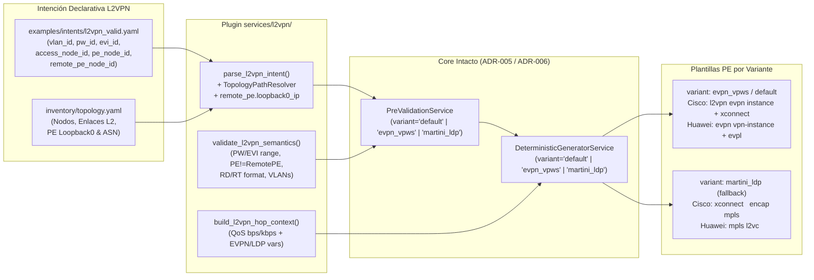

# ADR-009: Extensión del servicio L2VPN con soporte dual (`evpn_vpws` / `martini_ldp`)

- Estado: Accepted (aprobado el 29-10-2026)
- Etapa: E2
- Depende de: ADR-006, ADR-007
- Referencias: IETF RFC 8214 (Virtual Private Wire Service Support in Ethernet VPN — EVPN-VPWS); IETF RFC 7432 (BGP MPLS-Based Ethernet VPN); IETF RFC 4447 (Pseudowire Setup and Maintenance Using Label Distribution Protocol — Martini Draft); Documentación oficial Cisco IOS-XE 17.x (`l2vpn evpn instance <id> point-to-point`, `l2vpn xconnect context`, `xconnect <ip> <vcid> encapsulation mpls`) y Huawei VRP (`evpl instance <id>`, `evpn vpn-instance <name> vpws`, `mpls l2vc <ip> <vcid>`).
- Walkthrough: docs/walkthroughs/ADR-009.md

---
## PARTE A — DECISIÓN (congelada al aceptar)

### 1. Contexto
Con los servicios de Capa 3 (`DIA` en `ADR-006` y `L3VPN` en `ADR-008`) y el catálogo topológico (`ADR-007`) consolidados, corresponde completar el portafolio de servicios MPLS de la Etapa `E2` con **L2VPN punto a punto (VPWS / Pseudowire Ethernet sobre MPLS)**.

A diferencia de `DIA` y `L3VPN` —donde el PE termina la capa IP en una subinterfaz con dirección `/30` y enrutamiento estático o BGP—, un servicio `L2VPN` punto a punto transporta tramas Ethernet etiquetadas (`802.1Q`) de extremo a extremo entre dos demarcaciones a través del core MPLS sin direccionamiento IP en el circuito de cliente (`AC`, *Attachment Circuit*). Su diseño e integración multivendor en el laboratorio de la Universidad de Lima presenta tres retos arquitectónicos y de plano de control:

1. **Interoperabilidad de señalización entre Cisco IOS-XE 17.x (`C8200L`) y Huawei VRP V600 (`AR5710`) (Regla 7 del Contexto Maestro):**
   * En redes Carrier modernas, el plano de control preferido para servicios L2 punto a punto es **EVPN-VPWS (RFC 8214)** sobre la familia `l2vpn evpn` de MP-BGP, que emplea una instancia EVPN con *Route Distinguisher* (`rd`), *Route Targets* (`rt_import`, `rt_export`) e identificadores de circuito local y remoto (`local_ac_id`, `remote_ac_id`).
   * Sin embargo, en despliegues multivendor reales entre Cisco IOS-XE y Huawei VRP (y dependiendo del licenciamiento o capacidades de negociación de *Ethernet A-D per EVI/ES routes* en las imágenes de laboratorio), el operador requiere contar con el mecanismo clásico de contingencia **Martini LDP (RFC 4447, Targeted LDP Pseudowire)** (`xconnect <remote_pe_ip> <pw_id> encapsulation mpls` en Cisco IOS-XE; `mpls l2vc <remote_pe_ip> <pw_id>` en Huawei VRP) apuntando al `Loopback0` del PE remoto.
2. **Agnosticismo del modelo de intención frente a la variante de señalización:** Si la elección entre `evpn_vpws` y `martini_ldp` obligara a definir dos tipos de servicio distintos (`service_type: "L2VPN_EVPN"` vs. `service_type: "L2VPN_LDP"`), el operador tendría que reescribir la intención de negocio ante un cambio en el mecanismo de señalización del core. Por el contrario, `ADR-004` y `ADR-006` ya introdujeron el eje `variant: str` dentro de `TemplateKey(service_type, operation, role, variant)`.
3. **Compatibilidad con el pipeline lineal (`AccessHop -> TransitHop* -> ProviderEdgeHop`) y el catálogo topológico (`ADR-007`):** En los switches de acceso y tránsito (`C9300L` y `S5735`), el transporte L2 de la VLAN del cliente hacia el puerto troncal del PE es idéntico al de `DIA` y `L3VPN`. En el PE, sin embargo, no existe subred WAN `/30`, pero sí se requiere identificar el circuito virtual (`pw_id` / `vc_id`), los parámetros de señalización EVPN (`evi_id` / instancia, `rd`, `rt_import`, `rt_export`, `local_ac_id`, `remote_ac_id`) y la dirección `Loopback0` del PE remoto (`remote_pe_ip`, resoluble desde `remote_pe_node_id` en `inventory/topology.yaml`) para `martini_ldp`, manteniendo la aplicación de QoS (`bandwidth_mbps`, `qos_policy`) en base decimal 1000.

### 2. Alternativas
1. **Alternativa 1 — Dos servicios separados en el catálogo (`L2VPN_EVPN` y `L2VPN_MARTINI`) con modelos de intención incompatibles (`L2VpnEvpnIntent` y `L2VpnMartiniIntent`):**
   * *Descripción:* Registrar dos `service_type` independientes en `PluginCatalog`, obligando al usuario a cambiar el `service_type` y la estructura del archivo YAML/JSON según si el túnel se señaliza por MP-BGP EVPN o por Targeted LDP, usando siempre `variant="default"`.
   * *Ventajas:* Evita combinar atributos de EVPN (`rd`, `rt`) y de LDP (`remote_pe_ip`) en un mismo modelo de dominio.
   * *Desventajas:* Viola directamente la **Regla 7 del Contexto Maestro** (*"El modelo de intención de L2VPN es agnóstico al protocolo de señalización del pseudowire. El catálogo de plantillas resuelve mediante `TemplateKey.variant` tanto `evpn_vpws` como el fallback `martini_ldp`"*); inutiliza el diseño de `TemplateKey.variant` creado en `ADR-004`; e impide renderizar la misma intención declarativa bajo ambas variantes para comparación experimental en la tesis.

2. **Alternativa 2 — Servicio único `L2VPN` con modelo inmutable `L2VpnIntent` agnóstico a la señalización, resolución del `Loopback0` del PE remoto desde `TopologyCatalog` y despacho de plantillas por `TemplateKey.variant` (`default`/`evpn_vpws` y `martini_ldp`):**
   * *Descripción:*
     * Definir `@dataclass(frozen=True) class L2VpnIntent(ServiceIntent)` en `src/intentfabric/domain/intent.py` con `service_type: ClassVar[str] = "L2VPN"`, manteniendo la estructura de ruta lineal (`access: AccessHop`, `transits: tuple[TransitHop, ...]`, `provider_edge: ProviderEdgeHop`, propiedad `hops`) y los parámetros de demarcación y pseudowire:
       * `vlan_id: int` (`1..4094`)
       * `bandwidth_mbps: int` (`1..100000`)
       * `qos_policy_name: str`
       * `pw_id: int` (identificador de Pseudowire / VC-ID en rango `1..4294967295`, usado tanto en `martini_ldp` como en `evpn_vpws`)
       * `remote_pe_node_id: str` y `remote_pe_ip: IPv4Address` (resuelto automáticamente desde `TopologyNode.loopback0_ip` del `remote_pe_node_id` en `inventory/topology.yaml`, garantizando que `remote_pe_node_id != pe_node_id`)
       * `evi_id: int` (identificador de instancia EVPN / EVPL en rango `1..65535`, que por defecto toma `pw_id` cuando `1 <= pw_id <= 65535` o se declara explícitamente)
       * `local_ac_id: int` y `remote_ac_id: int` (identificadores de Attachment Circuit local/remoto para RFC 8214 EVPN-VPWS en rango `1..4294967295`, que por defecto toman `pw_id` o se declaran explícitamente)
       * `rd: str`, `rt_import: str`, `rt_export: str` (validados con `is_valid_route_distinguisher_or_target`; si no se especifican en el YAML/JSON, se derivan determinísticamente como `f"{pe_node.asn}:{pw_id}"` cuando `pe_node.asn <= 65535` o `f"{pe_node.asn}:{evi_id}"`, o se declaran explícitamente igual que en `L3VPN`).
     * Registrar en `VENDOR_DEFINITION` (`vendors/cisco/__init__.py` y `vendors/huawei/__init__.py`) las claves `TemplateKey("L2VPN", operation, role, variant)` para las variantes `"default"`, `"evpn_vpws"` y `"martini_ldp"` respetando la convención de rutas verificada en `tests/contract/test_vendor_contract.py` (`templates/l2vpn/{operation}/{role}.j2`, `templates/l2vpn/{operation}/{role}.evpn_vpws.j2`, `templates/l2vpn/{operation}/{role}.martini_ldp.j2`), donde `"default"` y `"evpn_vpws"` tienen exactamente el mismo contenido EVPN-VPWS (RFC 8214) y `"martini_ldp"` implementa el fallback Targeted LDP (RFC 4447).
   * *Ventajas:* Cumple estrictamente la Regla 7 del Contexto Maestro; permite que un mismo archivo de intención (`examples/intents/l2vpn_valid.yaml`) genere de forma determinista tanto la configuración `evpn_vpws` (o `default`) como el fallback `martini_ldp` cambiando únicamente el parámetro `variant` en `PreValidationService.validate(intent, variant=...)` y `DeterministicGeneratorService.generate(intent, variant=...)`; resuelve y valida `remote_pe_ip` contra el `loopback0_ip` de `inventory/topology.yaml`; y mantiene intactos `application/pre_validation.py` y `application/generation.py`.
   * *Desventajas:* Incrementa el número de archivos de plantilla en `vendors/*/templates/l2vpn/` para satisfacer la correspondencia biyectiva exigida por `tests/contract/test_vendor_contract.py`, lo cual se verifica automáticamente por contrato.

### 3. Criterios de elección
* **Cumplimiento de la Regla 7 (Variantes de Señalización en L2VPN):** El modelo de intención debe ser único y agnóstico a la señalización, resolviendo `evpn_vpws` y `martini_ldp` a través de `TemplateKey.variant`.
* **Cumplimiento del Principio Abierto/Cerrado (`ADR-004`):** Al igual que en `ADR-008`, añadir el tercer servicio (`L2VPN`) no debe requerir cambios en `PreValidationService` ni en `DeterministicGeneratorService`.
* **Consistencia Topológica de Extremo Remoto (`ADR-007`):** En un pseudowire punto a punto, el PE local y el PE remoto no pueden ser el mismo equipo (`pe_node_id != remote_pe_node_id`), y la dirección IP de señalización del PE remoto (`remote_pe_ip`) debe coincidir con el `loopback0_ip` declarado en `inventory/topology.yaml`.

### 4. Decisión
Adoptamos la **Alternativa 2**: implementar el modelo inmutable `L2VpnIntent` en `src/intentfabric/domain/intent.py` y el plugin `src/intentfabric/services/l2vpn/` (`intent_parser.py`, `validator.py`, `context_builder.py`), registrando en `vendors/cisco/` y `vendors/huawei/` el soporte de `L2VPN` para las variantes `default`, `evpn_vpws` y `martini_ldp`, junto con sus plantillas Jinja2 (`provision` y `teardown`) y archivos Golden en `tests/golden/l2vpn/`.



### 5. Sustento
1. **Validación integral de `TemplateKey.variant`:** Mientras que `ADR-008` demostró la extensibilidad horizontal del catálogo al agregar un nuevo `service_type` (`L3VPN`), `ADR-009` demuestra la extensibilidad ortogonal mediante `TemplateKey.variant` (`evpn_vpws` vs. `martini_ldp`), permitiendo conmutar el protocolo de plano de control MPLS sin alterar el intent del usuario ni el orquestador.
2. **Mitigación de riesgo de interoperabilidad en laboratorio:** Al disponer de Golden Configs probados tanto para `evpn_vpws` (RFC 8214) como para `martini_ldp` (RFC 4447) entre el router Cisco `C8200L` (`PE1-TEST`) y el router Huawei `AR5710` (`PE2-TEST`), la campaña experimental en la Universidad de Lima queda protegida ante cualquier restricción de negociación EVPN entre ambos fabricantes.
3. **Derivación determinista desde topología:** Al resolver `remote_pe_ip` directamente desde `remote_pe_node.loopback0_ip` en `inventory/topology.yaml` (y derivar por defecto `rd`/`rt` desde `pe_node.asn` y `evi_id` si no se declaran explícitamente), se evitan errores humanos de tipeo de direcciones Loopback o Route Targets en servicios punto a punto.

### 6. Consecuencias y riesgos aceptados
* **Alias `default` $\equiv$ `evpn_vpws` en el catálogo de plantillas:** Dado que `PreValidationService.validate()` y `DeterministicGeneratorService.generate()` tienen como valor por defecto `variant: str = "default"`, registrar en `VENDOR_DEFINITION` tanto `variant="default"` como `variant="evpn_vpws"` con idéntico contenido EVPN-VPWS permite invocar el pipeline estándar sin parámetros especiales y, a la vez, solicitar explícitamente `variant="evpn_vpws"` o `variant="martini_ldp"`.
* **Convención estricta de nombres de archivo de plantilla (`test_vendor_contract.py`):** Para cumplir la regla de `_assert_vendor_contract` (`templates/{service_type.lower()}/{operation}/{role}{suffix}.j2` y cero archivos `.j2` sin declarar), cada combinación `(operation, role, variant)` de `L2VPN` mapea a su ruta canónica exacta (`{role}.j2`, `{role}.evpn_vpws.j2`, `{role}.martini_ldp.j2`), verificando mediante pruebas que las plantillas `access` y `transit` de `L2VPN` en las tres variantes sean idénticas byte a byte a las de `DIA` y `L3VPN`.

---
## PARTE B — ESPECIFICACIÓN DE IMPLEMENTACIÓN (para el agente)

### 7. Alcance y fuera de alcance
- **Incluye:**
  - Extensión de `src/intentfabric/domain/intent.py` con el modelo inmutable `L2VpnIntent` (heredando de `ServiceIntent` con `service_type: ClassVar[str] = "L2VPN"`) y las funciones puras de validación de rango para identificadores L2VPN (`is_valid_pseudowire_id`, `is_valid_evi_id`), exportándolos en `src/intentfabric/domain/__init__.py`.
  - Creación del paquete `src/intentfabric/services/l2vpn/` con `intent_parser.py` (`parse_l2vpn_intent`, `L2VpnIntentParser`, `create_l2vpn_intent_parser`), `validator.py` (`validate_l2vpn_semantics`, `validate_l2vpn_intent_semantics`) y `context_builder.py` (`build_l2vpn_hop_context`).
  - Actualización de `VENDOR_DEFINITION` en `src/intentfabric/vendors/cisco/__init__.py` y `src/intentfabric/vendors/huawei/__init__.py` añadiendo las claves `TemplateKey("L2VPN", operation, role, variant)` para `variant in ("default", "evpn_vpws", "martini_ldp")`, y creación de las plantillas Jinja2 correspondientes bajo `src/intentfabric/vendors/{cisco,huawei}/templates/l2vpn/{provision,teardown}/`.
  - Registro del servicio `"L2VPN"` en `src/intentfabric/bootstrap.py` (`build_plugin_catalog`) sin modificar `src/intentfabric/application/pre_validation.py` ni `src/intentfabric/application/generation.py`.
  - Creación de los ejemplos declarativos `examples/intents/l2vpn_valid.json` y `examples/intents/l2vpn_valid.yaml`, y de los 16 archivos Golden en `tests/golden/l2vpn/` (4 de transporte L2 `access`/`transit` + 4 PE para `evpn_vpws` + 4 PE para `martini_ldp` cubriendo `provision` y `teardown` en Cisco y Huawei).
  - Actualización de `docs/specs/context-master.md` para marcar `ADR-009` como `Accepted` y creación/ampliación de las suites de pruebas (`tests/unit/test_l2vpn_intent_parser.py`, `tests/unit/test_l2vpn_golden.py`, `tests/unit/test_intent_models.py`, `tests/unit/test_pre_validation.py`, `tests/unit/test_intent_examples.py`, `tests/unit/test_plugin_bootstrap.py`, `tests/unit/test_intent_bootstrap.py` y `tests/contract/test_vendor_contract.py`).
- **NO incluye:**
  - Modificación de `src/intentfabric/application/pre_validation.py` ni `src/intentfabric/application/generation.py`.
  - Creación de nuevos archivos en `src/intentfabric/domain/`.
  - Adaptadores de transporte SSH o ejecución online (`ADR-010`).

### 8. Pasos de implementación

1. **[Paso 1 — Modelo de dominio `L2VpnIntent` y validadores de identificadores L2VPN en `domain/intent.py`]**:
   - **Archivos:**
     - `src/intentfabric/domain/intent.py` (modificar)
     - `src/intentfabric/domain/__init__.py` (modificar)
     - `docs/specs/context-master.md` (modificar: cambiar estado de `ADR-009` a `Accepted` en la tabla de la sección 6)
     - `tests/unit/test_intent_models.py` (modificar)
   - **Cambios / Firmas:**
     - En `src/intentfabric/domain/intent.py`, usando exclusivamente `stdlib`:
       - Definir las funciones puras de validación de rango:
         - `def is_valid_pseudowire_id(value: int) -> bool`: retorna `True` si `type(value) is int and 1 <= value <= 4_294_967_295` (rango de 32 bits sin signo distinto de cero para VC-ID RFC 4447 y AC-ID RFC 8214).
         - `def is_valid_evi_id(value: int) -> bool`: retorna `True` si `type(value) is int and 1 <= value <= 65_535` (rango de 16 bits para instancias `l2vpn evpn instance <evi_id>` en Cisco IOS-XE y `evpl instance <evi_id>` en Huawei VRP).
       - Definir `@dataclass(frozen=True) class L2VpnIntent(ServiceIntent)`:
         - `service_type: ClassVar[str] = "L2VPN"`
         - `vlan_id: int`
         - `bandwidth_mbps: int`
         - `qos_policy_name: str`
         - `pw_id: int`
         - `evi_id: int`
         - `local_ac_id: int`
         - `remote_ac_id: int`
         - `rd: str`
         - `rt_import: str`
         - `rt_export: str`
         - `remote_pe_node_id: str`
         - `remote_pe_ip: IPv4Address`
         - `access: AccessHop`
         - `transits: tuple[TransitHop, ...]`
         - `provider_edge: ProviderEdgeHop`
       - Propiedades de solo lectura en `L2VpnIntent`:
         - `@property def hops(self) -> tuple[ServiceHop, ...]: return (self.access, *self.transits, self.provider_edge)`
         - `@property def qos_policy(self) -> str: return self.qos_policy_name`
         - `@property def instance_name(self) -> str: return f"VPWS_{self.evi_id}"` (nombre canónico determinista para `l2vpn xconnect context` en Cisco y `evpn vpn-instance` en Huawei).
       - *Nota de diseño:* Al igual que `DiaIntent` y `L3VpnIntent`, `L2VpnIntent` hereda `description: str` de `ServiceIntent` y no bloquea en `__post_init__` la construcción en memoria con valores semánticamente inválidos para permitir probar acumulativamente todas las reglas de `PreValidationService` en `tests/unit/test_pre_validation.py`.
     - Exportar `L2VpnIntent`, `is_valid_evi_id` e `is_valid_pseudowire_id` en `src/intentfabric/domain/__init__.py`.
   - **Verificación del paso:** `.venv\Scripts\python -m pytest tests/unit/test_intent_models.py tests/unit/test_architecture.py`

2. **[Paso 2 — Plugin del servicio `L2VPN` (`services/l2vpn/`): parser topológico, validador semántico y constructor de contexto]**:
   - **Archivos:**
     - `src/intentfabric/services/l2vpn/__init__.py` (crear)
     - `src/intentfabric/services/l2vpn/intent_parser.py` (crear)
     - `src/intentfabric/services/l2vpn/validator.py` (crear)
     - `src/intentfabric/services/l2vpn/context_builder.py` (crear)
     - `tests/unit/test_l2vpn_intent_parser.py` (crear)
     - `tests/unit/test_pre_validation.py` (modificar y ampliar con casos L2VPN y variantes `evpn_vpws` / `martini_ldp`)
   - **Cambios / Firmas:**
     - En `src/intentfabric/services/l2vpn/intent_parser.py`:
       - Implementar `def parse_l2vpn_intent(payload: Mapping[str, object], *, topology: TopologyCatalog | None = None) -> L2VpnIntent`, la clase `class L2VpnIntentParser` (`service_type: str = "L2VPN"`, `__init__(self, known_vendors: frozenset[str], *, topology: TopologyCatalog | None = None) -> None`, `def parse(self, raw: Mapping[str, Any]) -> L2VpnIntent`) y la factoría `def create_l2vpn_intent_parser(topology: TopologyCatalog) -> ServiceIntentParser`.
       - Esquema declarativo aceptado en `payload` (rechazando cualquier llave desconocida con `IntentParseError(f"{unknown[0]}: campo desconocido")` en orden determinista):
         - Llaves requeridas base: `"service_type"`, `"description"`, `"vlan_id"`, `"bandwidth_mbps"`, `"access_node_id"`, `"pe_node_id"`, `"remote_pe_node_id"`.
         - Pares de alias requeridos (exactamente uno de cada par; si faltan ambos lanzar `IntentParseError(f"{canonical}: campo faltante")`, si se envían ambos lanzar `IntentParseError(f"{canonical}: alias duplicado {alias}")`):
           - `("pw_id", "vc_id")`
           - `("qos_policy_name", "qos_policy")`
           - `("access_interface", "client_interface")`
         - Llaves opcionales con derivación determinista por defecto:
           - `"evi_id"`: entero estricto válido según `is_valid_evi_id(evi_id)`. Si no se especifica (o es `None`), toma por defecto `pw_id` (si `not is_valid_evi_id(pw_id)`, lanzar `IntentParseError("evi_id: se requiere un entero entre 1 y 65535 cuando pw_id supera 65535")`).
           - `"local_ac_id"` y `"remote_ac_id"`: enteros estrictos válidos según `is_valid_pseudowire_id(...)`. Si no se especifican (o son `None`), toman por defecto `pw_id`.
           - `"rd"`: texto válido según `is_valid_route_distinguisher_or_target(rd)`. Si no se especifica (o es `None`), se deriva como `f"{pe_node.asn}:{evi_id}"`.
           - `"route_target"` o par `"rt_import"` / `"rt_export"`:
             - Si se mezcla `"route_target"` con `"rt_import"` y/o `"rt_export"`, lanzar `IntentParseError("route_target: no combine route_target con rt_import o rt_export")`.
             - Si se envía `"route_target"`, validar formato y asignar a `rt_import` y `rt_export`.
             - Si se envía `"rt_import"` o `"rt_export"`, exigir ambos y validar su formato con `is_valid_route_distinguisher_or_target`.
             - Si no se envía ninguno de los tres (`"route_target"`, `"rt_import"`, `"rt_export"`), derivar por defecto `rt_import = rt_export = f"{pe_node.asn}:{evi_id}"`.
           - `"remote_pe_ip"`: dirección IPv4 opcional en texto.
       - Validaciones estrictas en `parse_l2vpn_intent` (lanzando `IntentParseError(f"{field}: ...")`):
         - `service_type`: texto que tras `.strip().upper()` sea `"L2VPN"`.
         - `description`, `qos_policy_name`/`qos_policy`, `access_node_id`, `pe_node_id`, `remote_pe_node_id`: texto no vacío.
         - `vlan_id`: entero estricto en `1..4094`.
         - `bandwidth_mbps`: entero estricto en `1..100000`.
         - `pw_id`/`vc_id`: entero estricto válido según `is_valid_pseudowire_id(pw_id)` (reportando el nombre del campo provisto: `pw_id` o `vc_id`).
         - Exigir `topology is not None` (si `topology is None`, lanzar `IntentParseError("topology: inyecte un TopologyCatalog para resolver la ruta L2VPN")`).
         - Resolver la ruta local `access, *transits, provider_edge = TopologyPathResolver(topology).resolve_access_to_pe_hops(...)` traduciendo `TopologyPathResolutionError` a `IntentParseError` con la misma regla de mapeo de campos de `parse_dia_intent` y `parse_l3vpn_intent`.
         - Validar `remote_pe_node_id` contra `topology`:
           - Si `remote_pe_node_id == provider_edge.node_id`, lanzar `IntentParseError("remote_pe_node_id: debe ser distinto de pe_node_id")`.
           - Buscar `remote_pe = topology.find_node(remote_pe_node_id)`. Si es `None`, lanzar `IntentParseError(f"remote_pe_node_id: TOPOLOGY_NODE_NOT_FOUND; nodo inexistente {remote_pe_node_id!r}")`.
           - Si `remote_pe.role != NodeRole.PROVIDER_EDGE` o `remote_pe.loopback0_ip is None`, lanzar `IntentParseError(f"remote_pe_node_id: TOPOLOGY_INVALID_ENDPOINT_ROLE; {remote_pe_node_id!r} no es un PE con loopback0_ip")`.
           - Si `"remote_pe_ip"` fue provisto en `raw` (y no es `None`), parsear como `IPv4Address` estricto y verificar que sea igual a `remote_pe.loopback0_ip` (si difiere, lanzar `IntentParseError(f"remote_pe_ip: IP {remote_pe_ip} no coincide con loopback0_ip de {remote_pe_node_id} ({remote_pe.loopback0_ip})")`); de lo contrario, asignar `remote_pe_ip = remote_pe.loopback0_ip`.
     - En `src/intentfabric/services/l2vpn/validator.py`:
       - Implementar `def validate_l2vpn_semantics(intent: L2VpnIntent) -> tuple[ValidationIssue, ...]` (con alias `validate_l2vpn_intent_semantics = validate_l2vpn_semantics`) verificando acumulativamente con `stage=ValidationStage.STATIC_OFFLINE`:
         1. `INVALID_VLAN_RANGE`: si `not (1 <= intent.vlan_id <= 4094)` (`field_path="vlan_id"`).
         2. `RESERVED_CISCO_VLAN`: por cada salto con `hop.vendor == "cisco"` cuando `intent.vlan_id in {1, 1002, 1003, 1004, 1005}` (`field_path="vlan_id"`, `node_id=hop.node_id`).
         3. `BANDWIDTH_EXCEEDS_PORT_CAPACITY`: si `intent.bandwidth_mbps > 1000` (`field_path="bandwidth_mbps"`).
         4. `INVALID_PW_ID_RANGE`: por cada campo en `("pw_id", "local_ac_id", "remote_ac_id")` cuyo valor no cumpla `is_valid_pseudowire_id(getattr(intent, field))` (`field_path=field`).
         5. `INVALID_EVI_ID_RANGE`: si `not is_valid_evi_id(intent.evi_id)` (`field_path="evi_id"`).
         6. `INVALID_RD_FORMAT`: si `not is_valid_route_distinguisher_or_target(intent.rd)` (`field_path="rd"`).
         7. `INVALID_RT_FORMAT`: si `not is_valid_route_distinguisher_or_target(intent.rt_import)` (`field_path="rt_import"`) y/o si `not is_valid_route_distinguisher_or_target(intent.rt_export)` (`field_path="rt_export"`).
         8. `SAME_LOCAL_REMOTE_PE`: si `intent.remote_pe_node_id == intent.provider_edge.node_id` (`field_path="remote_pe_node_id"`, `node_id=intent.provider_edge.node_id`) o si `intent.remote_pe_ip == intent.provider_edge.management_ip` (`field_path="remote_pe_ip"`, `node_id=intent.provider_edge.node_id`).
     - En `src/intentfabric/services/l2vpn/context_builder.py` (importando exclusivamente de `stdlib` y `domain/`):
       - Implementar `def build_l2vpn_hop_context(intent: L2VpnIntent, hop_index: int, operation: Operation) -> dict[str, object]`:
         - Validar `if type(hop_index) is not int or not 0 <= hop_index < len(intent.hops): raise ValueError("hop_index: se requiere un indice entero dentro de la ruta")`.
         - Variables base comunes a todo salto: `"service_type": intent.service_type`, `"operation": operation.value`, `"description": intent.description`, `"vlan_id": intent.vlan_id`, `"vendor": hop.vendor`, `"role": hop.role.value`, `"node_id": hop.node_id`, `"management_ip": str(hop.management_ip)`.
         - Si `isinstance(hop, AccessHop)`: añadir `"client_interface": hop.customer_port`, `"uplink_interface": hop.uplink_interface`.
         - Si `isinstance(hop, TransitHop)`: añadir `"downstream_interface": hop.downstream_interface`, `"upstream_interface": hop.upstream_interface`, `"ingress_interface": hop.downstream_interface`, `"egress_interface": hop.upstream_interface`.
         - Si `isinstance(hop, ProviderEdgeHop)`: calcular `pe_subinterface = derive_subinterface_name(hop.parent_interface, intent.vlan_id)` y añadir `"pe_interface": hop.parent_interface`, `"parent_interface": hop.parent_interface`, `"pe_subinterface": pe_subinterface`, `"qos_policy": intent.qos_policy_name`, `"bandwidth_mbps": intent.bandwidth_mbps`, `"pw_id": intent.pw_id`, `"evi_id": intent.evi_id`, `"local_ac_id": intent.local_ac_id`, `"remote_ac_id": intent.remote_ac_id`, `"instance_name": intent.instance_name`, `"rd": intent.rd`, `"rt_import": intent.rt_import`, `"rt_export": intent.rt_export`, `"remote_pe_node_id": intent.remote_pe_node_id`, `"remote_pe_ip": str(intent.remote_pe_ip)`.
     - Exportar `L2VpnIntentParser`, `build_l2vpn_hop_context`, `create_l2vpn_intent_parser`, `parse_l2vpn_intent`, `validate_l2vpn_intent_semantics` y `validate_l2vpn_semantics` en `src/intentfabric/services/l2vpn/__init__.py`.
   - **Verificación del paso:** `.venv\Scripts\python -m pytest tests/unit/test_l2vpn_intent_parser.py tests/unit/test_pre_validation.py tests/unit/test_architecture.py`

3. **[Paso 3 — Plantillas Jinja2 Multivendor L2VPN por variante (`evpn_vpws`/`default` y `martini_ldp`), registro en `bootstrap.py` y Golden Configs (`tests/golden/l2vpn/`)]**:
   - **Archivos:**
     - `src/intentfabric/vendors/cisco/__init__.py` (modificar)
     - `src/intentfabric/vendors/huawei/__init__.py` (modificar)
     - `src/intentfabric/vendors/cisco/templates/l2vpn/provision/{access,transit,pe}.j2` (crear)
     - `src/intentfabric/vendors/cisco/templates/l2vpn/provision/{access,transit,pe}.evpn_vpws.j2` (crear)
     - `src/intentfabric/vendors/cisco/templates/l2vpn/provision/{access,transit,pe}.martini_ldp.j2` (crear)
     - `src/intentfabric/vendors/cisco/templates/l2vpn/teardown/{access,transit,pe}.j2` (crear)
     - `src/intentfabric/vendors/cisco/templates/l2vpn/teardown/{access,transit,pe}.evpn_vpws.j2` (crear)
     - `src/intentfabric/vendors/cisco/templates/l2vpn/teardown/{access,transit,pe}.martini_ldp.j2` (crear)
     - `src/intentfabric/vendors/huawei/templates/l2vpn/provision/{access,transit,pe}.j2` (crear)
     - `src/intentfabric/vendors/huawei/templates/l2vpn/provision/{access,transit,pe}.evpn_vpws.j2` (crear)
     - `src/intentfabric/vendors/huawei/templates/l2vpn/provision/{access,transit,pe}.martini_ldp.j2` (crear)
     - `src/intentfabric/vendors/huawei/templates/l2vpn/teardown/{access,transit,pe}.j2` (crear)
     - `src/intentfabric/vendors/huawei/templates/l2vpn/teardown/{access,transit,pe}.evpn_vpws.j2` (crear)
     - `src/intentfabric/vendors/huawei/templates/l2vpn/teardown/{access,transit,pe}.martini_ldp.j2` (crear)
     - `src/intentfabric/bootstrap.py` (modificar)
     - `examples/intents/l2vpn_valid.json` (crear)
     - `examples/intents/l2vpn_valid.yaml` (crear)
     - `tests/golden/l2vpn/cisco_provision_access.txt` (crear)
     - `tests/golden/l2vpn/cisco_provision_transit.txt` (crear)
     - `tests/golden/l2vpn/cisco_provision_pe_evpn_vpws.txt` (crear)
     - `tests/golden/l2vpn/cisco_provision_pe_martini_ldp.txt` (crear)
     - `tests/golden/l2vpn/cisco_teardown_access.txt` (crear)
     - `tests/golden/l2vpn/cisco_teardown_transit.txt` (crear)
     - `tests/golden/l2vpn/cisco_teardown_pe_evpn_vpws.txt` (crear)
     - `tests/golden/l2vpn/cisco_teardown_pe_martini_ldp.txt` (crear)
     - `tests/golden/l2vpn/huawei_provision_access.txt` (crear)
     - `tests/golden/l2vpn/huawei_provision_transit.txt` (crear)
     - `tests/golden/l2vpn/huawei_provision_pe_evpn_vpws.txt` (crear)
     - `tests/golden/l2vpn/huawei_provision_pe_martini_ldp.txt` (crear)
     - `tests/golden/l2vpn/huawei_teardown_access.txt` (crear)
     - `tests/golden/l2vpn/huawei_teardown_transit.txt` (crear)
     - `tests/golden/l2vpn/huawei_teardown_pe_evpn_vpws.txt` (crear)
     - `tests/golden/l2vpn/huawei_teardown_pe_martini_ldp.txt` (crear)
     - `tests/unit/test_l2vpn_golden.py` (crear)
     - `tests/unit/test_intent_examples.py` (modificar)
     - `tests/unit/test_plugin_bootstrap.py` (modificar)
     - `tests/unit/test_intent_bootstrap.py` (modificar)
     - `tests/contract/test_vendor_contract.py` (modificar)
   - **Cambios / Plantillas exactas:**
     - En `src/intentfabric/vendors/cisco/__init__.py` y `src/intentfabric/vendors/huawei/__init__.py`, declarar en `VENDOR_DEFINITION.templates`:
       - Para `service_type in ("DIA", "L3VPN")`: `TemplateKey(service_type, operation, role): f"templates/{service_type.lower()}/{operation.value}/{role.value}.j2"`.
       - Para `service_type == "L2VPN"` y `variant in ("default", "evpn_vpws", "martini_ldp")`: `TemplateKey("L2VPN", operation, role, variant): f"templates/l2vpn/{operation.value}/{role.value}{'' if variant == 'default' else f'.{variant}'}.j2"`.
     - Todas las plantillas `access*.j2` y `transit*.j2` (`provision` y `teardown`) de `l2vpn` en Cisco y Huawei tienen exactamente el mismo contenido que las plantillas `access.j2` y `transit.j2` de `dia` y `l3vpn`.
     - **`src/intentfabric/vendors/cisco/templates/l2vpn/provision/pe.j2`** y **`pe.evpn_vpws.j2`** (idénticas):
       ```jinja2
       l2vpn evpn instance {{ evi_id }} point-to-point
        rd {{ rd }}
        route-target export {{ rt_export }}
        route-target import {{ rt_import }}
       !
       policy-map {{ qos_policy }}
        class class-default
         police rate {{ cir_bps }} bps peak-rate {{ pir_bps }} bps
       !
       interface {{ pe_subinterface }}
        description {{ description }}
        encapsulation dot1Q {{ vlan_id }}
        service-policy input {{ qos_policy }}
        service-policy output {{ qos_policy }}
        no shutdown
       !
       l2vpn xconnect context {{ instance_name }}
        evpn instance {{ evi_id }} point-to-point
        interface {{ pe_subinterface }}
        vpws context {{ instance_name }}
         service target {{ remote_ac_id }} source {{ local_ac_id }}
       ```
     - **`src/intentfabric/vendors/cisco/templates/l2vpn/teardown/pe.j2`** y **`pe.evpn_vpws.j2`** (idénticas):
       ```jinja2
       no l2vpn xconnect context {{ instance_name }}
       !
       no interface {{ pe_subinterface }}
       !
       no policy-map {{ qos_policy }}
       !
       no l2vpn evpn instance {{ evi_id }} point-to-point
       ```
     - **`src/intentfabric/vendors/cisco/templates/l2vpn/provision/pe.martini_ldp.j2`**:
       ```jinja2
       policy-map {{ qos_policy }}
        class class-default
         police rate {{ cir_bps }} bps peak-rate {{ pir_bps }} bps
       !
       interface {{ pe_subinterface }}
        description {{ description }}
        encapsulation dot1Q {{ vlan_id }}
        xconnect {{ remote_pe_ip }} {{ pw_id }} encapsulation mpls
        service-policy input {{ qos_policy }}
        service-policy output {{ qos_policy }}
        no shutdown
       ```
     - **`src/intentfabric/vendors/cisco/templates/l2vpn/teardown/pe.martini_ldp.j2`**:
       ```jinja2
       no interface {{ pe_subinterface }}
       !
       no policy-map {{ qos_policy }}
       ```
     - **`src/intentfabric/vendors/huawei/templates/l2vpn/provision/pe.j2`** y **`pe.evpn_vpws.j2`** (idénticas):
       ```jinja2
       evpn vpn-instance {{ instance_name }} vpws
        route-distinguisher {{ rd }}
        vpn-target {{ rt_export }} export-extcommunity
        vpn-target {{ rt_import }} import-extcommunity
       #
       evpl instance {{ evi_id }}
        evpn binding vpn-instance {{ instance_name }}
        local-service-id {{ local_ac_id }} remote-service-id {{ remote_ac_id }}
       #
       traffic classifier {{ qos_policy }}_CLASS operator or
        if-match any
       #
       traffic behavior {{ qos_policy }}_BEHAVIOR
        car cir {{ cir_kbps }} pir {{ pir_kbps }}
       #
       traffic policy {{ qos_policy }}
        classifier {{ qos_policy }}_CLASS behavior {{ qos_policy }}_BEHAVIOR
       #
       interface {{ pe_subinterface }}
        description {{ description }}
        dot1q termination vid {{ vlan_id }}
        evpl instance {{ evi_id }}
        traffic-policy {{ qos_policy }} inbound
        traffic-policy {{ qos_policy }} outbound
        undo shutdown
       ```
     - **`src/intentfabric/vendors/huawei/templates/l2vpn/teardown/pe.j2`** y **`pe.evpn_vpws.j2`** (idénticas):
       ```jinja2
       undo interface {{ pe_subinterface }}
       #
       undo evpl instance {{ evi_id }}
       #
       undo evpn vpn-instance {{ instance_name }}
       #
       undo traffic policy {{ qos_policy }}
       undo traffic behavior {{ qos_policy }}_BEHAVIOR
       undo traffic classifier {{ qos_policy }}_CLASS
       ```
     - **`src/intentfabric/vendors/huawei/templates/l2vpn/provision/pe.martini_ldp.j2`**:
       ```jinja2
       traffic classifier {{ qos_policy }}_CLASS operator or
        if-match any
       #
       traffic behavior {{ qos_policy }}_BEHAVIOR
        car cir {{ cir_kbps }} pir {{ pir_kbps }}
       #
       traffic policy {{ qos_policy }}
        classifier {{ qos_policy }}_CLASS behavior {{ qos_policy }}_BEHAVIOR
       #
       interface {{ pe_subinterface }}
        description {{ description }}
        dot1q termination vid {{ vlan_id }}
        mpls l2vc {{ remote_pe_ip }} {{ pw_id }}
        traffic-policy {{ qos_policy }} inbound
        traffic-policy {{ qos_policy }} outbound
        undo shutdown
       ```
     - **`src/intentfabric/vendors/huawei/templates/l2vpn/teardown/pe.martini_ldp.j2`**:
       ```jinja2
       undo interface {{ pe_subinterface }}
       #
       undo traffic policy {{ qos_policy }}
       undo traffic behavior {{ qos_policy }}_BEHAVIOR
       undo traffic classifier {{ qos_policy }}_CLASS
       ```
     - En `src/intentfabric/bootstrap.py`:
       - En `build_plugin_catalog(topology: TopologyCatalog | None = None) -> PluginCatalog`: registrar `L2VpnIntentParser(known_vendors=catalog.vendor_ids(), topology=topology)`, `validate_l2vpn_semantics` y `build_l2vpn_hop_context` para `L2VpnIntentParser.service_type` (`"L2VPN"`).
     - En `examples/intents/l2vpn_valid.json` y `examples/intents/l2vpn_valid.yaml`:
       - Crear el ejemplo oficial para la ruta `S3-9306-TEST` (`GigabitEthernet1/0/1`) $\rightarrow$ `S1-9306-TEST` $\rightarrow$ `PE2-TEST` hacia el PE remoto `PE1-TEST` con:
         - `service_type: "L2VPN"`
         - `description: "L2VPN-CORP-000001"`
         - `vlan_id: 310`
         - `bandwidth_mbps: 100`
         - `qos_policy: "QOS_L2VPN_100M"`
         - `pw_id: 310`
         - `evi_id: 310`
         - `local_ac_id: 3101`
         - `remote_ac_id: 3102`
         - `rd: "65000:310"`
         - `rt_import: "65000:310"`
         - `rt_export: "65000:310"`
         - `access_node_id: "S3-9306-TEST"`
         - `access_interface: "GigabitEthernet1/0/1"`
         - `pe_node_id: "PE2-TEST"`
         - `remote_pe_node_id: "PE1-TEST"`
     - En `tests/unit/test_l2vpn_golden.py` y `tests/golden/l2vpn/*.txt`:
       - Verificar determinismo byte a byte y hash SHA-256 sobre las dos rutas mixtas reales de `inventory/topology.yaml` para las tres variantes (`"default"`, `"evpn_vpws"`, `"martini_ldp"`):
         - **Ruta 1 (`S3-9306-TEST` [cisco access] $\rightarrow$ `S1-9306-TEST` [huawei transit] $\rightarrow$ `PE2-TEST` [huawei pe], con `remote_pe_node_id: "PE1-TEST"`, `remote_pe_ip == 10.255.0.1`):** usando `examples/intents/l2vpn_valid.json` y `l2vpn_valid.yaml`, compara `access` y `transit` contra `{vendor}_{operation}_{role}.txt` y el artefacto `pe` contra `huawei_{operation}_pe_evpn_vpws.txt` (tanto para `variant="default"` como para `variant="evpn_vpws"`) y contra `huawei_{operation}_pe_martini_ldp.txt` (para `variant="martini_ldp"`).
         - **Ruta 2 (`S3-4505-TEST` [huawei access] $\rightarrow$ `S1-4505-TEST` [cisco transit] $\rightarrow$ `PE1-TEST` [cisco pe], con `remote_pe_node_id: "PE2-TEST"`, `remote_pe_ip == 10.255.0.2`):** con `description: "L2VPN-CORP-000002"`, `vlan_id: 410`, `bandwidth_mbps: 200`, `qos_policy: "QOS_L2VPN_200M"`, `pw_id: 410`, `evi_id: 410`, `local_ac_id: 3102`, `remote_ac_id: 3101`, `rd: "65000:410"`, `rt_import: "65000:310"`, `rt_export: "65000:310"`, `access_node_id: "S3-4505-TEST"`, `access_interface: "GigabitEthernet0/0/1"`, `pe_node_id: "PE1-TEST"`, `remote_pe_node_id: "PE2-TEST"`, compara `access` y `transit` contra `{vendor}_{operation}_{role}.txt` y el artefacto `pe` contra `cisco_{operation}_pe_evpn_vpws.txt` (`default` y `evpn_vpws`) y contra `cisco_{operation}_pe_martini_ldp.txt` (`martini_ldp`).
   - **Verificación del paso:** `.venv\Scripts\python -m pytest` y `.venv\Scripts\python scripts/check_env.py`

### 9. Criterios de aceptación
1. **Extensibilidad Abierto/Cerrado y despacho por variante (`ADR-004`, Regla 7):** El servicio `L2VPN` y sus variantes (`default`, `evpn_vpws`, `martini_ldp`) se integran end-to-end en `PreValidationService` y `DeterministicGeneratorService` sin modificar `src/intentfabric/application/pre_validation.py` ni `src/intentfabric/application/generation.py`, respetando las fronteras estáticas de AST en `tests/unit/test_architecture.py` y el contrato de recursos en `tests/contract/test_vendor_contract.py`.
2. **Resolución de ruta local y `Loopback0` del PE remoto desde topología (`ADR-007`):** `parse_l2vpn_intent` y `L2VpnIntentParser` resuelven la cadena `AccessHop -> TransitHop -> ProviderEdgeHop` y extraen `remote_pe_ip` desde `remote_pe_node.loopback0_ip` en `inventory/topology.yaml`, derivando por defecto `evi_id`, `local_ac_id`, `remote_ac_id`, `rd` y `rt` cuando no se declaran explícitamente, y rechazando `remote_pe_node_id == pe_node_id`, nodos remotos inexistentes o que no sean PE, o `remote_pe_ip` discordante con el inventario mediante `IntentParseError` (verificado en `tests/unit/test_l2vpn_intent_parser.py`).
3. **Validación semántica acumulativa L2VPN:** `PreValidationService.validate()` detecta y acumula defectos en intenciones `L2VPN` incluyendo `INVALID_VLAN_RANGE`, `RESERVED_CISCO_VLAN`, `BANDWIDTH_EXCEEDS_PORT_CAPACITY`, `INVALID_PW_ID_RANGE`, `INVALID_EVI_ID_RANGE`, `INVALID_RD_FORMAT`, `INVALID_RT_FORMAT` y `SAME_LOCAL_REMOTE_PE` (verificado en `tests/unit/test_pre_validation.py`).
4. **Cumplimiento de Regla 3 (QoS base 1000) y Regla 7 (`evpn_vpws` vs. `martini_ldp`) en Golden Configs:** Las configuraciones renderizadas para las dos rutas reales del laboratorio (`S3-9306-TEST -> S1-9306-TEST -> PE2-TEST` y `S3-4505-TEST -> S1-4505-TEST -> PE1-TEST`) coinciden byte a byte con `tests/golden/l2vpn/*.txt` tanto en `provision` como en `teardown` para `evpn_vpws` (y `default`) y `martini_ldp` (verificado en `tests/unit/test_l2vpn_golden.py`).
5. **No regresión y limpieza de entorno:** Toda la suite de pruebas del repositorio (`.venv\Scripts\python -m pytest`) y `scripts/check_env.py` pasan al 100% en verde.

### 10. Registro de cambios de la Parte B
| Fecha | Archivos afectados | Cambio / Implementación | Resultado / Validación | Motivo |
|---|---|---|---|---|
| 29-10-2026 | `docs/adr/ADR-009.md` | Diseño inicial de Parte A y Parte B para extensión L2VPN con variantes `evpn_vpws` y `martini_ldp` | Pendiente de ejecución de Parte B | Completar portafolio de servicios MPLS de Etapa E2 |
| 29-10-2026 | `domain/intent.py`, `domain/__init__.py`, `docs/specs/context-master.md`, `tests/unit/test_intent_models.py` | Paso 1: modelo L2VPN inmutable, alias y validadores estrictos; estado maestro Accepted | 176 pruebas aprobadas (modelos y arquitectura; `--basetemp=.pytest_cache/adr-009-step1`) | Definir contrato de dominio sin efectos secundarios |
