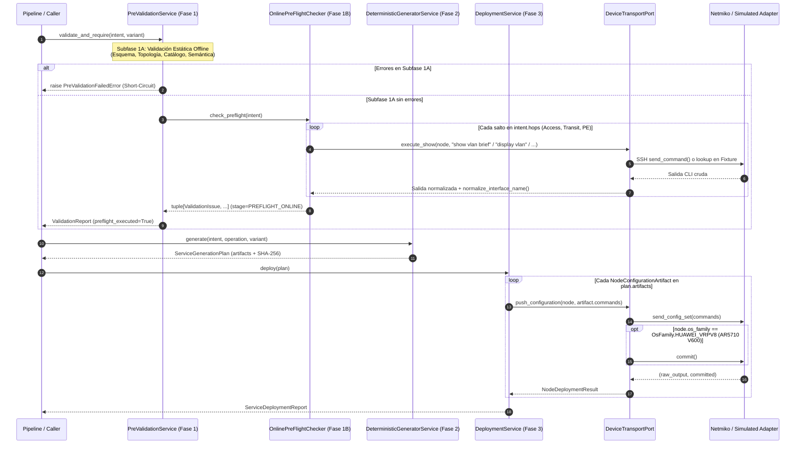

# ADR-010: Transporte de dispositivos (Netmiko/Simulado), Pre-Flight Online y Despliegue

- Estado: Accepted (aprobado el 29-10-2026)
- Etapa: E3
- Depende de: ADR-007, ADR-008, ADR-009
- Referencias: Documentación oficial Cisco IOS-XE 17.x (`show vlan brief`, `show interfaces switchport`, `show ip interface brief`, `show vrf`, `show bgp all summary`) y Huawei VRP V200/V600 (`display vlan`, `display port vlan`, `display interface brief`, `display ip vpn-instance`, `display bgp peer`, confirmación transaccional `commit` en VRPv8/V600); Documentación de Netmiko 4.x (`ConnectHandler`, `send_command`, `send_config_set`, `commit`).
- Walkthrough: docs/walkthroughs/ADR-010.md

---
## PARTE A — DECISIÓN (congelada al aceptar)

### 1. Contexto
Con los modelos de intención, validadores estáticos offline (Fase 1A) y generadores deterministas Jinja2 con Golden Configs (Fase 2) completados para los tres servicios del portafolio (`DIA`, `L3VPN`, `L2VPN`) en las Etapas `E1` y `E2`, corresponde abordar la **Etapa E3**: conectar el núcleo de aplicación con el plano de gestión de los dispositivos de red para materializar la **Subfase 1B (Pre-Flight Check Online de solo lectura)** y la **Fase 3 (Despliegue Automatizado de `provision` y `teardown`)**.

En el contexto del laboratorio de la Universidad de Lima y de la defensa experimental de la tesis, esta etapa debe resolver cuatro desafíos técnicos y arquitectónicos concretos:

1. **Heterogeneidad de modelos de confirmación CLI entre plataformas (`OsFamily` en `ADR-007` y Regla 7 del Contexto Maestro):**
   * En el catálogo `inventory/topology.yaml` coexisten tres familias de sistema operativo (`OsFamily`):
     * `cisco_xe` (Switches `C9300L-24T-4G` y Router PE `C8200L-1N-4T` con IOS-XE 17.x): aplica los comandos en `running-config` de forma inmediata dentro de `configure terminal`.
     * `huawei` (Switches `S5735-L24P4XE` con VRP V200 / VRPv5): aplica los comandos de forma inmediata dentro de `system-view`.
     * `huawei_vrpv8` (Router PE `AR5710-S8T2XE` con VRP V600): utiliza un buffer de configuración candidata (*two-stage mode*) donde los comandos enviados en `system-view` quedan pendientes (`[~PE2-TEST]` $\rightarrow$ `[*PE2-TEST]`) y **no se activan en el plano de control ni de datos a menos que se ejecute explícitamente `commit`** antes de salir de `system-view`.
   * Si el adaptador de transporte no distingue `OsFamily.HUAWEI_VRPV8` de `OsFamily.HUAWEI_VRP`, el despliegue sobre `PE2-TEST` devolverá éxito por SSH pero la subinterfaz, la VRF y la sesión BGP jamás entrarán en operación.
2. **Doble modalidad de ejecución (Laboratorio Físico SSH vs. Simulación Determinista Offline con Fixtures Reales):**
   * Las campañas de pruebas automatizadas (`pytest`), la validación continua fuera de horario de laboratorio y la contingencia ante el bloqueo temporal de consola en `AR5710` exigen que el 100% de la Fase 1B (`OnlinePreFlightChecker`) y de la Fase 3 (`DeploymentService`) puedan ejecutarse sin red mediante un `SimulatedTransportAdapter` determinista alimentado por fixtures de salidas CLI reales (`tests/fixtures/`), manteniendo exactamente el mismo contrato de puerto (`DeviceTransportPort`) que `NetmikoTransportAdapter`.
3. **Verificación Pre-Flight Online de Colisiones y Precondiciones Day-0 (Fase 1B):**
   * Antes de emitir cualquier comando de configuración en Fase 3, la subfase `1B` (que implementa `PreFlightCheckerPort` de `ADR-005`) debe interrogar por SSH en modo *read-only* a cada salto de la ruta (`AccessHop`, `TransitHop`, `ProviderEdgeHop`) para detectar colisiones operativas antes de tocar la red:
     * En `access` y `transit`: verificar que el `vlan_id` del servicio no exista ya activo en la base de datos de VLANs (`VLAN_COLLISION` en `show vlan brief` / `display vlan`), y que en el switch de acceso el puerto de demarcación (`customer_port`) no esté ya asignado a otra VLAN de servicio (`CLIENT_PORT_BUSY` en `show interfaces <port> switchport` / `display port vlan <port>`).
     * En `pe`: verificar que la subinterfaz derivada (`pe_subinterface`, p. ej. `GigabitEthernet0/0/4.210`, comparada mediante `normalize_interface_name` según la **Regla 4**) no exista previamente en `show ip interface brief` / `display interface brief` (`SUBINTERFACE_ALREADY_EXISTS`); y verificar las precondiciones Day-0 según el tipo de servicio: en `DIA`, que la VRF de Internet (`intent.vrf_name`) ya exista creada en el PE (`MISSING_BASE_VRF` en `show vrf` / `display ip vpn-instance`); en `L3VPN`, dado que en un entorno Carrier un mismo cliente corporativo puede conectar múltiples sucursales a la misma VRF en un PE, la existencia previa de `vrf_name` es válida e idempotente, verificándose como precondición que el proceso BGP del PE esté activo con el ASN esperado (`BGP_PROCESS_NOT_RUNNING` en `show bgp all summary` / `display bgp peer`).
4. **Orden determinista de despliegue en Fase 3 (`provision` vs. `teardown`) y trazabilidad por salto:**
   * `DeploymentService` debe ejecutar en orden los comandos de cada `NodeConfigurationArtifact` del `ServiceGenerationPlan`, registrar la transcripción cruda recibida, indicar si se ejecutó `commit` (`committed: bool`) y abortar inmediatamente (`Fail-Fast`) ante cualquier error de transporte o rechazo sintáctico CLI (`% Invalid input`, `Error:`) lanzando `DeploymentError`.

### 2. Alternativas
1. **Alternativa 1 — Invocar `netmiko.ConnectHandler` directamente desde `PreValidationService` y desde un script de despliegue procedural con diccionarios ad-hoc:**
   * *Descripción:* Importar `netmiko` dentro de la capa `application/`, abrir conexiones SSH pasando diccionarios libres y usar `unittest.mock.patch("netmiko.ConnectHandler")` en las pruebas unitarias para simular respuestas de los routers.
   * *Ventajas:* Menos clases e interfaces formales.
   * *Desventajas:* Rompe la Arquitectura Hexagonal de `ADR-001` y hace fallar `tests/unit/test_architecture.py` (que prohíbe librerías de terceros fuera de `adapters/`); acopla las pruebas unitarias a la API interna de `netmiko` en lugar de usar un contrato de dominio propio; y dificulta construir escenarios reproducibles de colisión Pre-Flight y de validación posdespliegue (`ADR-011`) basados en fixtures versionados en `tests/fixtures/`.

2. **Alternativa 2 — Puerto Hexagonal `DeviceTransportPort` con dos adaptadores intercambiables (`NetmikoTransportAdapter` con soporte `commit` para `huawei_vrpv8` y `SimulatedTransportAdapter` basado en fixtures), `OnlinePreFlightChecker` (Fase 1B) y `DeploymentService` (Fase 3):**
   * *Descripción:*
     * **Contrato de Transporte (`application/transport.py` y `domain/deployment.py`):**
       * Definir en `domain/deployment.py` los modelos inmutables:
         * `DeviceCredentials`: credenciales inyectadas desde variables de entorno en los bordes (`username`, `password`, `secret` opcional, `port: int = 22`, `timeout_seconds: int = 30`), sin valores hardcodeados en código ni en inventario.
         * `CommandExecutionRecord`: registro inmutable de una interacción sobre el transporte (`node_id`, `os_family`, `mode`, `commands`, `raw_output`, `committed: bool`).
         * `NodeDeploymentResult`: resultado inmutable de aplicar los comandos de un `NodeConfigurationArtifact` en un nodo (`hop_index`, `node_id`, `management_ip`, `vendor`, `os_family`, `role`, `operation`, `commands`, `raw_output`, `committed: bool`, `sha256`).
         * `ServiceDeploymentReport`: reporte inmutable de la Fase 3 (`service_id`, `service_type`, `operation`, `variant`, `plan_sha256`, `results: tuple[NodeDeploymentResult, ...]`, con propiedad `is_successful: bool` y método `to_dict()`).
       * Definir en `application/transport.py` el protocolo `DeviceTransportPort`:
         * `def execute_show(self, node: TopologyNode, command: str) -> str`: ejecuta un comando operativo de solo lectura y devuelve la salida textual normalizada (`\n`).
         * `def push_configuration(self, node: TopologyNode, commands: Sequence[str]) -> tuple[str, bool]`: envía la secuencia de comandos de configuración al nodo, ejecuta `commit` automáticamente cuando `node.os_family == OsFamily.HUAWEI_VRPV8`, inspecciona que la salida no contenga marcadores de error CLI de Cisco (`% Invalid input`, `% Incomplete command`, `% Ambiguous command`) ni de Huawei (`Error:`, `Unrecognized command`, `Wrong parameter`) y retorna `(raw_output, committed)`. Si ocurre un fallo de conexión SSH, timeout o error CLI del dispositivo, lanza `DeviceTransportError` / `CliCommandRejectedError` (subclases de `IntentFabricError` en `domain/errors.py`).
     * **Adaptadores de Transporte (`adapters/netmiko_transport.py` y `adapters/simulated_transport.py`):**
       * `NetmikoTransportAdapter`: confina la importación de `netmiko` dentro de `adapters/`. Traduce `node.os_family` al `device_type` de Netmiko (`"cisco_xe"`, `"huawei"`, `"huawei_vrpv8"`), utiliza `send_command(command, strip_prompt=True, strip_command=True)` para consultas de solo lectura y `send_config_set(commands, exit_config_mode=...)` + `commit()` condicional cuando `node.os_family == OsFamily.HUAWEI_VRPV8`.
       * `SimulatedTransportAdapter`: implementación 100% determinista en memoria e inicializable desde archivos fixture en `tests/fixtures/` (o diccionarios `(node_id, command) -> output`), que registra en una bitácora auditable todos los comandos `show`/`display` y bloques de configuración enviados por nodo, simula el flag `committed = (node.os_family == OsFamily.HUAWEI_VRPV8)` y permite inyectar fallos o colisiones para pruebas de Fase 1B y Fase 3 sin hardware.
     * **Subfase 1B — Pre-Flight Online (`application/preflight_online.py`):**
       * Implementar `OnlinePreFlightChecker(PreFlightCheckerPort)` que recibe `topology: TopologyCatalog` y `transport: DeviceTransportPort` y ejecuta las verificaciones de solo lectura por salto:
         1. En cada salto `AccessHop` y `TransitHop`: consulta las VLANs activas (`show vlan brief` en Cisco / `display vlan` en Huawei) y emite `ValidationIssue(code="VLAN_COLLISION", stage=ValidationStage.PREFLIGHT_ONLINE, field_path="vlan_id", node_id=hop.node_id, ...)` si `intent.vlan_id` ya figura creada en el switch.
         2. En `AccessHop`: consulta el estado del puerto de cliente (`show interfaces <port> switchport` en Cisco / `display port vlan <port>` en Huawei) y emite `CLIENT_PORT_BUSY` (`field_path="hops[0].customer_port"`, `node_id=hop.node_id`) si el puerto ya está asignado a una VLAN de acceso distinta de `1` o no se encuentra en modo `access` libre.
         3. En `ProviderEdgeHop`: consulta las interfaces del PE (`show ip interface brief` en Cisco / `display interface brief` en Huawei), normaliza cada nombre con `normalize_interface_name` (Regla 4) y emite `SUBINTERFACE_ALREADY_EXISTS` (`field_path="vlan_id"`, `node_id=hop.node_id`) si la subinterfaz `<parent_interface>.<vlan_id>` ya existe.
         4. En `ProviderEdgeHop` para `DIA`: consulta las VRFs del PE (`show vrf` en Cisco / `display ip vpn-instance` en Huawei) y emite `MISSING_BASE_VRF` (`field_path="vrf_name"`, `node_id=hop.node_id`) si `intent.vrf_name` (la VRF de salida a Internet preconfigurada en Day-0) no existe en el PE.
         5. En `ProviderEdgeHop` para `L3VPN`: consulta el resumen BGP (`show bgp all summary` en Cisco / `display bgp peer` en Huawei) y emite `BGP_PROCESS_NOT_RUNNING` (`field_path="pe_asn"`, `node_id=hop.node_id`) si el proceso BGP local no está activo o su ASN local no coincide con `intent.pe_asn` (permitiendo que `intent.vrf_name` ya exista en el PE cuando se aprovisionan múltiples sucursales de un mismo cliente).
     * **Fase 3 — Servicio de Despliegue (`application/deployment.py`):**
       * Implementar `DeploymentService` que recibe `topology: TopologyCatalog` y `transport: DeviceTransportPort`, toma un `ServiceGenerationPlan` previamente validado y generado en Fase 2, resuelve cada `TopologyNode` desde `topology`, envía `artifact.commands` mediante `transport.push_configuration(node, artifact.commands)` y construye `ServiceDeploymentReport`. Si un nodo falla, lanza `DeploymentError` conservando los resultados de los saltos previos ejecutados (`partial_results`) para auditoría y limpieza (`teardown`).
   * *Ventajas:* Respeta al 100% la Arquitectura Hexagonal (`ADR-001`) y el aislamiento AST (`test_architecture.py`); satisface las Reglas 1, 4 y 7 del Contexto Maestro; conecta limpiamente con el puerto `PreFlightCheckerPort` dejado listo en `ADR-005`; y permite probar exhaustivamente la Fase 1B y la Fase 3 tanto offline (con `SimulatedTransportAdapter` y fixtures reales de IOS-XE 17.x y VRP V200/V600) como en el laboratorio físico (con `NetmikoTransportAdapter`).
   * *Desventajas:* Requiere definir parsers deterministas de salidas Pre-Flight y sus fixtures en `tests/fixtures/`, los cuales además servirán de base directa para `ADR-011`.

### 3. Criterios de elección
* **Cumplimiento de la Regla 7 (Confirmación Transaccional en Huawei VRPv8 / V600):** El transporte debe ejecutar `commit` de forma determinista y exclusiva cuando `node.os_family == OsFamily.HUAWEI_VRPV8` (`PE2-TEST` AR5710), sin enviarlo en `cisco_xe` ni en `huawei` (VRPv5 S5735).
* **Cumplimiento de la Regla 4 (Normalización Canónica en Pre-Flight Online):** La detección de `SUBINTERFACE_ALREADY_EXISTS` sobre salidas de `show ip interface brief` (`Gi0/0/4.210`) o `display interface brief` (`GE0/0/0.110`) debe utilizar `normalize_interface_name` (`ADR-007`) para evitar falsos negativos por truncamiento de nombres en CLI.
* **Soporte Multisucursal en L3VPN Carrier-Grade:** En `L3VPN`, la existencia previa de `vrf_name` en un PE es un caso legítimo cuando varias sedes de un mismo cliente corporativo se conectan al mismo PE, por lo que Pre-Flight valida la inexistencia de la subinterfaz Dot1Q (`SUBINTERFACE_ALREADY_EXISTS`) y la actividad del proceso BGP (`BGP_PROCESS_NOT_RUNNING`) sin rechazar VRFs compartidas.
* **Testabilidad 100% Offline Reproducible:** El diseño debe permitir ejecutar toda la batería de pruebas de Fase 1B y Fase 3 en cualquier entorno sin conectividad SSH ni routers físicos mediante `SimulatedTransportAdapter` y fixtures reales en `tests/fixtures/`.

### 4. Decisión
Adoptamos la **Alternativa 2**: definir el puerto `DeviceTransportPort` en `src/intentfabric/application/transport.py` y los modelos inmutables de despliegue en `src/intentfabric/domain/deployment.py`; implementar `NetmikoTransportAdapter` (con soporte `commit` para `OsFamily.HUAWEI_VRPV8`) y `SimulatedTransportAdapter` en `src/intentfabric/adapters/`; implementar `OnlinePreFlightChecker` (Fase 1B) en `src/intentfabric/application/preflight_online.py` y `DeploymentService` (Fase 3) en `src/intentfabric/application/deployment.py`, respaldados por fixtures operativos reales de Cisco IOS-XE y Huawei VRP en `tests/fixtures/`.

### 5. Sustento
1. **Fidelidad operativa al hardware del laboratorio:** La distinción explícita basada en `TopologyNode.os_family` (`cisco_xe`, `huawei`, `huawei_vrpv8`) resuelve de raíz la asimetría entre los switches Huawei `S5735` (VRPv5 inmediato) y el router PE Huawei `AR5710` (VRP V600 transaccional con `commit`), evitando fallos silenciosos durante las pruebas en la Universidad de Lima.
2. **Integración sin fricción con `ADR-005` y `ADR-006`:** `OnlinePreFlightChecker` implementa directamente el protocolo `PreFlightCheckerPort` ya inyectable en `PreValidationService.__init__`, y `DeploymentService` consume directamente el `ServiceGenerationPlan` y los `NodeConfigurationArtifact` producidos por `DeterministicGeneratorService.generate()`.
3. **Auditabilidad ante fallos parciales de despliegue:** Al encapsular en `DeploymentError` tanto el artefacto fallido como la tupla inmutable de `partial_results` (los nodos que sí alcanzaron a recibir configuración antes del corte), el operador o el orquestador (`ADR-012`) dispone de evidencia exacta de qué equipos fueron modificados y puede ejecutar la operación `teardown` determinista para restituir el estado base del laboratorio.

### 6. Consecuencias y riesgos aceptados
* **Sin rollback transaccional automático a mitad de comando (Alcance MVP Sección 5 del Contexto Maestro):** Si un comando falla en el tercer salto de la ruta, `DeploymentService` detiene inmediatamente la ejecución (`Fail-Fast`) y reporta en `DeploymentError.partial_results` los saltos previos completados; la reversión del servicio se realiza ejecutando el plan `teardown` correspondiente.
* **Detección determinista de rechazos CLI sobre SSH:** Dado que el canal SSH de Netmiko no devuelve un código de salida distinto de cero cuando el sistema operativo de red rechaza un comando por sintaxis o estado, `DeviceTransportPort` inspecciona determinísticamente la transcripción devuelta en busca de patrones de error de Cisco IOS-XE y Huawei VRP para lanzar `CliCommandRejectedError`.

---
## PARTE B — ESPECIFICACIÓN DE IMPLEMENTACIÓN (para el agente)

### 7. Alcance y fuera de alcance
- **Incluye:**
  - Creación de `src/intentfabric/domain/deployment.py` con los modelos inmutables `DeviceCredentials`, `CommandExecutionRecord`, `NodeDeploymentResult` y `ServiceDeploymentReport`, y las funciones puras de detección de errores CLI (`contains_cli_error`, `find_cli_error_line`).
  - Extensión de `src/intentfabric/domain/errors.py` con `DeviceTransportError`, `CliCommandRejectedError` y `DeploymentError`, exportando los nuevos símbolos en `src/intentfabric/domain/__init__.py`.
  - Creación del puerto `DeviceTransportPort` en `src/intentfabric/application/transport.py`, el verificador online de Fase 1B `OnlinePreFlightChecker` en `src/intentfabric/application/preflight_online.py` y el servicio de Fase 3 `DeploymentService` en `src/intentfabric/application/deployment.py`, exportándolos en `src/intentfabric/application/__init__.py`.
  - Creación de los adaptadores `NetmikoTransportAdapter` (y carga de credenciales desde entorno `load_credentials_from_env`) en `src/intentfabric/adapters/netmiko_transport.py` y `SimulatedTransportAdapter` en `src/intentfabric/adapters/simulated_transport.py`, exportándolos en `src/intentfabric/adapters/__init__.py`.
  - Extensión de `src/intentfabric/bootstrap.py` con las factorías `build_online_preflight_checker`, `build_pre_validator` y `build_deployment_service`.
  - Creación de los archivos fixture de salidas operativas reales en `tests/fixtures/preflight/` para Cisco IOS-XE y Huawei VRP, y de las suites de pruebas `tests/unit/test_deployment_models.py`, `tests/unit/test_transport_adapters.py`, `tests/unit/test_preflight_online.py` y `tests/unit/test_deployment_service.py`.
  - Actualización de `docs/specs/context-master.md` para marcar `ADR-010` como `Accepted`.
- **NO incluye:**
  - Validación posdespliegue de Fase 4, *Triage en Cascada*, Sonda SVI Efímera ni cálculo de `SDC` (corresponden a `ADR-011`).
  - Orquestador completo de las 4 fases (`PipelineOrchestrator`), logger experimental CSV/JSON ni CLI `argparse` (corresponden a `ADR-012`).
  - Modificación de `src/intentfabric/application/pre_validation.py` ni `src/intentfabric/application/generation.py`.

### 8. Pasos de implementación

1. **[Paso 1 — Modelos de dominio de transporte y despliegue (`domain/deployment.py`) y excepciones (`domain/errors.py`)]**:
   - **Archivos:**
     - `src/intentfabric/domain/deployment.py` (crear)
     - `src/intentfabric/domain/errors.py` (modificar)
     - `src/intentfabric/domain/__init__.py` (modificar)
     - `docs/specs/context-master.md` (modificar: cambiar estado de `ADR-010` a `Accepted` en la tabla de la sección 6)
     - `tests/unit/test_deployment_models.py` (crear)
   - **Cambios / Firmas:**
     - En `src/intentfabric/domain/deployment.py` (usando exclusivamente `stdlib`: `dataclasses`, `ipaddress`, `re`, `collections.abc`):
       - Definir patrones deterministas de rechazo CLI para Cisco IOS-XE y Huawei VRP:
         - `def find_cli_error_line(raw_output: str, *, vendor: str | None = None) -> str | None`: inspecciona línea por línea `raw_output.splitlines()` y devuelve la primera línea (con `.strip()`) que coincida con un marcador de error CLI:
           - Marcadores Cisco (`vendor in (None, "cisco")`): líneas que contengan `"% Invalid input"`, `"% Incomplete command"`, `"% Ambiguous command"`, `"% Authorization failed"` o comiencen con `"% Error"`.
           - Marcadores Huawei (`vendor in (None, "huawei")`): líneas que comiencen (ignorando mayúsculas/minúsculas) con `"Error:"`, `"Error["`, `"Unrecognized command"`, `"Wrong parameter"`, `"Incomplete command"` o `"Ambiguous command"`.
           - Si ninguna línea coincide, retorna `None`.
         - `def contains_cli_error(raw_output: str, *, vendor: str | None = None) -> bool`: retorna `find_cli_error_line(raw_output, vendor=vendor) is not None`.
       - Definir `@dataclass(frozen=True, slots=True) class DeviceCredentials`:
         - `username: str`
         - `password: str`
         - `secret: str | None = None`
         - `port: int = 22`
         - `timeout_seconds: int = 30`
         - En `__post_init__`: validar que `username` y `password` sean `str` no vacíos tras `.strip()`, que `secret` sea `None` o `str` no vacío, que `type(port) is int and 1 <= port <= 65535` y `type(timeout_seconds) is int and 1 <= timeout_seconds <= 600` (lanzando `ValueError(f"{campo}: ...")` en caso contrario).
         - Implementar `__repr__(self) -> str` redactando los secretos (`password='***'`, `secret='***' if self.secret is not None else None`) para evitar fugas en trazas o logs.
       - Definir `@dataclass(frozen=True, slots=True) class CommandExecutionRecord`:
         - `node_id: str`
         - `os_family: OsFamily`
         - `mode: str` (`"show"` o `"config"`)
         - `commands: tuple[str, ...]`
         - `raw_output: str`
         - `committed: bool = False`
         - En `__post_init__`: validar `node_id` no vacío, `isinstance(os_family, OsFamily)`, `mode in ("show", "config")`, `isinstance(commands, tuple) and len(commands) > 0`, `isinstance(raw_output, str)` y `type(committed) is bool`.
       - Definir `@dataclass(frozen=True, slots=True) class NodeDeploymentResult`:
         - `hop_index: int`
         - `node_id: str`
         - `management_ip: IPv4Address`
         - `vendor: str`
         - `os_family: OsFamily`
         - `role: NodeRole`
         - `operation: Operation`
         - `commands: tuple[str, ...]`
         - `raw_output: str`
         - `committed: bool`
         - `sha256: str`
         - En `__post_init__`: validar `type(hop_index) is int and hop_index >= 0`, `node_id.strip() != ""`, `isinstance(management_ip, IPv4Address)`, `vendor in ("cisco", "huawei")`, `isinstance(os_family, OsFamily)`, `isinstance(role, NodeRole)`, `isinstance(operation, Operation)`, `isinstance(commands, tuple) and len(commands) > 0`, `isinstance(raw_output, str)`, `type(committed) is bool` y `sha256.strip() != ""`.
         - Método `to_dict(self) -> dict[str, object]` con orden fijo de claves: `"hop_index"`, `"node_id"`, `"management_ip"` (`str`), `"vendor"`, `"os_family"` (`.value`), `"role"` (`.value`), `"operation"` (`.value`), `"commands"` (`list`), `"raw_output"`, `"committed"`, `"sha256"`.
       - Definir `@dataclass(frozen=True, slots=True) class ServiceDeploymentReport`:
         - `service_id: str`
         - `service_type: str`
         - `operation: Operation`
         - `variant: str`
         - `plan_sha256: str`
         - `results: tuple[NodeDeploymentResult, ...]`
         - En `__post_init__`: validar `service_id.strip() != ""`, `service_type.strip() != ""`, `isinstance(operation, Operation)`, `variant.strip() != ""`, `plan_sha256.strip() != ""` y `isinstance(results, tuple) and len(results) > 0`.
         - Propiedad `@property def is_successful(self) -> bool: return len(self.results) > 0`.
         - Método `to_dict(self) -> dict[str, object]` con claves `"service_id"`, `"service_type"`, `"operation"` (`.value`), `"variant"`, `"plan_sha256"`, `"is_successful"` y `"results"` (`[r.to_dict() for r in self.results]`).
     - En `src/intentfabric/domain/errors.py`:
       - `class DeviceTransportError(IntentFabricError)`: recibe `message: str, *, node_id: str, command: str | None = None` y expone `self.node_id = node_id` y `self.command = command`.
       - `class CliCommandRejectedError(DeviceTransportError)`: recibe `message: str, *, node_id: str, command: str | None = None, raw_output: str = ""` y expone además `self.raw_output = raw_output`.
       - `class DeploymentError(IntentFabricError)`: recibe `message: str, *, node_id: str, hop_index: int, partial_results: tuple[NodeDeploymentResult, ...] = ()` y expone `self.node_id = node_id`, `self.hop_index = hop_index` y `self.partial_results = tuple(partial_results)`.
     - Exportar los nuevos modelos, funciones y errores en `src/intentfabric/domain/__init__.py`.
   - **Verificación del paso:** `.venv\Scripts\python -m pytest tests/unit/test_deployment_models.py tests/unit/test_architecture.py`

2. **[Paso 2 — Puerto `DeviceTransportPort` y adaptadores `SimulatedTransportAdapter` y `NetmikoTransportAdapter` (con soporte `commit` en `huawei_vrpv8`)]**:
   - **Archivos:**
     - `src/intentfabric/application/transport.py` (crear)
     - `src/intentfabric/adapters/simulated_transport.py` (crear)
     - `src/intentfabric/adapters/netmiko_transport.py` (crear)
     - `src/intentfabric/adapters/__init__.py` (modificar)
     - `tests/unit/test_transport_adapters.py` (crear)
   - **Cambios / Firmas:**
     - En `src/intentfabric/application/transport.py`:
       - Definir `class DeviceTransportPort(Protocol)`:
         - `def execute_show(self, node: TopologyNode, command: str) -> str: ...`
         - `def push_configuration(self, node: TopologyNode, commands: Sequence[str]) -> tuple[str, bool]: ...`
     - En `src/intentfabric/adapters/simulated_transport.py`:
       - Implementar `class SimulatedTransportAdapter`:
         - `__init__(self, show_outputs: Mapping[tuple[str, str], str] | None = None, *, default_show_outputs: Mapping[str, str] | None = None, config_outputs: Mapping[str, str] | None = None, failing_nodes: Mapping[str, Exception] | None = None) -> None`:
           - Almacena respuestas deterministas por `(node.node_id, command.strip())` (con fallback a `default_show_outputs.get(command.strip(), "")`), salidas de configuración por `node.node_id`, excepciones simuladas por `node.node_id` (o por `(node.node_id, command.strip())`) y una lista interna `_history: list[CommandExecutionRecord]`.
         - Propiedad `@property def history(self) -> tuple[CommandExecutionRecord, ...]`: devuelve la tupla inmutable de registros ejecutados en orden cronológico.
         - Método `set_show_output(self, node_id: str, command: str, output: str) -> None`: registra o actualiza la salida simulada de un comando `show`/`display` para un nodo.
         - Método `execute_show(self, node: TopologyNode, command: str) -> str`:
           - Si existe fallo configurado para `(node.node_id, command.strip())` o `node.node_id`, lanza `DeviceTransportError(str(err), node_id=node.node_id, command=command)` (o relanza si ya es `DeviceTransportError`).
           - Normaliza saltos de línea `\r\n` $\rightarrow$ `\n`, verifica `find_cli_error_line(output, vendor=node.vendor)` (si detecta error CLI en la salida, lanza `CliCommandRejectedError(error_line, node_id=node.node_id, command=command, raw_output=output)`), registra `CommandExecutionRecord(node_id=node.node_id, os_family=node.os_family, mode="show", commands=(command,), raw_output=output, committed=False)` y retorna `output`.
         - Método `push_configuration(self, node: TopologyNode, commands: Sequence[str]) -> tuple[str, bool]`:
           - Valida que `commands` no esté vacío (`tuple(commands)`).
           - Si existe fallo configurado para `node.node_id`, lanza `DeviceTransportError`.
           - Obtiene `raw_output = self._config_outputs.get(node.node_id, "\n".join(commands) + "\n")`.
           - Si `find_cli_error_line(raw_output, vendor=node.vendor)` no es `None`, lanza `CliCommandRejectedError(error_line, node_id=node.node_id, command="\n".join(commands), raw_output=raw_output)`.
           - Calcula `committed = (node.os_family == OsFamily.HUAWEI_VRPV8)` (Regla 7: solo `huawei_vrpv8` requiere y ejecuta `commit`).
           - Registra `CommandExecutionRecord(node_id=node.node_id, os_family=node.os_family, mode="config", commands=tuple(commands), raw_output=raw_output, committed=committed)` y retorna `(raw_output, committed)`.
     - En `src/intentfabric/adapters/netmiko_transport.py`:
       - Implementar `def load_credentials_from_env(env: Mapping[str, str] | None = None, *, prefix: str = "INTENTFABRIC_SSH_") -> DeviceCredentials`:
         - Lee `f"{prefix}USERNAME"` y `f"{prefix}PASSWORD"` (requeridos; si falta alguno o está vacío lanza `DeviceTransportError("credenciales SSH ausentes: defina INTENTFABRIC_SSH_USERNAME e INTENTFABRIC_SSH_PASSWORD", node_id="env")`), `f"{prefix}SECRET"` (opcional), `f"{prefix}PORT"` (opcional, por defecto `"22"`) y `f"{prefix}TIMEOUT"` (opcional, por defecto `"30"`).
       - Implementar `class NetmikoTransportAdapter`:
         - `__init__(self, credentials: DeviceCredentials, *, connect_factory: Callable[..., Any] | None = None) -> None`:
           - Si `connect_factory is None`, resuelve perezosamente `from netmiko import ConnectHandler` al conectar (permitiendo instanciar o inyectar un `connect_factory` doble en pruebas unitarias sin abrir sockets reales).
         - Mapea `node.os_family.value` a `device_type` de Netmiko (`"cisco_xe"`, `"huawei"`, `"huawei_vrpv8"`).
         - En `execute_show(self, node: TopologyNode, command: str) -> str`: abre sesión con context manager (`with self._connect(node) as connection:`), invoca `connection.send_command(command, strip_prompt=True, strip_command=True)`, normaliza `\r\n` $\rightarrow$ `\n`, verifica `find_cli_error_line(output, vendor=node.vendor)` (lanzando `CliCommandRejectedError` si aplica) y envuelve cualquier excepción de transporte en `DeviceTransportError(..., node_id=node.node_id, command=command)`.
         - En `push_configuration(self, node: TopologyNode, commands: Sequence[str]) -> tuple[str, bool]`:
           - Si `node.os_family == OsFamily.HUAWEI_VRPV8`: invoca `output = connection.send_config_set(list(commands), exit_config_mode=False)`, verifica que `output` no tenga errores CLI, invoca `commit_output = connection.commit()` y `connection.exit_config_mode()`, concatena `raw_output`, verifica errores CLI en `commit_output` y retorna `(raw_output, True)`.
           - Si `node.os_family in (OsFamily.CISCO_XE, OsFamily.HUAWEI_VRP)`: invoca `output = connection.send_config_set(list(commands), exit_config_mode=True)`, verifica errores CLI y retorna `(output, False)`.
     - Exportar `NetmikoTransportAdapter`, `SimulatedTransportAdapter` y `load_credentials_from_env` en `src/intentfabric/adapters/__init__.py`.
   - **Verificación del paso:** `.venv\Scripts\python -m pytest tests/unit/test_transport_adapters.py tests/unit/test_architecture.py`

3. **[Paso 3 — Subfase 1B (`OnlinePreFlightChecker`), Fase 3 (`DeploymentService`), fixtures operativos y registro en `bootstrap.py`]**:
   - **Archivos:**
     - `src/intentfabric/application/preflight_online.py` (crear)
     - `src/intentfabric/application/deployment.py` (crear)
     - `src/intentfabric/application/__init__.py` (modificar)
     - `src/intentfabric/bootstrap.py` (modificar)
     - `tests/fixtures/preflight/cisco_show_vlan_brief_clean.txt` (crear)
     - `tests/fixtures/preflight/huawei_display_vlan_clean.txt` (crear)
     - `tests/fixtures/preflight/cisco_show_interfaces_switchport_free.txt` (crear)
     - `tests/fixtures/preflight/huawei_display_port_vlan_free.txt` (crear)
     - `tests/fixtures/preflight/cisco_show_ip_interface_brief_clean.txt` (crear)
     - `tests/fixtures/preflight/huawei_display_interface_brief_clean.txt` (crear)
     - `tests/fixtures/preflight/cisco_show_vrf_clean.txt` (crear)
     - `tests/fixtures/preflight/huawei_display_ip_vpn_instance_clean.txt` (crear)
     - `tests/fixtures/preflight/cisco_show_bgp_all_summary_clean.txt` (crear)
     - `tests/fixtures/preflight/huawei_display_bgp_peer_clean.txt` (crear)
     - `tests/unit/test_preflight_online.py` (crear)
     - `tests/unit/test_deployment_service.py` (crear)
   - **Cambios / Firmas:**
     - En `src/intentfabric/application/preflight_online.py` (solo `stdlib`, `domain/` y `application/`):
       - Implementar funciones puras de extracción para Pre-Flight:
         - `parse_active_vlans(output: str, vendor: str) -> frozenset[int]`:
           - En Cisco (`show vlan brief`): extrae el primer token entero (`1..4094`) de las líneas de tabla de VLANs.
           - En Huawei (`display vlan`): extrae los IDs de VLAN de las filas de tabla (`^(\d+)\s+(?:common|mux|super)` o listado de VLANs activas).
         - `parse_access_port_vlan(output: str, vendor: str, interface_name: str) -> int | None`:
           - En Cisco (`show interfaces <port> switchport`): busca `Access Mode VLAN:\s*(\d+)`.
           - En Huawei (`display port vlan <port>`): busca la fila de la interfaz (comparada con `are_equivalent_interfaces` / `abbreviate_interface_name`) y extrae su `PVID` entero.
         - `parse_existing_interfaces(output: str, vendor: str) -> frozenset[str]`:
           - En Cisco (`show ip interface brief`) y Huawei (`display interface brief`): extrae el primer token de cada fila de interfaz y lo normaliza canónicamente mediante `normalize_interface_name(token, vendor=vendor)` (ignorando encabezados o tokens que no sean interfaces válidas).
         - `parse_existing_vrfs(output: str, vendor: str) -> frozenset[str]`:
           - En Cisco (`show vrf`) y Huawei (`display ip vpn-instance`): extrae los nombres de VRF declarados en las filas de la tabla (ignorando encabezados `Name`, `VPN-Instance Name`, `Total`).
         - `parse_local_bgp_asn(output: str, vendor: str) -> int | None`:
           - En Cisco (`show bgp all summary`) y Huawei (`display bgp peer`): extrae el ASN local (`local AS number\s+(\d+)` en Cisco; `Local AS number\s*:\s*(\d+)` en Huawei).
       - Implementar `class OnlinePreFlightChecker`:
         - `__init__(self, topology: TopologyCatalog, transport: DeviceTransportPort) -> None`.
         - `def check_preflight(self, intent: Any) -> tuple[ValidationIssue, ...]`:
           - Para cada `index, hop` en `enumerate(intent.hops)`:
             - Obtiene `node = self._topology.get_node(hop.node_id)`.
             - Si `isinstance(hop, (AccessHop, TransitHop))`:
               1. Consulta `vlan_cmd = "show vlan brief" if node.vendor == "cisco" else "display vlan"`. Si `intent.vlan_id in parse_active_vlans(output, node.vendor)`, agrega `ValidationIssue(code="VLAN_COLLISION", message=f"vlan_id: la VLAN {intent.vlan_id} ya existe en {node.node_id}.", stage=ValidationStage.PREFLIGHT_ONLINE, field_path="vlan_id", node_id=node.node_id)`.
               2. Si `isinstance(hop, AccessHop)`: consulta `port_cmd = f"show interfaces {hop.customer_port} switchport" if node.vendor == "cisco" else f"display port vlan {hop.customer_port}"`. Si `pvid := parse_access_port_vlan(output, node.vendor, hop.customer_port)` no es `None` y `pvid != 1`, agrega `ValidationIssue(code="CLIENT_PORT_BUSY", message=f"customer_port: el puerto {hop.customer_port} ya pertenece a la VLAN {pvid} en {node.node_id}.", stage=ValidationStage.PREFLIGHT_ONLINE, field_path="hops[0].customer_port", node_id=node.node_id)`.
             - Si `isinstance(hop, ProviderEdgeHop)`:
               1. Calcula `expected_subif = derive_subinterface_name(hop.parent_interface, intent.vlan_id)` y consulta `if_cmd = "show ip interface brief" if node.vendor == "cisco" else "display interface brief"`. Si `expected_subif in parse_existing_interfaces(output, node.vendor)`, agrega `ValidationIssue(code="SUBINTERFACE_ALREADY_EXISTS", message=f"vlan_id: la subinterfaz {expected_subif} ya existe en {node.node_id}.", stage=ValidationStage.PREFLIGHT_ONLINE, field_path="vlan_id", node_id=node.node_id)`.
               2. Si `intent.service_type == "DIA"`: consulta `vrf_cmd = "show vrf" if node.vendor == "cisco" else "display ip vpn-instance"`. Si `intent.vrf_name not in parse_existing_vrfs(output, node.vendor)`, agrega `ValidationIssue(code="MISSING_BASE_VRF", message=f"vrf_name: la VRF base {intent.vrf_name!r} no existe en {node.node_id}.", stage=ValidationStage.PREFLIGHT_ONLINE, field_path="vrf_name", node_id=node.node_id)`.
               3. Si `intent.service_type == "L3VPN"`: consulta `bgp_cmd = "show bgp all summary" if node.vendor == "cisco" else "display bgp peer"`. Si `parse_local_bgp_asn(output, node.vendor) != intent.pe_asn`, agrega `ValidationIssue(code="BGP_PROCESS_NOT_RUNNING", message=f"pe_asn: BGP con ASN {intent.pe_asn} no esta activo en {node.node_id}.", stage=ValidationStage.PREFLIGHT_ONLINE, field_path="pe_asn", node_id=node.node_id)`. *(Nota: en L3VPN NO se rechaza que `vrf_name` ya exista en el PE).*
     - En `src/intentfabric/application/deployment.py`:
       - Implementar `class DeploymentService`:
         - `__init__(self, topology: TopologyCatalog, transport: DeviceTransportPort) -> None`.
         - `def deploy(self, plan: ServiceGenerationPlan) -> ServiceDeploymentReport`:
           - Recorre en orden `plan.artifacts` (respetando el orden canónico de artefactos del plan).
           - Para cada `artifact`:
             - Resuelve `node = self._topology.get_node(artifact.node_id)`.
             - Invoca `raw_output, committed = self._transport.push_configuration(node, artifact.commands)`.
             - Si `push_configuration` lanza `DeviceTransportError` (incluyendo `CliCommandRejectedError`), captura la excepción y lanza `DeploymentError(f"{artifact.node_id}: fallo de despliegue en salto {artifact.hop_index}; {error}", node_id=artifact.node_id, hop_index=artifact.hop_index, partial_results=tuple(completed))` desde `error`.
             - Construye y acumula `NodeDeploymentResult(...)`.
           - Retorna `ServiceDeploymentReport(service_id=plan.service_id, service_type=plan.service_type, operation=plan.operation, variant=plan.variant, plan_sha256=plan.plan_sha256, results=tuple(completed))`.
     - En `src/intentfabric/bootstrap.py`:
       - Añadir las factorías `build_online_preflight_checker(topology: TopologyCatalog | None = None, *, transport: DeviceTransportPort) -> OnlinePreFlightChecker`, `build_pre_validator(catalog: PluginCatalog | None = None, *, topology: TopologyCatalog | None = None, preflight_checker: PreFlightCheckerPort | None = None) -> PreValidationService` y `build_deployment_service(topology: TopologyCatalog | None = None, *, transport: DeviceTransportPort) -> DeploymentService`.
   - **Verificación del paso:** `.venv\Scripts\python -m pytest` y `.venv\Scripts\python scripts/check_env.py`

### 9. Criterios de aceptación
1. **Aislamiento Hexagonal del Transporte (`ADR-001`):** `DeviceTransportPort`, `OnlinePreFlightChecker` y `DeploymentService` residen en `application/` dependiendo únicamente de `stdlib` y `domain/`, mientras que `netmiko` queda estrictamente confinado en `adapters/netmiko_transport.py` y las credenciales se cargan exclusivamente desde variables de entorno sin secretos en código (verificado en `tests/unit/test_architecture.py` y `tests/unit/test_transport_adapters.py`).
2. **Confirmación transaccional `commit` exclusiva para Huawei VRPv8 / V600 (Regla 7):** Tanto `NetmikoTransportAdapter` como `SimulatedTransportAdapter` ejecutan `commit` y marcan `committed=True` única y exclusivamente cuando `node.os_family == OsFamily.HUAWEI_VRPV8` (`PE2-TEST` AR5710), manteniendo `committed=False` para `OsFamily.CISCO_XE` (`C9300L`, `C8200L`) y `OsFamily.HUAWEI_VRP` (`S5735` VRPv5) (verificado en `tests/unit/test_transport_adapters.py` y `tests/unit/test_deployment_service.py`).
3. **Detección Pre-Flight Online con Normalización Canónica de Interfaces y Soporte Multisucursal L3VPN (Regla 1 y Regla 4):** `OnlinePreFlightChecker` integrado en `PreValidationService` detecta `VLAN_COLLISION`, `CLIENT_PORT_BUSY`, `SUBINTERFACE_ALREADY_EXISTS` (normalizando nombres truncados como `Gi0/0/4.210` o `GE0/0/0.110` mediante `normalize_interface_name`), `MISSING_BASE_VRF` (en `DIA`) y `BGP_PROCESS_NOT_RUNNING` (en `L3VPN`), permitiendo que una VRF de `L3VPN` ya exista en el PE para conectar nuevas sucursales del mismo cliente (verificado con fixtures reales en `tests/unit/test_preflight_online.py`).
4. **Despliegue Secuencial Determinista y Fail-Fast con Resultados Parciales (Fase 3):** `DeploymentService.deploy(plan)` aplica en orden los comandos de cada `NodeConfigurationArtifact` para `provision` y `teardown` en los tres servicios (`DIA`, `L3VPN`, `L2VPN`), y ante un error de transporte o rechazo CLI (`CliCommandRejectedError`) aborta inmediatamente lanzando `DeploymentError` con la lista exacta de `partial_results` ejecutados antes del fallo (verificado en `tests/unit/test_deployment_service.py`).
5. **No regresión y limpieza de entorno:** Toda la suite de pruebas del repositorio (`.venv\Scripts\python -m pytest`) y `scripts/check_env.py` pasan al 100% en verde.

### 10. Registro de cambios de la Parte B
| Fecha | Archivos afectados | Cambio / Implementación | Resultado / Validación | Motivo |
|---|---|---|---|---|
| 29-10-2026 | `docs/adr/ADR-010.md` | Diseño inicial de Parte A y Parte B para transporte (Netmiko/Simulado), Pre-Flight Online (Fase 1B) y Despliegue (Fase 3) | Pendiente de ejecución de Parte B | Completar Etapa E3 del roadmap |
| 29-10-2026 | `domain/deployment.py`, `domain/errors.py`, `domain/__init__.py`, `docs/specs/context-master.md`, `tests/unit/test_deployment_models.py` | Paso 1: modelos inmutables, deteccion CLI, errores de transporte y despliegue; estado ADR-010 sincronizado | 142 pruebas de modelos y arquitectura aprobadas con TEMP/TMP en directorio autorizado | Contratos puros y trazabilidad del despliegue |
| 29-10-2026 | `application/transport.py`, `adapters/simulated_transport.py`, `adapters/netmiko_transport.py`, `adapters/__init__.py`, `tests/unit/test_transport_adapters.py` | Paso 2: puerto de transporte, simulador auditable y Netmiko con commit exclusivo VRPv8; carga de credenciales por entorno | 123 pruebas de transporte y arquitectura aprobadas sin sockets, con TEMP/TMP autorizado | Acceso intercambiable y fail-fast ante rechazos CLI o fallos SSH |
| 29-10-2026 | `adapters/netmiko_transport.py`, `tests/unit/test_transport_adapters.py` | Paso 2: inspeccion independiente de la salida de commit sin depender del salto de linea previo; prueba de resolucion perezosa de ConnectHandler | 125 pruebas de transporte y arquitectura aprobadas | Evitar falsos exitos al concatenar transcripciones sin terminador |
| 29-10-2026 | `adapters/netmiko_transport.py`, `tests/unit/test_transport_adapters.py` | Paso 2: traducir ValueError de la confirmacion Huawei al contrato de error del transporte | 126 pruebas de transporte y arquitectura aprobadas; comportamiento comprobado en netmiko/huawei/huawei.py de Netmiko 4.8.0 instalado | Preservar fail-fast y resultados parciales ante fallos nativos de commit |
