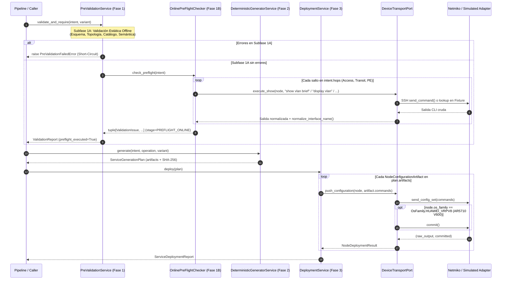

# ADR-010: Transporte de dispositivos (Netmiko/Simulado), Pre-Flight Online y Despliegue

- Estado: Proposed
- Etapa: E3
- Depende de: ADR-007, ADR-008, ADR-009
- Referencias: Documentación oficial Cisco IOS-XE 17.x (`show vlan brief`, `show interfaces status`, `show ip interface brief`, `show vrf`, `show bgp all summary`, `show lldp`) y Huawei VRP V200/V600 (`display vlan`, `display interface brief`, `display ip interface brief`, `display ip vpn-instance`, `display bgp peer`, `display lldp local`, confirmación transaccional `commit` en VRPv8/V600); Documentación de Netmiko 4.x (`ConnectHandler`, `send_command`, `send_config_set`, `commit`).
- Walkthrough: docs/walkthroughs/ADR-010.md

---
## PARTE A — DECISIÓN (congelada al aceptar)

### 1. Contexto
Con los modelos de intención, validadores estáticos offline (Fase 1A) y generadores deterministas Jinja2 con Golden Configs (Fase 2) completados para los tres servicios del portafolio (`DIA`, `L3VPN`, `L2VPN`) en las Etapas `E1` y `E2`, corresponde abordar la **Etapa E3**: conectar el núcleo de aplicación con el plano de gestión de los dispositivos de red para materializar la **Subfase 1B (Pre-Flight Check Online de solo lectura)** y la **Fase 3 (Despliegue Automatizado de `provision` y `teardown`)**.

En el contexto del laboratorio de la Universidad de Lima y de la defensa experimental de la tesis, esta etapa debe resolver cuatro desafíos técnicos y arquitectónicos concretos:

1. **Heterogeneidad de modelos de confirmación CLI entre plataformas (`OsFamily` en `ADR-007` y Regla 7 del Contexto Maestro):**
   * En el catálogo `inventory/topology.yaml` coexisten tres familias de sistema operativo (`OsFamily`):
     * `cisco_xe` (Switches `C9300L-24T-4G` y Router PE `C8200L-1N-4T` con IOS-XE 17.x): aplica los comandos en `running-config` de forma inmediata dentro de `configure terminal`.
     * `huawei` (Switches `S5735-L24P4XE` con VRP V200 / VRPv5): aplica los comandos de forma inmediata dentro de `system-view`.
     * `huawei_vrpv8` (Router PE `AR5710-S8T2XE` con VRP V600): utiliza un buffer de configuración candidata (*two-stage mode*) donde los comandos enviados en `system-view` quedan pendientes (`[~PE2-TEST]` $\rightarrow$ `[*PE2-TEST]`) y **no se activan en el plano de control ni de datos a menos que se ejecute explícitamente `commit`** antes de salir de `system-view`.
   * Si el adaptador de transporte no distingue `OsFamily.HUAWEI_VRPV8` de `OsFamily.HUAWEI_VRP`, el despliegue sobre `PE2-TEST` devolverá éxito por SSH pero la subinterfaz, la VRF y la sesión BGP jamás entrarán en operación.
2. **Doble modalidad de ejecución (Laboratorio Físico SSH vs. Simulación Determinista Offline con Fixtures Reales):**
   * Las campañas de pruebas automatizadas (`pytest`), la validación continua fuera de horario de laboratorio y la contingencia ante el bloqueo temporal de consola en `AR5710` exigen que el 100% de la Fase 1B (`PreFlightCheckService`) y de la Fase 3 (`DeploymentService`) puedan ejecutarse sin red mediante un `SimulatedTransportAdapter` determinista alimentado por fixtures de salidas CLI reales (`tests/fixtures/`), manteniendo exactamente el mismo contrato de puerto (`DeviceTransportPort`) que `NetmikoTransportAdapter`.
3. **Verificación Pre-Flight Online de Colisiones y Precondiciones Day-0 (Fase 1B):**
   * Antes de emitir cualquier comando de configuración en Fase 3, la subfase `1B` (que implementa `PreFlightCheckerPort` de `ADR-005`) debe interrogar por SSH en modo *read-only* a cada salto de la ruta (`AccessHop`, `TransitHop`, `ProviderEdgeHop`) para detectar colisiones operativas antes de tocar la red:
     * En `access` y `transit`: verificar que el `vlan_id` del servicio no exista ya activo en la base de datos de VLANs (`VLAN_COLLISION` en `show vlan brief` / `display vlan`), y que en el switch de acceso el puerto de demarcación (`customer_port`) no tenga ya otra VLAN de servicio asignada o descripción activa de otro cliente (`CLIENT_PORT_BUSY`).
     * En `pe`: verificar que la subinterfaz derivada (`pe_subinterface`, p. ej. `GigabitEthernet0/0/4.210`, comparada mediante `normalize_interface_name` según la **Regla 4**) no exista previamente en `show ip interface brief` / `display interface brief` (`SUBINTERFACE_ALREADY_EXISTS`); y verificar las precondiciones Day-0 según el tipo de servicio: en `DIA`, que la VRF de Internet (`intent.vrf_name`) ya exista creada en el PE (`MISSING_BASE_VRF` en `show vrf` / `display ip vpn-instance`); en `L3VPN`, que la VRF o RD no colisione con otro servicio distinto y que el proceso BGP con `pe_asn` esté activo (`BGP_PROCESS_NOT_RUNNING`).
4. **Orden determinista de despliegue en Fase 3 (`provision` vs. `teardown`) y trazabilidad por salto:**
   * En `provision`, la secuencia de despliegue recorre `AccessHop -> TransitHop* -> ProviderEdgeHop` (habilitando primero el transporte L2 y finalmente levantando la subinterfaz/protocolo en el PE). En `teardown`, para evitar tráfico huérfano o *blackholing* temporal mientras se desmonta el circuito, o bien para mantener trazabilidad determinista por salto sobre `ServiceGenerationPlan`, `DeploymentService` debe ejecutar los comandos de cada `NodeConfigurationArtifact`, registrar la transcripción cruda recibida, indicar si se ejecutó `commit` (`committed: bool`) y abortar inmediatamente (`Fail-Fast`) ante cualquier error de transporte o rechazo sintáctico CLI (`% Invalid input`, `Error:`) lanzando `DeploymentError`.

### 2. Alternativas
1. **Alternativa 1 — Invocar `netmiko.ConnectHandler` directamente desde `PreValidationService` y desde un script de despliegue procedural con diccionarios ad-hoc:**
   * *Descripción:* Importar `netmiko` dentro de la capa `application/`, abrir conexiones SSH pasando diccionarios libres y usar `unittest.mock.patch("netmiko.ConnectHandler")` en las pruebas unitarias para simular respuestas de los routers.
   * *Ventajas:* Menos clases e interfaces formales.
   * *Desventajas:* Rompe la Arquitectura Hexagonal de `ADR-001` y hace fallar `tests/unit/test_architecture.py` (que prohíbe librerías de terceros fuera de `adapters/`); acopla las pruebas unitarias a la API interna de `netmiko` en lugar de usar un contrato de dominio propio; y dificulta construir escenarios reproducibles de colisión Pre-Flight y de validación posdespliegue (`ADR-011`) basados en fixtures versionados en `tests/fixtures/`.

2. **Alternativa 2 — Puerto Hexagonal `DeviceTransportPort` con dos adaptadores intercambiables (`NetmikoTransportAdapter` con soporte `commit` para `huawei_vrpv8` y `SimulatedTransportAdapter` basado en fixtures), `OnlinePreFlightChecker` (Fase 1B) y `DeploymentService` (Fase 3):**
   * *Descripción:*
     * **Contrato de Transporte (`application/transport.py` y `domain/deployment.py`):**
       * Definir en `domain/deployment.py` los modelos inmutables:
         * `DeviceCredentials`: credenciales inyectadas desde variables de entorno en los bordes (`username`, `password`, `secret` opcional, `port: int = 22`, `timeout_seconds: int = 30`), sin valores hardcodeados.
         * `CommandExecutionResult`: resultado inmutable de un comando `show`/`display` de solo lectura (`node_id`, `command`, `output`, ` success: bool`).
         * `NodeDeploymentResult`: resultado inmutable de aplicar los comandos de un `NodeConfigurationArtifact` en un nodo (`hop_index`, `node_id`, `management_ip`, `vendor`, `os_family`, `operation`, `commands`, `raw_output`, `committed: bool`, `sha256`).
         * `ServiceDeploymentReport`: reporte inmutable de la Fase 3 (`service_id`, `service_type`, `operation`, `variant`, `plan_sha256`, `results: tuple[NodeDeploymentResult, ...]`, `is_successful: bool`, con método `to_dict()`).
       * Definir en `application/transport.py` el protocolo `DeviceTransportPort`:
         * `def execute_show(self, node: TopologyNode, command: str) -> str`: ejecuta un comando operativo de solo lectura y devuelve la salida textual normalizada (`\n`).
         * `def push_configuration(self, node: TopologyNode, commands: Sequence[str]) -> tuple[str, bool]`: envía la secuencia de comandos de configuración al nodo, ejecuta `commit` automáticamente cuando `node.os_family == OsFamily.HUAWEI_VRPV8`, inspecciona que la salida no contenga marcadores de error CLI de Cisco (`% Invalid input`, `% Incomplete command`, `% Ambiguous command`) ni de Huawei (`Error:`, `Unrecognized command`, `Wrong parameter`) y retorna `(raw_output, committed)`. Si ocurre un fallo de conexión SSH, timeout o error CLI del dispositivo, lanza `DeviceTransportError` / `CliCommandRejectedError` (subclases de `IntentFabricError` en `domain/errors.py`).
     * **Adaptadores de Transporte (`adapters/netmiko_transport.py` y `adapters/simulated_transport.py`):**
       * `NetmikoTransportAdapter`: confina la importación de `netmiko` dentro de `adapters/`. Traduce `node.os_family` al `device_type` de Netmiko (`"cisco_xe"`, `"huawei"`, `"huawei_vrpv8"`), utiliza `send_command(command, strip_prompt=True, strip_command=True)` para consultas de solo lectura y `send_config_set(commands, exit_config_mode=...)` + `commit()` condicional cuando `node.os_family == OsFamily.HUAWEI_VRPV8`.
       * `SimulatedTransportAdapter`: implementación 100% determinista en memoria e inicializable desde archivos fixture en `tests/fixtures/` (o diccionarios `(node_id, command) -> output`), que registra en una bitácora auditable todos los comandos `show`/`display` y bloques de configuración enviados por nodo, simula el flag `committed = (node.os_family == OsFamily.HUAWEI_VRPV8)` y permite inyectar fallos o colisiones para pruebas de Fase 1B y Fase 3 sin hardware.
     * **Subfase 1B — Pre-Flight Online (`application/preflight_online.py`):**
       * Implementar `OnlinePreFlightChecker(PreFlightCheckerPort)` que recibe `topology: TopologyCatalog` y `transport: DeviceTransportPort` y ejecuta las verificaciones de solo lectura por salto:
         1. En cada salto `AccessHop` y `TransitHop`: consulta las VLANs activas (`show vlan brief` en Cisco / `display vlan` en Huawei) y emite `ValidationIssue(code="VLAN_COLLISION", stage=ValidationStage.PREFLIGHT_ONLINE, field_path="vlan_id", node_id=hop.node_id, ...)` si `intent.vlan_id` ya figura creada en el switch.
         2. En `AccessHop`: consulta el estado del puerto de cliente (`show interfaces <port> switchport` en Cisco / `display port vlan <port>` en Huawei) y emite `CLIENT_PORT_BUSY` si el puerto ya está asignado a una VLAN distinta de la VLAN por defecto (`1`).
         3. En `ProviderEdgeHop`: consulta las interfaces del PE (`show ip interface brief` en Cisco / `display interface brief` en Huawei), normaliza cada nombre con `normalize_interface_name` (Regla 4) y emite `SUBINTERFACE_ALREADY_EXISTS` si la subinterfaz `<parent_interface>.<vlan_id>` ya existe.
         4. En `ProviderEdgeHop` para `DIA`: consulta las VRFs del PE (`show vrf` en Cisco / `display ip vpn-instance` en Huawei) y emite `MISSING_BASE_VRF` si `intent.vrf_name` (la VRF de salida a Internet preconfigurada en Day-0) no existe en el PE.
         5. En `ProviderEdgeHop` para `L3VPN`: consulta las VRFs (`show vrf` / `display ip vpn-instance`) y emite `VRF_COLLISION` si `intent.vrf_name` ya existe en el PE antes del aprovisionamiento.
     * **Fase 3 — Servicio de Despliegue (`application/deployment.py`):**
       * Implementar `DeploymentService` que recibe `topology: TopologyCatalog` y `transport: DeviceTransportPort`, toma un `ServiceGenerationPlan` previamente validado y generado en Fase 2, resuelve cada `TopologyNode` desde `topology`, envía `artifact.commands` mediante `transport.push_configuration(node, artifact.commands)` y construye `ServiceDeploymentReport`. Si un nodo falla, lanza `DeploymentError` conservando los resultados de los saltos previos ejecutados (`partial_results`) para auditoría y limpieza (`teardown`).
   * *Ventajas:* Respeta al 100% la Arquitectura Hexagonal (`ADR-001`) y el aislamiento AST (`test_architecture.py`); satisface las Reglas 1, 4 y 7 del Contexto Maestro; conecta limpiamente con el puerto `PreFlightCheckerPort` dejado listo en `ADR-005`; y permite probar exhaustivamente la Fase 1B y la Fase 3 tanto offline (con `SimulatedTransportAdapter` y fixtures reales de IOS-XE 17.x y VRP V200/V600) como en el laboratorio físico (con `NetmikoTransportAdapter`).
   * *Desventajas:* Requiere definir parsers ligeros de salidas Pre-Flight (`show vlan brief` / `display vlan`, `show ip interface brief` / `display interface brief`, `show vrf` / `display ip vpn-instance`) y sus fixtures en `tests/fixtures/`, los cuales además servirán de base directa para `ADR-011`.

### 3. Criterios de elección
* **Cumplimiento de la Regla 7 (Confirmación Transaccional en Huawei VRPv8 / V600):** El transporte debe ejecutar `commit` de forma determinista y exclusiva cuando `node.os_family == OsFamily.HUAWEI_VRPV8` (`PE2-TEST` AR5710), sin enviarlo en `cisco_xe` ni en `huawei` (VRPv5 S5735).
* **Cumplimiento de la Regla 4 (Normalización Canónica en Pre-Flight Online):** La detección de `SUBINTERFACE_ALREADY_EXISTS` sobre salidas de `show ip interface brief` (`Gi0/0/4.210`) o `display interface brief` (`GE0/0/0.110`) debe utilizar `normalize_interface_name` (`ADR-007`) para evitar falsos negativos por truncamiento de nombres en CLI.
* **Testabilidad 100% Offline Reproducible:** El diseño debe permitir ejecutar toda la batería de pruebas de Fase 1B y Fase 3 en cualquier entorno sin conectividad SSH ni routers físicos mediante `SimulatedTransportAdapter` y fixtures reales en `tests/fixtures/`.

### 4. Decisión
Adoptamos la **Alternativa 2**: definir el puerto `DeviceTransportPort` en `src/intentfabric/application/transport.py` y los modelos inmutables de despliegue en `src/intentfabric/domain/deployment.py`; implementar `NetmikoTransportAdapter` (con soporte `commit` para `OsFamily.HUAWEI_VRPV8`) y `SimulatedTransportAdapter` en `src/intentfabric/adapters/`; implementar `OnlinePreFlightChecker` (Fase 1B) en `src/intentfabric/application/preflight_online.py` y `DeploymentService` (Fase 3) en `src/intentfabric/application/deployment.py`, respaldados por fixtures operativos reales de Cisco IOS-XE y Huawei VRP en `tests/fixtures/`.

### 5. Sustento
1. **Fidelidad operativa al hardware del laboratorio:** La distinción explícita basada en `TopologyNode.os_family` (`cisco_xe`, `huawei`, `huawei_vrpv8`) resuelve de raíz la asimetría entre los switches Huawei `S5735` (VRPv5 inmediato) y el router PE Huawei `AR5710` (VRP V600 transaccional con `commit`), evitando fallos silenciosos durante las pruebas en la Universidad de Lima.
2. **Integración sin fricción con `ADR-005` y `ADR-006`:** `OnlinePreFlightChecker` implementa directamente el protocolo `PreFlightCheckerPort` ya inyectable en `PreValidationService.__init__`, y `DeploymentService` consume directamente el `ServiceGenerationPlan` y los `NodeConfigurationArtifact` producidos por `DeterministicGeneratorService.generate()`.
3. **Auditabilidad ante fallos parciales de despliegue:** Al encapsular en `DeploymentError` tanto el artefacto fallido como la tupla inmutable de `partial_results` (los nodos que sí alcanzaron a recibir configuración antes del corte), el operador o el orquestador (`ADR-012`) dispone de evidencia exacta de qué equipos fueron modificados y puede ejecutar la operación `teardown` determinista para restituir el estado base del laboratorio.

### 6. Consecuencias y riesgos aceptados
* **Sin rollback transaccional automático a mitad de comando (Alcance MVP Sección 5 del Contexto Maestro):** Si un comando falla en el tercer salto de la ruta, `DeploymentService` detiene inmediatamente la ejecución (`Fail-Fast`) y reporta en `DeploymentError.partial_results` los saltos previos completados; la reversión del servicio se realiza ejecutando el plan `teardown` correspondiente.
* **Detección determinista de rechazos CLI sobre SSH:** Dado que el canal SSH de Netmiko no devuelve un código de salida distinto de cero cuando el sistema operativo de red rechaza un comando por sintaxis o estado, `DeviceTransportPort` inspecciona determinísticamente la transcripción devuelta en busca de patrones de error de Cisco IOS-XE y Huawei VRP para lanzar `CliCommandRejectedError`.