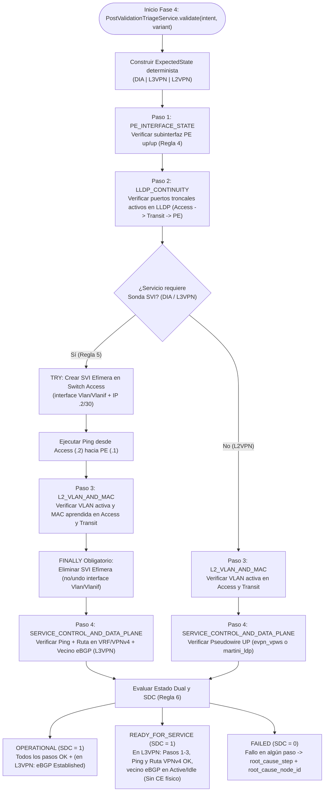

# ADR-011: Validación posdespliegue: Parsers deterministas, Triage en Cascada y Sonda SVI

- Estado: Proposed
- Etapa: E4
- Depende de: ADR-010
- Referencias: IETF RFC 9315 (Intent-Based Networking — Intent Fulfillment & Assurance / Drift Detection); IETF RFC 4364 (BGP/MPLS IP VPNs); IETF RFC 8214 / RFC 4447 (L2VPN EVPN-VPWS / Martini LDP); Documentación oficial Cisco IOS-XE 17.x (`show ip interface brief`, `show lldp neighbors`, `show mac address-table vlan`, `ping`, `show ip route vrf`, `show bgp vpnv4 unicast all`, `show l2vpn evpn vpws`, `show mpls l2transport vc`) y Huawei VRP V200/V600 (`display ip interface brief`, `display lldp neighbor brief`, `display mac-address vlan`, `ping`, `display ip routing-table vpn-instance`, `display bgp vpnv4 all routing-table`, `display evpl instance`, `display mpls l2vc`).
- Walkthrough: docs/walkthroughs/ADR-011.md

---
## PARTE A — DECISIÓN (congelada al aceptar)

### 1. Contexto
Con el transporte de dispositivos (`DeviceTransportPort`), el chequeo Pre-Flight Online (Fase 1B) y el servicio de despliegue secuencial (Fase 3) completados en `ADR-010`, el framework ya es capaz de validar, generar y aplicar configuraciones multivendor (`DIA`, `L3VPN`, `L2VPN`) sobre routers y switches Cisco IOS-XE y Huawei VRP. Corresponde ahora diseñar en la **Etapa E4** el mecanismo que cierra el lazo de control (*Closed-Loop Assurance*): la **Fase 4 (Validación Posdespliegue)**.

En redes Carrier MPLS/L2 multivendor —y particularmente bajo las restricciones físicas del laboratorio de la Universidad de Lima—, verificar que los comandos CLI se enviaron por SSH sin errores de sintaxis (`ServiceDeploymentReport.is_successful == True`) es insuficiente para declarar un servicio operativo (`SDC = 1`, *State Compliance*). Existen cuatro desafíos técnicos que la Fase 4 debe resolver con rigor determinístico:

1. **Verificación activa del plano de datos sin router CE físico (Regla 5 del Contexto Maestro):**
   * En el laboratorio no existen routers CE ni hosts conectados detrás del puerto de demarcación (`customer_port`) de los switches de acceso (`S3-9306-TEST` y `S3-4505-TEST`). En servicios de Capa 3 (`DIA` y `L3VPN`), si ningún dispositivo transmite tramas etiquetadas en la `vlan_id` desde el switch de acceso hacia el PE, la tabla MAC L2 de los switches de acceso y tránsito permanece vacía para esa VLAN y nunca se comprueba el plano de datos real (encapsulación Dot1Q en troncales, terminación VLAN en la subinterfaz del PE y respuesta ICMP en la VRF).
   * Por ello, la **Regla 5** establece que durante la Fase 4 el validador debe aprovisionar dinámicamente una **Sonda SVI Efímera** en el switch de acceso (`interface Vlan<id>` en Cisco IOS-XE / `interface Vlanif<id>` en Huawei VRP) asignándole la dirección IP `.2` (`wan_ce_ip`) de la subred WAN `/30`, ejecutar un `ping` hacia la IP `.1` (`wan_pe_ip` en la subinterfaz del PE), auditar la tabla MAC en los switches L2 y **eliminar obligatoriamente la SVI** (`no interface Vlan<id>` / `undo interface Vlanif<id>`) dentro de un bloque `finally` incondicional para no dejar direccionamiento L3 residual en la capa de acceso.
2. **Evaluación Multicapa y Estado Operativo Dual en `L3VPN` (Regla 6 del Contexto Maestro):**
   * En `L3VPN`, gracias a `redistribute connected` (Cisco IOS-XE) e `import-route direct` (Huawei VRP) incorporados en `ADR-008`, apenas la subinterfaz WAN del PE se levanta en estado `up/up`, el prefijo `/30` se inyecta en MP-BGP VPNv4 con su *Route Distinguisher* (`rd`) y *Route Target* (`rt_export`).
   * Sin embargo, como la Sonda SVI efímera solo existe durante unos segundos para la prueba ICMP y no levanta un demonio BGP, la sesión eBGP PE-CE hacia el vecino `.2` permanecerá en estado `Active`, `Idle` o `Connect` cuando no haya un CE físico conectado, o pasará a `Established` si se conecta un CE. Si el validador exigiera ciegamente `Established`, todas las pruebas de `L3VPN` en el laboratorio sin CE fallarían falsamente (`SDC = 0`).
   * La **Regla 6** resuelve esto definiendo una evaluación multicapa con lógica dual: si (a) la subinterfaz WAN en el PE está `up/up`, (b) el ping desde la Sonda SVI efímera hacia `.1` es exitoso (`100%` / `> 0` paquetes recibidos), y (c) el prefijo WAN `/30` está presente en la tabla VRF/VPNv4 (`show bgp vpnv4 unicast ...` / `display bgp vpnv4 ...` o tabla de enrutamiento de la VRF), entonces el servicio es conforme (`SDC = 1`) con estado `OPERATIONAL` (si la sesión eBGP está `Established`) o `READY_FOR_SERVICE` (si la sesión eBGP está en `Active`/`Idle`/`Connect` esperando al CE físico). Si falla (a), (b) o (c), el estado es `FAILED` (`SDC = 0`).
3. **Verificación del plano de control en `L2VPN` según variante (`evpn_vpws` vs. `martini_ldp`, Regla 7):**
   * En `L2VPN` no existe direccionamiento IP en el circuito de cliente (por lo que no se instancia Sonda SVI L3), pero sí se debe verificar la propagación de la VLAN en `access` y `transit`, el estado `up/up` de la subinterfaz AC en el PE y el estado operativo del circuito virtual en el PE según la variante desplegada: `show l2vpn evpn vpws` / `display evpl instance <evi_id>` para `evpn_vpws` (o `default`), y `show mpls l2transport vc <pw_id>` / `display mpls l2vc <pw_id>` para `martini_ldp`.
4. **Aislamiento de causa raíz mediante *Triage en Cascada*:**
   * Cuando una validación posdespliegue falla, un simple booleano `False` no le indica al operador NOC en qué capa ocurrió el problema. Estructurar la Fase 4 como un pipeline diagnóstico de 4 pasos ordenados (*Triage en Cascada*: `1. CORE_PE_INTERFACE` $\rightarrow$ `2. LLDP_TRUNK_CONTINUITY` $\rightarrow$ `3. L2_VLAN_PROPAGATION_AND_MAC` $\rightarrow$ `4. SERVICE_DATA_AND_CONTROL_PLANE`) permite registrar el resultado individual de cada paso (`TriageStepResult`), identificar exactamente el nodo y la capa del primer fallo (`root_cause_step`, `root_cause_node_id`) y calcular determinísticamente el indicador experimental de la tesis: **State Compliance (`SDC` $\in \{0, 1\}$)**.

### 2. Alternativas
1. **Alternativa 1 — Verificación monolítica por expresiones regulares acopladas dentro del servicio de despliegue (`DeploymentService`) sin modelo de `ExpectedState` ni `ObservedState`:**
   * *Descripción:* Añadir al final de `DeploymentService.deploy()` un bloque condicional que ejecute un único comando `show`/`display` en el PE, busque con un `if "up" in output:` si la interfaz levantó y devuelva un booleano.
   * *Ventajas:* Implementación mínima en un solo archivo.
   * *Desventajas:* Incumple el diseño arquitectónico del Contexto Maestro (que exige separar Fase 3 y Fase 4, contrastar `ExpectedState` vs. `ObservedState`, ejecutar el *Triage en Cascada* de 4 pasos y gestionar la Sonda SVI Efímera con limpieza `finally`); no permite ejecutar `intentfabric verify` de forma independiente; e impide distinguir `OPERATIONAL` de `READY_FOR_SERVICE` en `L3VPN`.

2. **Alternativa 2 — Motor de Validación Posdespliegue desacoplado (`PostValidationTriageService`) con constructores de `ExpectedState` por servicio, parsers CLI deterministas, Sonda SVI Efímera protegida por `try/finally` y evaluador de cumplimiento `SDC` (`OPERATIONAL` / `READY_FOR_SERVICE` / `FAILED`):**
   * *Descripción:*
     * **Modelos inmutables de dominio (`src/intentfabric/domain/post_validation.py`):**
       * `class ServiceOperationalStatus(StrEnum)`: `OPERATIONAL = "OPERATIONAL"`, `READY_FOR_SERVICE = "READY_FOR_SERVICE"`, `FAILED = "FAILED"`.
       * `class TriageStepName(StrEnum)`:
         1. `PE_INTERFACE_STATE = "pe_interface_state"` (Estado administrativo y de protocolo `up/up` de la subinterfaz del servicio en el PE).
         2. `LLDP_CONTINUITY = "lldp_continuity"` (Vecindad LLDP activa en los enlaces troncales `Access -> Transit* -> PE`).
         3. `L2_VLAN_AND_MAC = "l2_vlan_and_mac"` (Existencia de `vlan_id` en switches `access`/`transit` y aprendizaje de MAC en la VLAN tras activar tráfico/sonda).
         4. `SERVICE_CONTROL_AND_DATA_PLANE = "service_control_and_data_plane"` (Sonda SVI Efímera + Ping `.2 -> .1` + Ruta/BGP/Pseudowire en PE según servicio).
       * `@dataclass(frozen=True, slots=True) class ExpectedState`: define de forma declarativa e inmutable qué estado operativo debe observarse para un `intent` y `variant` dados (`service_id`, `service_type`, `variant`, `vlan_id`, `pe_node_id`, `pe_subinterface`, `expected_lldp_links`, `requires_svi_probe: bool`, `svi_interface: str | None`, `svi_ip_cidr: str | None`, `ping_target_ip: str | None`, `vrf_name: str | None`, `expected_route_prefix: str | None`, `bgp_neighbor_ip: str | None`, `pw_id: int | None`, `evi_id: int | None`).
       * `@dataclass(frozen=True, slots=True) class ObservedState`: captura las evidencias normalizadas extraídas de los dispositivos (`pe_subinterface_up: bool`, `lldp_links_up: tuple[tuple[str, str], ...]`, `active_vlan_nodes: tuple[str, ...]`, `mac_learned_nodes: tuple[str, ...]`, `svi_ping_success: bool | None`, `svi_cleaned_up: bool`, `control_plane_route_or_vc_up: bool`, `ebgp_neighbor_state: str | None`).
       * `@dataclass(frozen=True, slots=True) class TriageStepResult`: resultado de un paso del triage (`step: TriageStepName`, `passed: bool`, `node_id: str`, `details: str`, `commands_executed: tuple[str, ...]`).
       * `@dataclass(frozen=True, slots=True) class PostValidationReport`: reporte final inmutable (`service_id`, `service_type`, `variant`, `status: ServiceOperationalStatus`, `sdc: int` donde `sdc == 1` si `status in (OPERATIONAL, READY_FOR_SERVICE)` y `0` si `FAILED`, `expected_state: ExpectedState`, `observed_state: ObservedState`, `steps: tuple[TriageStepResult, ...]`, `root_cause_step: TriageStepName | None`, `root_cause_node_id: str | None`, con método `to_dict()`).
     * **Constructores de `ExpectedState` (`expected_state.py` o función pura en `domain/post_validation.py`):**
       * Construye determinísticamente `ExpectedState` a partir de `DiaIntent`, `L3VpnIntent` o `L2VpnIntent` y el `TopologyCatalog`:
         * Para `DIA` y `L3VPN`: `requires_svi_probe=True`, `svi_interface = "Vlan{vlan_id}"` (Cisco) o `"Vlanif{vlan_id}"` (Huawei), `svi_ip_cidr = f"{wan_ce_ip}/30"`, `ping_target_ip = str(wan_pe_ip)`. En `DIA`, `expected_route_prefix = str(intent.lan_network)`. En `L3VPN`, `expected_route_prefix = str(intent.wan_network)` y `bgp_neighbor_ip = str(wan_ce_ip)`.
         * Para `L2VPN`: `requires_svi_probe=False`, `pw_id = intent.pw_id`, `evi_id = intent.evi_id`.
     * **Parsers Deterministas de Salidas CLI (`src/intentfabric/application/post_validation.py`):**
       * Funciones puras `stdlib` que normalizan interfaces con `normalize_interface_name` (Regla 4) para evaluar:
         1. `parse_interface_is_up(output: str, vendor: str, interface_name: str) -> bool` (`show ip interface brief` / `display interface brief`, verificando estado físico y de protocolo `up`/`up` o `up`/`up(s)`).
         2. `parse_lldp_neighbor_ports(output: str, vendor: str) -> frozenset[str]` (`show lldp neighbors` / `display lldp neighbor brief`, extrayendo las interfaces locales canónicas que tienen vecino LLDP activo).
         3. `parse_vlan_mac_count(output: str, vendor: str, vlan_id: int) -> int` (`show mac address-table vlan <id>` / `display mac-address vlan <id>`, contando entradas MAC aprendidas en esa VLAN).
         4. `parse_ping_success(output: str, vendor: str) -> bool` (`Success rate is (\d+) percent` con porcentaje $> 0$ en Cisco; `(\d+)\s+packet\(s\)\s+received` con recibidos $> 0$ o `0.00% packet loss` en Huawei).
         5. `parse_vrf_route_present(output: str, vendor: str, prefix: str) -> bool` (`show ip route vrf <vrf>` / `show bgp vpnv4 unicast all` en Cisco; `display ip routing-table vpn-instance <vrf>` / `display bgp vpnv4 all routing-table` en Huawei).
         6. `parse_bgp_neighbor_state(output: str, vendor: str, neighbor_ip: str) -> str | None` (`show bgp vpnv4 unicast vrf <vrf> summary` en Cisco; `display bgp vpnv4 vpn-instance <vrf> peer` en Huawei, devolviendo `"Established"` cuando la columna `State/PfxRcd` es numérica o `"Established"`, o el estado textual `"Active"`, `"Idle"`, `"Connect"`).
         7. `parse_l2vpn_circuit_up(output: str, vendor: str, variant: str, *, pw_id: int, evi_id: int) -> bool` (`show l2vpn evpn vpws` / `display evpl instance <evi_id>` para `evpn_vpws`/`default`; `show mpls l2transport vc <pw_id>` / `display mpls l2vc <pw_id>` para `martini_ldp`).
     * **Ciclo de Vida Garantizado de la Sonda SVI Efímera (Regla 5):**
       * En `PostValidationTriageService.validate(intent, *, variant="default")`:
         * Cuando `expected.requires_svi_probe` es `True` (`DIA` y `L3VPN`), abre un bloque `try ... finally` sobre el nodo `access`:
           * En `try`: envía `push_configuration` para crear la SVI efímera (`interface Vlan<id>` + `ip address <ce_ip> 255.255.255.252` + `no shutdown` en Cisco; `interface Vlanif<id>` + `ip address <ce_ip> 255.255.255.252` + `undo shutdown` en Huawei), ejecuta `ping` desde `access` hacia `wan_pe_ip`, y consulta las tablas MAC en `access` y `transit` mientras la SVI acaba de generar tráfico ARP/ICMP sobre la VLAN.
           * En `finally`: ejecuta **siempre** `push_configuration` en `access` con `("no interface Vlan<id>",)` (Cisco) o `("undo interface Vlanif<id>",)` (Huawei), registrando `svi_cleaned_up=True` (o lanzando `EphemeralProbeCleanupError` si el transporte falla al limpiar la SVI, sin ocultar la causa).
   * *Ventajas:* Cumple estrictamente las Reglas 1, 4, 5, 6 y 7 del Contexto Maestro; mantiene 0 dependencias externas en `domain/` y `application/` (`test_architecture.py`); garantiza por construcción (`try/finally`) que jamás quede una SVI efímera olvidada en los switches de acceso del laboratorio; y entrega el cálculo exacto de `SDC` ($\in \{0, 1\}$) y la clasificación dual `OPERATIONAL` / `READY_FOR_SERVICE` requerida para el capítulo experimental de la tesis.
   * *Desventajas:* Requiere cubrir los formatos de salida CLI de `ping`, `lldp`, `mac-address`, `vrf/bgp` y `l2vpn` en ambos fabricantes mediante fixtures representativos en `tests/fixtures/post_validation/`.

### 3. Criterios de elección
* **Cumplimiento de la Regla 5 (Invariante de Limpieza de Sonda SVI Efímera):** La eliminación de la interfaz `Vlan<id>` / `Vlanif<id>` en el switch de acceso debe ejecutarse en un bloque `finally` garantizado, incluso si el comando `ping` falla o si la consulta de tablas MAC lanza una excepción de transporte.
* **Cumplimiento de la Regla 6 (Lógica Dual en L3VPN):** El motor debe distinguir entre un fallo real de aprovisionamiento (`FAILED`, `SDC = 0` cuando la subinterfaz está caída, el ping SVI falla o el prefijo `/30` no se inyectó en la VRF/MP-BGP) y la ausencia esperada del equipo CE en el laboratorio (`READY_FOR_SERVICE`, `SDC = 1` cuando subinterfaz, ping SVI y ruta VPNv4 cumplen, pero el vecino eBGP `.2` está en `Active`/`Idle`), pasando a `OPERATIONAL` (`SDC = 1`) cuando el vecino alcanza `Established`.
* **Diagnóstico Determinista por Capas (*Triage en Cascada*):** Los 4 pasos del triage deben ejecutarse y registrarse en orden canónico, identificando en `PostValidationReport.root_cause_step` y `root_cause_node_id` el primer eslabón que incumplió el `ExpectedState`.

### 4. Decisión
Adoptamos la **Alternativa 2**: crear los modelos inmutables `ExpectedState`, `ObservedState`, `TriageStepResult`, `PostValidationReport` y `ServiceOperationalStatus` en `src/intentfabric/domain/post_validation.py`; implementar los parsers deterministas de verificación y el servicio `PostValidationTriageService` (con gestión `try/finally` de la Sonda SVI Efímera y cálculo de `SDC`) en `src/intentfabric/application/post_validation.py`; registrar su factoría en `src/intentfabric/bootstrap.py`; y verificar todos los escenarios (`OPERATIONAL`, `READY_FOR_SERVICE`, `FAILED` y limpieza `finally` ante fallos) con fixtures reales en `tests/fixtures/post_validation/`.

### 5. Sustento
1. **Resolución del problema metodológico de validación sin CE en la tesis:** En un laboratorio académico sin routers CE por cada orden de servicio, la combinación de la **Sonda SVI Efímera** (que inyecta tráfico real etiquetado desde el borde del switch de acceso a través del switch de tránsito hasta la subinterfaz del PE) con la **evaluación dual `OPERATIONAL` / `READY_FOR_SERVICE`** permite demostrar empíricamente ante el jurado tanto la continuidad del plano de datos L2/L3 como la propagación del plano de control MPLS/VPNv4.
2. **Seguridad operativa mediante limpieza `finally`:** Al encapsular la creación y destrucción de la SVI dentro de un bloque `try ... finally` en `PostValidationTriageService`, el estado de configuración de los switches de acceso permanece idéntico antes y después de ejecutar la Fase 4.
3. **Métrica cuantitativa directa para el capítulo de resultados (`SDC`):** El atributo `PostValidationReport.sdc` (`1` o `0`) junto con `status` y el desglose de `steps` alimenta directamente el `ExecutionRecord` que consolidará el `ADR-012`.

### 6. Consecuencias y riesgos aceptados
* **Dependencia de permisos de configuración durante la Fase 4 para `DIA` y `L3VPN`:** A diferencia de `L2VPN` (donde la Fase 4 solo ejecuta comandos `show`/`display`), en `DIA` y `L3VPN` la Fase 4 requiere usar `push_configuration` sobre el switch de acceso exclusivamente para crear y remover la Sonda SVI Efímera (Regla 5).
* **Evaluación de aprendizaje MAC en `L2VPN` sin tráfico activo:** Dado que en `L2VPN` no se instancia SVI L3 ni hay CE transmitiendo tramas en el puerto de acceso, el Paso 3 en `L2VPN` verifica obligatoriamente que la `vlan_id` esté activa en la base de datos de VLANs de todos los switches L2 (`access` y `transit`) y registra las MACs observadas sin fallar si el contador MAC es `0` por ausencia de CE, mientras que en `DIA` y `L3VPN` (donde la Sonda SVI acaba de ejecutar `ping` a través de la VLAN) sí exige `mac_count > 0` o `svi_ping_success == True`.