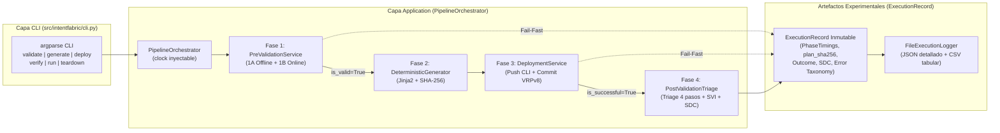

# ADR-012: Orquestador del Pipeline de 4 Fases, Registro Experimental y CLI `intentfabric`

- Estado: Proposed
- Etapa: E4
- Depende de: ADR-011
- Referencias: IETF RFC 9315 (Intent-Based Networking — Closed-Loop Lifecycle & Telemetry); Documentación estándar de Python 3.14 (`argparse`, `time.perf_counter`, `csv`, `json`).
- Walkthrough: docs/walkthroughs/ADR-012.md

---
## PARTE A — DECISIÓN (congelada al aceptar)

### 1. Contexto
Con las cuatro fases del framework implementadas individualmente en los ADRs precedentes —Fase 1 (`PreValidationService` + `OnlinePreFlightChecker` en `ADR-005`/`ADR-010`), Fase 2 (`DeterministicGeneratorService` en `ADR-006`), Fase 3 (`DeploymentService` en `ADR-010`) y Fase 4 (`PostValidationTriageService` en `ADR-011`)— junto con los tres servicios (`DIA`, `L3VPN`, `L2VPN`) y el catálogo topológico (`ADR-007`), corresponde cerrar la **Etapa E4 (y el MVP completo del proyecto)** mediante tres componentes de integración final:

1. **Orquestación de Ciclo Cerrado (`PipelineOrchestrator`):**
   * Actualmente cada fase existe como un servicio de aplicación independiente. Se requiere un orquestador en `application/orchestrator.py` que coordine la secuencia inmutable de la **Regla 1** (`Fase 1 -> Fase 2 -> Fase 3 -> Fase 4`), garantizando el corte temprano (`Fail-Fast`) si falla la Fase 1 (sin invocar Fase 2, 3 ni 4), si falla la Fase 3 (registrando los resultados parciales sin invocar Fase 4), o ejecutando el retiro limpio del servicio (`teardown`: Generación de plantilla `teardown` + Despliegue en la ruta).
2. **Instrumentación Experimental y Exportación de Métricas de Tesis (`ExecutionRecord` y `ExecutionLoggerPort`):**
   * Para sustentar cuantitativamente la tesis ante el jurado (evaluaciones TI2 y TI3), cada ejecución del pipeline debe medir con precisión los tiempos de cada fase (`phase1_validation_ms`, `phase2_generation_ms`, `phase3_deployment_ms`, `phase4_post_validation_ms`, `total_duration_ms`), conservar la huella criptográfica de la configuración (`plan_sha256`), el estado operativo alcanzado (`OPERATIONAL`, `READY_FOR_SERVICE`, `FAILED`, `TEARDOWN_COMPLETED`, `REJECTED_PRE_VALIDATION`, `DEPLOYMENT_FAILED`), el indicador de cumplimiento de estado (`sdc` $\in \{0, 1\}$) y la taxonomía del error o causa raíz (`error_code`, `failure_stage`, `root_cause_node_id`).
   * Al mismo tiempo, `AGENTS.md` exige **determinismo en las pruebas**: el reloj utilizado para medir duraciones no puede acoplarse de forma rígida al reloj del sistema en las pruebas unitarias, sino inyectarse como `clock: Callable[[], float] = time.perf_counter` para que en pruebas se puedan verificar tiempos deterministas exactos sin acoplarse a la carga de CPU.
3. **Interfaz de Línea de Comandos (`intentfabric CLI`) respetando las fronteras de `test_architecture.py`:**
   * Los operadores NOC y el arnés experimental interactúan mediante la CLI nativa basada en `argparse` con los subcomandos del ciclo de vida: `validate` (Fase 1), `generate` (Fase 1A + Fase 2), `deploy` (Fase 1 + Fase 2 + Fase 3), `verify` (Fase 4 independiente), `run` (Ciclo completo de 4 fases) y `teardown` (Generación `teardown` + Despliegue `teardown`).
   * Según `ADR-001` y `tests/unit/test_architecture.py`, la capa `cli` solo puede importar de `("cli", "domain", "application", "bootstrap")` y `stdlib` (nunca de `adapters/` directamente), por lo que `bootstrap.py` debe proveer las funciones de composición que conectan la carga de archivos, el transporte (`netmiko` o `simulated`) y el logger de ejecuciones (`json`/`csv`).

### 2. Alternativas
1. **Alternativa 1 — Script CLI monolítico que encadena llamadas manuales a los servicios e imprime texto libre por consola:**
   * *Descripción:* Escribir la secuencia `if/else` de las 4 fases directamente dentro de la función `main()` de `cli.py`, midiendo el tiempo global al inicio y al final del script e imprimiendo mensajes no estructurados con `print()`.
   * *Ventajas:* Menor cantidad de clases.
   * *Desventajas:* Viola la Arquitectura Hexagonal al trasladar la lógica de coordinación del negocio y el manejo de errores entre fases a la capa de presentación (`cli`); impide invocar el pipeline completo programáticamente desde pruebas de integración sin pasar por `sys.argv`; y no genera artefactos estructurados (`.json` y `.csv`) para el análisis estadístico de la campaña experimental de la tesis.

2. **Alternativa 2 — `PipelineOrchestrator` en `application/`, modelo inmutable `ExecutionRecord` en `domain/`, puerto `ExecutionLoggerPort` con adaptador JSON/CSV en `adapters/` y CLI `argparse` declarativa en `cli/`:**
   * *Descripción:*
     * **Modelos de Dominio de Ejecución (`src/intentfabric/domain/execution.py`):**
       * `class PipelineOutcome(StrEnum)`:
         * `VALIDATED = "VALIDATED"`
         * `GENERATED = "GENERATED"`
         * `DEPLOYED = "DEPLOYED"`
         * `OPERATIONAL = "OPERATIONAL"`
         * `READY_FOR_SERVICE = "READY_FOR_SERVICE"`
         * `TEARDOWN_COMPLETED = "TEARDOWN_COMPLETED"`
         * `REJECTED_PRE_VALIDATION = "REJECTED_PRE_VALIDATION"`
         * `DEPLOYMENT_FAILED = "DEPLOYMENT_FAILED"`
         * `POST_VALIDATION_FAILED = "POST_VALIDATION_FAILED"`
       * `@dataclass(frozen=True, slots=True) class PhaseTimings`:
         * `phase1_validation_ms: float = 0.0`
         * `phase2_generation_ms: float = 0.0`
         * `phase3_deployment_ms: float = 0.0`
         * `phase4_post_validation_ms: float = 0.0`
         * `total_duration_ms: float = 0.0`
       * `@dataclass(frozen=True, slots=True) class ExecutionRecord`:
         * Encapsula toda la evidencia de una corrida del pipeline: `service_id`, `service_type`, `operation`, `variant`, `outcome: PipelineOutcome`, `is_successful: bool`, `sdc: int | None` (`1` o `0` cuando se ejecuta Fase 4, `None` en operaciones que no ejecutan Fase 4 como `validate`, `generate` o `teardown`), `plan_sha256: str | None`, `timings: PhaseTimings`, `failure_stage: str | None`, `error_code: str | None`, `root_cause_node_id: str | None`, `validation_report: ValidationReport | None`, `generation_plan: ServiceGenerationPlan | None`, `deployment_report: ServiceDeploymentReport | None`, `post_validation_report: PostValidationReport | None`.
         * Incluye `to_dict()` (para exportación JSON completa) y `to_csv_row()` + `CSV_HEADERS` (para agregar una fila plana al dataset experimental CSV de la tesis).
     * **Puerto de Registro y Orquestador (`src/intentfabric/application/orchestrator.py`):**
       * `class ExecutionLoggerPort(Protocol)`: `def record(self, execution: ExecutionRecord) -> None: ...` (con implementación `NoOpExecutionLogger` por defecto).
       * `class PipelineOrchestrator`: recibe `catalog: PluginCatalog`, `pre_validator: PreValidationService`, `generator: DeterministicGeneratorService`, `deployment_service: DeploymentService | None = None`, `post_validator: PostValidationTriageService | None = None`, `logger: ExecutionLoggerPort | None = None` y `clock: Callable[[], float] = time.perf_counter`.
       * Expone los casos de uso de alto nivel (todos registrando automáticamente el `ExecutionRecord` en `self._logger` antes de retornar):
         1. `validate(intent_or_raw, *, variant="default") -> ExecutionRecord` (Fase 1: 1A + 1B si hay transporte configurado).
         2. `generate(intent_or_raw, *, operation=Operation.PROVISION, variant="default") -> ExecutionRecord` (Fase 1 + Fase 2).
         3. `deploy(intent_or_raw, *, operation=Operation.PROVISION, variant="default") -> ExecutionRecord` (Fase 1 + Fase 2 + Fase 3, con corte inmediato si Fase 1 es inválida o si Fase 3 lanza `DeploymentError`).
         4. `verify(intent_or_raw, *, variant="default") -> ExecutionRecord` (Fase 4 directa para auditoría bajo demanda de un servicio ya desplegado).
         5. `run(intent_or_raw, *, variant="default") -> ExecutionRecord` (Ciclo cerrado completo de aprovisionamiento: Fase 1 $\rightarrow$ Fase 2 $\rightarrow$ Fase 3 $\rightarrow$ Fase 4).
         6. `teardown(intent_or_raw, *, variant="default") -> ExecutionRecord` (Retiro determinista de servicio: validación estática de plantilla `teardown` $\rightarrow$ Fase 2 con `Operation.TEARDOWN` $\rightarrow$ Fase 3 `deploy(plan)`).
     * **Adaptador de Persistencia Experimental (`src/intentfabric/adapters/execution_logger.py`):**
       * `FileExecutionLogger(ExecutionLoggerPort)`: escribe el reporte detallado en JSON (`UTF-8`, `\n`) y/o añade la fila de métricas a un archivo CSV acumulativo (`summary.csv` con `CSV_HEADERS`), ideal para procesar las corridas experimentales de TI2/TI3.
     * **Entrypoint CLI (`src/intentfabric/cli.py` y `[project.scripts]` en `pyproject.toml`):**
       * Implementa con `argparse` los subcomandos `validate`, `generate`, `deploy`, `verify`, `run` y `teardown`, soportando banderas `--intent`, `--topology`, `--variant`, `--transport {simulated,ssh}`, `--json-out` y `--csv-out`, devolviendo código de salida `0` si `record.is_successful` es `True` y `1` (o `2` ante errores de argumentos/archivos) si falla.
   * *Ventajas:* Cumple estrictamente la Regla 1 del Contexto Maestro y todas las reglas de capas de `tests/unit/test_architecture.py`; garantiza determinismo en pruebas mediante la inyección de `clock`; y entrega listo el instrumento de recolección de datos (`JSON` + `CSV` con tiempos por fase, hashes `SHA-256`, taxonomía de fallos y `SDC`) para el capítulo experimental de la tesis.
   * *Desventajas:* Añade un módulo en `domain/` (`execution.py`), uno en `application/` (`orchestrator.py`), uno en `adapters/` (`execution_logger.py`) y el módulo `cli.py`.

### 3. Criterios de elección
* **Cumplimiento de la Regla 1 (Secuencia de 4 Fases y Cortocircuito `Fail-Fast`):** `PipelineOrchestrator.run()` debe garantizar que ningún error en Fase 1 permita avanzar a Fase 2/3, y ningún error en Fase 3 permita avanzar a Fase 4, capturando siempre un `ExecutionRecord` completo con la etapa exacta de fallo (`failure_stage`) y el código taxonómico (`error_code`).
* **Trazabilidad Experimental Determinista:** Los tiempos por fase deben calcularse mediante un reloj monotónico inyectable (`clock`), permitiendo pruebas unitarias 100% deterministas y exportación directa a CSV/JSON sin marcas de tiempo aleatorias en los hashes.
* **Respeto Estricto a `test_architecture.py`:** `src/intentfabric/cli.py` solo importa de `domain`, `application`, `bootstrap` y `stdlib`, delegando en `bootstrap.py` la construcción del orquestador y sus adaptadores.

### 4. Decisión
Adoptamos la **Alternativa 2**: crear `PhaseTimings`, `PipelineOutcome` y `ExecutionRecord` en `src/intentfabric/domain/execution.py`; implementar `ExecutionLoggerPort` y `PipelineOrchestrator` en `src/intentfabric/application/orchestrator.py`; implementar `FileExecutionLogger` (JSON/CSV) en `src/intentfabric/adapters/execution_logger.py`; exponer las factorías de composición en `src/intentfabric/bootstrap.py`; e implementar la interfaz de línea de comandos en `src/intentfabric/cli.py` registrada como entrypoint `intentfabric` en `pyproject.toml`.

### 5. Sustento
1. **Cierre cohesivo de la arquitectura hexagonal:** `PipelineOrchestrator` actúa como la fachada de aplicación única para todo el ciclo de vida del servicio (`validate`, `generate`, `deploy`, `verify`, `run`, `teardown`), manteniendo `cli.py` como un adaptador primario delgado que traduce argumentos de consola a llamadas al orquestador y formatea el código de salida.
2. **Instrumentación lista para defensa de tesis (TI2 y TI3):** Al generar de forma nativa tanto el reporte JSON completo de cada corrida como filas tabulares CSV (`service_id`, `service_type`, `operation`, `variant`, `outcome`, `is_successful`, `sdc`, `plan_sha256`, tiempos de las 4 fases en ms, `failure_stage`, `error_code`, `root_cause_node_id`), el autor puede ejecutar lotes de intenciones válidas e inválidas y obtener inmediatamente las tablas de resultados del documento de tesis.
3. **Limpieza determinista del laboratorio mediante `teardown`:** El subcomando `intentfabric teardown` automatiza la generación y el envío de las plantillas `teardown` de `DIA`, `L3VPN` y `L2VPN`, permitiendo restaurar los switches y routers del laboratorio en segundos entre pruebas experimentales.

### 6. Consecuencias y riesgos aceptados
* **Registro del script `intentfabric` en `pyproject.toml`:** Se añade la tabla `[project.scripts]` con `intentfabric = "intentfabric.cli:main"` en `pyproject.toml` sin agregar ninguna dependencia nueva ni modificar `requirements.lock`.
* **Comportamiento de `teardown` frente a Pre-Flight Online:** En la operación `teardown`, el objetivo es retirar recursos que ya están configurados en los equipos (la VLAN y la subinterfaz sí existen en la red porque pertenecen al servicio que se va a desmontar). Por ello, `PipelineOrchestrator.teardown()` valida la intención de forma estática (Subfase 1A para operación `teardown`, sin rechazar que la VLAN o subinterfaz esté presente en 1B), genera el `ServiceGenerationPlan` con `Operation.TEARDOWN` y lo despliega mediante `DeploymentService`.