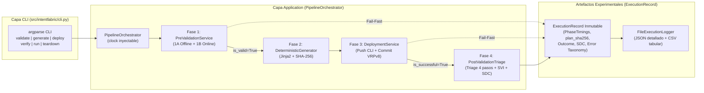

# ADR-012: Orquestador del Pipeline de 4 Fases, Registro Experimental y CLI `intentfabric`

- Estado: Accepted (aprobado el 29-10-2026)
- Etapa: E4
- Depende de: ADR-011
- Referencias: IETF RFC 9315 (Intent-Based Networking — Closed-Loop Lifecycle & Telemetry); Documentación estándar de Python 3.14 (`argparse`, `time.perf_counter`, `csv`, `json`).
- Walkthrough: docs/walkthroughs/ADR-012.md

---
## PARTE A — DECISIÓN (congelada al aceptar)

### 1. Contexto
Con las cuatro fases del framework implementadas individualmente en los ADRs precedentes —Fase 1 (`PreValidationService` + `OnlinePreFlightChecker` en `ADR-005`/`ADR-010`), Fase 2 (`DeterministicGeneratorService` en `ADR-006`), Fase 3 (`DeploymentService` en `ADR-010`) y Fase 4 (`PostValidationTriageService` en `ADR-011`)— junto con los tres servicios (`DIA`, `L3VPN`, `L2VPN`) y el catálogo topológico (`ADR-007`), corresponde cerrar la **Etapa E4 (y el MVP completo del proyecto)** mediante tres componentes de integración final:

1. **Orquestación de Ciclo Cerrado (`PipelineOrchestrator`):**
   * Actualmente cada fase existe como un servicio de aplicación independiente. Se requiere un orquestador en `application/orchestrator.py` que coordine la secuencia inmutable de la **Regla 1** (`Fase 1 -> Fase 2 -> Fase 3 -> Fase 4`), garantizando el corte temprano (`Fail-Fast`) si falla la Fase 1 (sin invocar Fase 2, 3 ni 4), si falla la Fase 3 (registrando los resultados parciales sin invocar Fase 4), o ejecutando el retiro limpio del servicio (`teardown`: Generación de plantilla `teardown` + Despliegue en la ruta).
2. **Instrumentación Experimental y Exportación de Métricas de Tesis (`ExecutionRecord` y `ExecutionLoggerPort`):**
   * Para sustentar cuantitativamente la tesis ante el jurado (evaluaciones TI2 y TI3), cada ejecución del pipeline debe medir con precisión los tiempos de cada fase (`phase1_validation_ms`, `phase2_generation_ms`, `phase3_deployment_ms`, `phase4_post_validation_ms`, `total_duration_ms`), conservar la huella criptográfica de la configuración (`plan_sha256`), el estado operativo alcanzado (`OPERATIONAL`, `READY_FOR_SERVICE`, `POST_VALIDATION_FAILED`, `TEARDOWN_COMPLETED`, `REJECTED_PRE_VALIDATION`, `DEPLOYMENT_FAILED`), el indicador de cumplimiento de estado (`sdc` $\in \{0, 1\}$) y la taxonomía del error o causa raíz (`error_code`, `failure_stage`, `root_cause_node_id`).
   * Al mismo tiempo, `AGENTS.md` exige **determinismo en las pruebas**: el reloj utilizado para medir duraciones no puede acoplarse de forma rígida al reloj del sistema en las pruebas unitarias, sino inyectarse como `clock: Callable[[], float] = time.perf_counter` para que en pruebas se puedan verificar tiempos deterministas exactos sin acoplarse a la carga de CPU.
3. **Interfaz de Línea de Comandos (`intentfabric CLI`) respetando las fronteras de `test_architecture.py`:**
   * Los operadores NOC y el arnés experimental interactúan mediante la CLI nativa basada en `argparse` con los subcomandos del ciclo de vida: `validate` (Fase 1), `generate` (Fase 1A + Fase 2), `deploy` (Fase 1 + Fase 2 + Fase 3), `verify` (Fase 4 independiente), `run` (Ciclo completo de 4 fases) y `teardown` (Generación `teardown` + Despliegue `teardown`).
   * Según `ADR-001` y `tests/unit/test_architecture.py`, la capa `cli` solo puede importar de `("cli", "domain", "application", "bootstrap")` y `stdlib` (nunca de `adapters/` directamente), por lo que `bootstrap.py` debe proveer las funciones de composición que conectan la carga de archivos, el transporte (`netmiko` o `simulated`) y el logger de ejecuciones (`json`/`csv`).

### 2. Alternativas
1. **Alternativa 1 — Script CLI monolítico que encadena llamadas manuales a los servicios e imprime texto libre por consola:**
   * *Descripción:* Escribir la secuencia `if/else` de las 4 fases directamente dentro de la función `main()` de `cli.py`, midiendo el tiempo global al inicio y al final del script e imprimiendo mensajes no estructurados con `print()`.
   * *Ventajas:* Menor cantidad de clases.
   * *Desventajas:* Viola la Arquitectura Hexagonal al trasladar la lógica de coordinación del negocio y el manejo de errores entre fases a la capa de presentación (`cli`); impide invocar el pipeline completo programáticamente desde pruebas de integración sin pasar por `sys.argv`; y no genera artefactos estructurados (`.json` y `.csv`) para el análisis estadístico de la campaña experimental de la tesis.

2. **Alternativa 2 — `PipelineOrchestrator` en `application/`, modelo inmutable `ExecutionRecord` en `domain/`, puerto `ExecutionLoggerPort` con adaptador JSON/CSV en `adapters/` y CLI `argparse` declarativa en `cli.py`:**
   * *Descripción:*
     * **Modelos de Dominio de Ejecución (`src/intentfabric/domain/execution.py`):**
       * `class PipelineOutcome(StrEnum)`:
         * `VALIDATED = "VALIDATED"`
         * `GENERATED = "GENERATED"`
         * `DEPLOYED = "DEPLOYED"`
         * `OPERATIONAL = "OPERATIONAL"`
         * `READY_FOR_SERVICE = "READY_FOR_SERVICE"`
         * `TEARDOWN_COMPLETED = "TEARDOWN_COMPLETED"`
         * `REJECTED_PRE_VALIDATION = "REJECTED_PRE_VALIDATION"`
         * `DEPLOYMENT_FAILED = "DEPLOYMENT_FAILED"`
         * `POST_VALIDATION_FAILED = "POST_VALIDATION_FAILED"`
       * `@dataclass(frozen=True, slots=True) class PhaseTimings`:
         * `phase1_validation_ms: float = 0.0`
         * `phase2_generation_ms: float = 0.0`
         * `phase3_deployment_ms: float = 0.0`
         * `phase4_post_validation_ms: float = 0.0`
         * `total_duration_ms: float = 0.0`
       * `@dataclass(frozen=True, slots=True) class ExecutionRecord`:
         * Encapsula toda la evidencia de una corrida del pipeline: `service_id`, `service_type`, `operation`, `variant`, `outcome: PipelineOutcome`, `is_successful: bool`, `sdc: int | None` (`1` o `0` cuando se ejecuta Fase 4, `None` en operaciones que no ejecutan Fase 4 como `validate`, `generate`, `deploy` o `teardown`), `plan_sha256: str | None`, `timings: PhaseTimings`, `failure_stage: str | None`, `error_code: str | None`, `root_cause_node_id: str | None`, `validation_report: ValidationReport | None`, `generation_plan: ServiceGenerationPlan | None`, `deployment_report: ServiceDeploymentReport | None`, `post_validation_report: PostValidationReport | None`.
         * Incluye `to_dict()` (para exportación JSON completa) y `to_csv_row()` + `CSV_HEADERS` (para agregar una fila plana al dataset experimental CSV de la tesis).
     * **Puerto de Registro y Orquestador (`src/intentfabric/application/orchestrator.py`):**
       * `class ExecutionLoggerPort(Protocol)`: `def record(self, execution: ExecutionRecord) -> None: ...` (con implementación `NoOpExecutionLogger` por defecto).
       * `class PipelineOrchestrator`: recibe `catalog: PluginCatalog`, `pre_validator: PreValidationService`, `generator: DeterministicGeneratorService`, `deployment_service: DeploymentService | None = None`, `post_validator: PostValidationTriageService | None = None`, `logger: ExecutionLoggerPort | None = None` y `clock: Callable[[], float] = time.perf_counter`.
       * Expone los casos de uso de alto nivel (todos registrando automáticamente el `ExecutionRecord` en `self._logger` antes de retornar):
         1. `validate(intent_or_raw, *, variant="default") -> ExecutionRecord` (Fase 1: 1A + 1B si hay transporte configurado).
         2. `generate(intent_or_raw, *, operation=Operation.PROVISION, variant="default") -> ExecutionRecord` (Fase 1 + Fase 2).
         3. `deploy(intent_or_raw, *, operation=Operation.PROVISION, variant="default") -> ExecutionRecord` (Fase 1 + Fase 2 + Fase 3, con corte inmediato si Fase 1 es inválida o si Fase 3 lanza `DeploymentError`).
         4. `verify(intent_or_raw, *, variant="default") -> ExecutionRecord` (Fase 4 directa para auditoría bajo demanda de un servicio ya desplegado).
         5. `run(intent_or_raw, *, variant="default") -> ExecutionRecord` (Ciclo cerrado completo de aprovisionamiento: Fase 1 $\rightarrow$ Fase 2 $\rightarrow$ Fase 3 $\rightarrow$ Fase 4).
         6. `teardown(intent_or_raw, *, variant="default") -> ExecutionRecord` (Retiro determinista de servicio: validación estática de plantilla `teardown` $\rightarrow$ Fase 2 con `Operation.TEARDOWN` $\rightarrow$ Fase 3 `deploy(plan)`).
     * **Adaptador de Persistencia Experimental (`src/intentfabric/adapters/execution_logger.py`):**
       * `FileExecutionLogger(ExecutionLoggerPort)`: escribe el reporte detallado en JSON (`UTF-8`, `\n`) y/o añade la fila de métricas a un archivo CSV acumulativo (`summary.csv` con `CSV_HEADERS`), ideal para procesar las corridas experimentales de TI2/TI3.
     * **Entrypoint CLI (`src/intentfabric/cli.py` y `[project.scripts]` en `pyproject.toml`):**
       * Implementa con `argparse` los subcomandos `validate`, `generate`, `deploy`, `verify`, `run` y `teardown`, soportando banderas `--intent`, `--topology`, `--variant`, `--transport {simulated,ssh}`, `--json-out` y `--csv-out`, devolviendo código de salida `0` si `record.is_successful` es `True` y `1` (o `2` ante errores de argumentos/archivos) si falla.
   * *Ventajas:* Cumple estrictamente la Regla 1 del Contexto Maestro y todas las reglas de capas de `tests/unit/test_architecture.py`; garantiza determinismo en pruebas mediante la inyección de `clock`; y entrega listo el instrumento de recolección de datos (`JSON` + `CSV` con tiempos por fase, hashes `SHA-256`, taxonomía de fallos y `SDC`) para el capítulo experimental de la tesis.
   * *Desventajas:* Añade un módulo en `domain/` (`execution.py`), uno en `application/` (`orchestrator.py`), uno en `adapters/` (`execution_logger.py`) y el módulo `cli.py`.

### 3. Criterios de elección
* **Cumplimiento de la Regla 1 (Secuencia de 4 Fases y Cortocircuito `Fail-Fast`):** `PipelineOrchestrator.run()` debe garantizar que ningún error en Fase 1 permita avanzar a Fase 2/3, y ningún error en Fase 3 permita avanzar a Fase 4, capturando siempre un `ExecutionRecord` completo con la etapa exacta de fallo (`failure_stage`) y el código taxonómico (`error_code`).
* **Trazabilidad Experimental Determinista:** Los tiempos por fase deben calcularse mediante un reloj monotónico inyectable (`clock`), permitiendo pruebas unitarias 100% deterministas y exportación directa a CSV/JSON sin marcas de tiempo aleatorias en los hashes.
* **Respeto Estricto a `test_architecture.py`:** `src/intentfabric/cli.py` solo importa de `domain`, `application`, `bootstrap` y `stdlib`, delegando en `bootstrap.py` la construcción del orquestador y sus adaptadores.

### 4. Decisión
Adoptamos la **Alternativa 2**: crear `PhaseTimings`, `PipelineOutcome` y `ExecutionRecord` en `src/intentfabric/domain/execution.py`; implementar `ExecutionLoggerPort` y `PipelineOrchestrator` en `src/intentfabric/application/orchestrator.py`; implementar `FileExecutionLogger` (JSON/CSV) en `src/intentfabric/adapters/execution_logger.py`; exponer las factorías de composición en `src/intentfabric/bootstrap.py`; e implementar la interfaz de línea de comandos en `src/intentfabric/cli.py` registrada como entrypoint `intentfabric` en `pyproject.toml`.



### 5. Sustento
1. **Cierre cohesivo de la arquitectura hexagonal:** `PipelineOrchestrator` actúa como la fachada de aplicación única para todo el ciclo de vida del servicio (`validate`, `generate`, `deploy`, `verify`, `run`, `teardown`), manteniendo `cli.py` como un adaptador primario delgado que traduce argumentos de consola a llamadas al orquestador y formatea el código de salida.
2. **Instrumentación lista para defensa de tesis (TI2 y TI3):** Al generar de forma nativa tanto el reporte JSON completo de cada corrida como filas tabulares CSV (`service_id`, `service_type`, `operation`, `variant`, `outcome`, `is_successful`, `sdc`, `plan_sha256`, tiempos de las 4 fases en ms, `failure_stage`, `error_code`, `root_cause_node_id`), el autor puede ejecutar lotes de intenciones válidas e inválidas y obtener inmediatamente las tablas de resultados del documento de tesis.
3. **Limpieza determinista del laboratorio mediante `teardown`:** El subcomando `intentfabric teardown` automatiza la generación y el envío de las plantillas `teardown` de `DIA`, `L3VPN` y `L2VPN`, permitiendo restaurar los switches y routers del laboratorio en segundos entre pruebas experimentales.

### 6. Consecuencias y riesgos aceptados
* **Registro del script `intentfabric` en `pyproject.toml`:** Se añade la tabla `[project.scripts]` con `intentfabric = "intentfabric.cli:main"` en `pyproject.toml` sin agregar ninguna dependencia nueva ni modificar `requirements.lock`.
* **Comportamiento de `teardown` frente a Pre-Flight Online:** En la operación `teardown`, el objetivo es retirar recursos que ya están configurados en los equipos (la VLAN y la subinterfaz sí existen en la red porque pertenecen al servicio que se va a desmontar). Por ello, `PipelineOrchestrator.teardown()` valida la intención de forma estática (Subfase 1A para operación `teardown`, sin rechazar que la VLAN o subinterfaz esté presente en 1B), genera el `ServiceGenerationPlan` con `Operation.TEARDOWN` y lo despliega mediante `DeploymentService`.

---
## PARTE B — ESPECIFICACIÓN DE IMPLEMENTACIÓN (para el agente)

### 7. Alcance y fuera de alcance
- **Incluye:**
  - Creación de `src/intentfabric/domain/execution.py` con `PipelineOutcome`, `PhaseTimings`, `ExecutionRecord` y `CSV_HEADERS`, exportándolos en `src/intentfabric/domain/__init__.py`.
  - Creación de `src/intentfabric/application/orchestrator.py` con `ExecutionLoggerPort`, `NoOpExecutionLogger` y `PipelineOrchestrator`, exportándolos en `src/intentfabric/application/__init__.py`.
  - Creación de `src/intentfabric/adapters/execution_logger.py` con `FileExecutionLogger` (escritura determinista en JSON y CSV con `encoding="utf-8", newline="\n"`), exportándolo en `src/intentfabric/adapters/__init__.py`.
  - Extensión de `src/intentfabric/bootstrap.py` con funciones de composición para cargar intenciones desde archivo (`load_intent_file`), crear el transporte simulado con estado base limpio/operativo (`build_simulated_transport`), crear `FileExecutionLogger` (`build_execution_logger`) y construir `PipelineOrchestrator` (`build_orchestrator`).
  - Creación de `src/intentfabric/cli.py` con la interfaz `argparse` (`validate`, `generate`, `deploy`, `verify`, `run`, `teardown`) y registro del script `intentfabric = "intentfabric.cli:main"` en `pyproject.toml`.
  - Creación de las suites de pruebas `tests/unit/test_execution_models.py`, `tests/unit/test_pipeline_orchestrator.py` y `tests/unit/test_cli.py`, y actualización de `docs/specs/context-master.md` para marcar `ADR-012` como `Accepted`.
- **NO incluye:**
  - Nuevas dependencias en `pyproject.toml` ni cambios en `requirements.lock`.
  - Modificación de `src/intentfabric/application/pre_validation.py`, `src/intentfabric/application/generation.py`, `src/intentfabric/application/deployment.py` ni `src/intentfabric/application/post_validation.py`.

### 8. Pasos de implementación

1. **[Paso 1 — Modelos inmutables de registro experimental (`domain/execution.py`)]**:
   - **Archivos:**
     - `src/intentfabric/domain/execution.py` (crear)
     - `src/intentfabric/domain/__init__.py` (modificar)
     - `docs/specs/context-master.md` (modificar: cambiar estado de `ADR-012` a `Accepted` en la tabla de la sección 6)
     - `tests/unit/test_execution_models.py` (crear)
   - **Cambios / Firmas:**
     - En `src/intentfabric/domain/execution.py` (usando exclusivamente `stdlib` y módulos de `domain/`):
       - Definir `class PipelineOutcome(StrEnum)`:
         - `VALIDATED = "VALIDATED"`
         - `GENERATED = "GENERATED"`
         - `DEPLOYED = "DEPLOYED"`
         - `OPERATIONAL = "OPERATIONAL"`
         - `READY_FOR_SERVICE = "READY_FOR_SERVICE"`
         - `TEARDOWN_COMPLETED = "TEARDOWN_COMPLETED"`
         - `REJECTED_PRE_VALIDATION = "REJECTED_PRE_VALIDATION"`
         - `DEPLOYMENT_FAILED = "DEPLOYMENT_FAILED"`
         - `POST_VALIDATION_FAILED = "POST_VALIDATION_FAILED"`
       - Definir `CSV_HEADERS: tuple[str, ...] = ("service_id", "service_type", "operation", "variant", "outcome", "is_successful", "sdc", "plan_sha256", "phase1_validation_ms", "phase2_generation_ms", "phase3_deployment_ms", "phase4_post_validation_ms", "total_duration_ms", "failure_stage", "error_code", "root_cause_node_id")`.
       - Definir `@dataclass(frozen=True, slots=True) class PhaseTimings`:
         - `phase1_validation_ms: float = 0.0`
         - `phase2_generation_ms: float = 0.0`
         - `phase3_deployment_ms: float = 0.0`
         - `phase4_post_validation_ms: float = 0.0`
         - `total_duration_ms: float = 0.0`
         - En `__post_init__`: validar que cada uno de los 5 campos sea `int` o `float` (excluyendo `bool`) y `>= 0.0`, redondeado a 3 decimales (`round(float(val), 3)`) para serialización determinista.
         - Método `to_dict(self) -> dict[str, float]`.
       - Definir `@dataclass(frozen=True, slots=True) class ExecutionRecord`:
         - `service_id: str`
         - `service_type: str`
         - `operation: Operation`
         - `variant: str`
         - `outcome: PipelineOutcome`
         - `is_successful: bool`
         - `timings: PhaseTimings`
         - `sdc: int | None = None`
         - `plan_sha256: str | None = None`
         - `failure_stage: str | None = None`
         - `error_code: str | None = None`
         - `root_cause_node_id: str | None = None`
         - `validation_report: ValidationReport | None = None`
         - `generation_plan: ServiceGenerationPlan | None = None`
         - `deployment_report: ServiceDeploymentReport | None = None`
         - `post_validation_report: PostValidationReport | None = None`
         - En `__post_init__`: validar `service_id.strip() != ""`, `service_type.strip() != ""`, `isinstance(operation, Operation)`, `variant.strip() != ""`, `isinstance(outcome, PipelineOutcome)`, `type(is_successful) is bool`, `isinstance(timings, PhaseTimings)`, y `sdc in (None, 0, 1)` (con `type(sdc) is int` cuando no es `None`).
         - Método `to_dict(self) -> dict[str, object]` con orden fijo de claves: `"service_id"`, `"service_type"`, `"operation"` (`.value`), `"variant"`, `"outcome"` (`.value`), `"is_successful"`, `"sdc"`, `"plan_sha256"`, `"timings"` (`self.timings.to_dict()`), `"failure_stage"`, `"error_code"`, `"root_cause_node_id"`, `"validation_report"` (`.to_dict()` o `None`), `"generation_plan"` (`.to_dict()` o `None`), `"deployment_report"` (`.to_dict()` o `None`), `"post_validation_report"` (`.to_dict()` o `None`).
         - Método `to_csv_row(self) -> dict[str, object]`: retorna un diccionario cuyas claves coinciden exactamente en orden y nombre con `CSV_HEADERS`, reemplazando `None` por `""` para escritura directa con `csv.DictWriter`.
     - Exportar `CSV_HEADERS`, `ExecutionRecord`, `PhaseTimings` y `PipelineOutcome` en `src/intentfabric/domain/__init__.py`.
   - **Verificación del paso:** `.venv\Scripts\python -m pytest tests/unit/test_execution_models.py tests/unit/test_architecture.py`

2. **[Paso 2 — `ExecutionLoggerPort`, `FileExecutionLogger` y `PipelineOrchestrator` (`application/orchestrator.py` y `adapters/execution_logger.py`)]**:
   - **Archivos:**
     - `src/intentfabric/application/orchestrator.py` (crear)
     - `src/intentfabric/adapters/execution_logger.py` (crear)
     - `src/intentfabric/application/__init__.py` (modificar)
     - `src/intentfabric/adapters/__init__.py` (modificar)
     - `tests/unit/test_pipeline_orchestrator.py` (crear)
   - **Cambios / Firmas:**
     - En `src/intentfabric/application/orchestrator.py` (solo `stdlib`, `domain/` y `application/`):
       - Definir `class ExecutionLoggerPort(Protocol)`:
         - `def record(self, execution: ExecutionRecord) -> None: ...`
       - Definir `class NoOpExecutionLogger`:
         - `def record(self, execution: ExecutionRecord) -> None: return None`
       - Definir `class PipelineOrchestrator`:
         - `__init__(self, catalog: PluginCatalog, pre_validator: PreValidationService, generator: DeterministicGeneratorService, *, deployment_service: DeploymentService | None = None, post_validator: PostValidationTriageService | None = None, logger: ExecutionLoggerPort | None = None, clock: Callable[[], float] = time.perf_counter) -> None`:
           - Crea también un validador estático interno `_static_pre_validator = PreValidationService(catalog, topology=pre_validator._topology)` para las operaciones que solo requieren Subfase 1A (`generate` offline y `teardown`).
         - Método auxiliar `_resolve_intent(self, intent_or_raw: ServiceIntent | Mapping[str, Any]) -> DiaIntent | L3VpnIntent | L2VpnIntent`: si es `Mapping`, invoca `self._catalog.parse_intent(intent_or_raw)`; si ya es `ServiceIntent`, lo devuelve.
         - `def validate(self, intent_or_raw: ServiceIntent | Mapping[str, Any], *, operations: Sequence[str] = ("provision", "teardown"), variant: str = "default") -> ExecutionRecord`:
           - Mide `phase1_validation_ms` al ejecutar `report = self._pre_validator.validate(intent, operations=operations, variant=variant)`.
           - Si `report.is_valid`: construye y registra `ExecutionRecord(..., outcome=PipelineOutcome.VALIDATED, is_successful=True, validation_report=report)`.
           - Si `not report.is_valid`: extrae `first_error = report.errors[0]` y construye `ExecutionRecord(..., outcome=PipelineOutcome.REJECTED_PRE_VALIDATION, is_successful=False, failure_stage=first_error.stage.value, error_code=first_error.code, root_cause_node_id=first_error.node_id, validation_report=report)`.
         - `def generate(self, intent_or_raw: ServiceIntent | Mapping[str, Any], *, operation: Operation | str = Operation.PROVISION, variant: str = "default") -> ExecutionRecord`:
           - Normaliza `op = Operation(operation)`.
           - Ejecuta Fase 1 (con `self._static_pre_validator.validate(intent, operations=(op.value,), variant=variant)`). Si `not report.is_valid`, retorna y registra `REJECTED_PRE_VALIDATION` sin invocar Fase 2.
           - Ejecuta Fase 2 midiendo `phase2_generation_ms`: `plan = self._generator.generate(intent, operation=op, variant=variant)`.
           - Retorna y registra `ExecutionRecord(..., operation=op, outcome=PipelineOutcome.GENERATED, is_successful=True, plan_sha256=plan.plan_sha256, validation_report=report, generation_plan=plan)`.
         - `def deploy(self, intent_or_raw: ServiceIntent | Mapping[str, Any], *, operation: Operation | str = Operation.PROVISION, variant: str = "default") -> ExecutionRecord`:
           - Exige que `self._deployment_service is not None` (si es `None`, lanza `PluginRegistrationError("deployment_service: inyecte un DeploymentService para desplegar")`).
           - Normaliza `op = Operation(operation)`.
           - Ejecuta Fase 1: usa `self._pre_validator` cuando `op == Operation.PROVISION` y `self._static_pre_validator` cuando `op == Operation.TEARDOWN`. Si `not report.is_valid`, retorna y registra `REJECTED_PRE_VALIDATION`.
           - Ejecuta Fase 2 (`plan = self._generator.generate(...)`).
           - Ejecuta Fase 3 (`self._deployment_service.deploy(plan)`):
             - Si lanza `DeploymentError as error`: captura y retorna `ExecutionRecord(..., outcome=PipelineOutcome.DEPLOYMENT_FAILED, is_successful=False, plan_sha256=plan.plan_sha256, failure_stage="deployment", error_code="DEPLOYMENT_ERROR", root_cause_node_id=error.node_id, validation_report=report, generation_plan=plan)`.
             - Si tiene éxito: retorna `ExecutionRecord(..., outcome=PipelineOutcome.TEARDOWN_COMPLETED if op == Operation.TEARDOWN else PipelineOutcome.DEPLOYED, is_successful=True, plan_sha256=plan.plan_sha256, validation_report=report, generation_plan=plan, deployment_report=dep_report)`.
         - `def verify(self, intent_or_raw: ServiceIntent | Mapping[str, Any], *, variant: str = "default") -> ExecutionRecord`:
           - Exige que `self._post_validator is not None`.
           - Mide `phase4_post_validation_ms` ejecutando `post_report = self._post_validator.validate(intent, variant=variant)`.
           - Determina `outcome`: `PipelineOutcome.OPERATIONAL` si `post_report.status == ServiceOperationalStatus.OPERATIONAL`, `PipelineOutcome.READY_FOR_SERVICE` si `READY_FOR_SERVICE`, o `PipelineOutcome.POST_VALIDATION_FAILED` si `FAILED`.
           - Retorna y registra `ExecutionRecord(..., outcome=outcome, is_successful=post_report.is_compliant, sdc=post_report.sdc, failure_stage=post_report.root_cause_step.value if not post_report.is_compliant else None, error_code="POST_VALIDATION_FAILED" if not post_report.is_compliant else None, root_cause_node_id=post_report.root_cause_node_id, post_validation_report=post_report)`.
         - `def run(self, intent_or_raw: ServiceIntent | Mapping[str, Any], *, variant: str = "default") -> ExecutionRecord`:
           - Exige `self._deployment_service is not None` y `self._post_validator is not None`.
           - Coordina en secuencia Fase 1 (`self._pre_validator.validate`) $\rightarrow$ Fase 2 (`self._generator.generate`) $\rightarrow$ Fase 3 (`self._deployment_service.deploy`) $\rightarrow$ Fase 4 (`self._post_validator.validate`).
           - Cortocircuita en Fase 1 (`REJECTED_PRE_VALIDATION`) o en Fase 3 (`DEPLOYMENT_FAILED`) sin ejecutar las fases siguientes.
           - Al completar Fase 4, consolida los 4 tiempos en `PhaseTimings`, `plan_sha256`, `sdc=post_report.sdc` y los 4 reportes en un único `ExecutionRecord`, registrándolo en `self._logger` una sola vez.
         - `def teardown(self, intent_or_raw: ServiceIntent | Mapping[str, Any], *, variant: str = "default") -> ExecutionRecord`:
           - Delegan en `self.deploy(intent_or_raw, operation=Operation.TEARDOWN, variant=variant)`.
     - En `src/intentfabric/adapters/execution_logger.py`:
       - Implementar `class FileExecutionLogger`:
         - `__init__(self, *, json_path: Path | str | None = None, csv_path: Path | str | None = None) -> None`.
         - `def record(self, execution: ExecutionRecord) -> None`:
           - Si `self._json_path is not None`: crea directorios padres si no existen y escribe `json.dumps(execution.to_dict(), indent=2, ensure_ascii=False) + "\n"` con `encoding="utf-8", newline="\n"`.
           - Si `self._csv_path is not None`: crea directorios padres si no existen; si el archivo no existe o está vacío (`stat().st_size == 0`), escribe primero `CSV_HEADERS` y luego la fila `execution.to_csv_row()` usando `csv.DictWriter(..., fieldnames=CSV_HEADERS, lineterminator="\n")` con `encoding="utf-8", newline="\n"`.
     - Exportar `ExecutionLoggerPort`, `NoOpExecutionLogger`, `PipelineOrchestrator` en `src/intentfabric/application/__init__.py` y `FileExecutionLogger` en `src/intentfabric/adapters/__init__.py`.
   - **Verificación del paso:** `.venv\Scripts\python -m pytest tests/unit/test_pipeline_orchestrator.py tests/unit/test_architecture.py`

3. **[Paso 3 — Composición en `bootstrap.py`, CLI `intentfabric` (`src/intentfabric/cli.py`) y registro en `pyproject.toml`]**:
   - **Archivos:**
     - `src/intentfabric/bootstrap.py` (modificar)
     - `src/intentfabric/cli.py` (crear)
     - `pyproject.toml` (modificar: añadir `[project.scripts]`)
     - `tests/unit/test_cli.py` (crear)
   - **Cambios / Firmas:**
     - En `src/intentfabric/bootstrap.py`:
       - Añadir `def load_intent_file(path: Path | str) -> dict[str, Any]`: envuelve `load_intent_mapping(Path(path))`.
       - Añadir `def build_execution_logger(*, json_path: Path | str | None = None, csv_path: Path | str | None = None) -> ExecutionLoggerPort`: retorna `FileExecutionLogger(json_path=json_path, csv_path=csv_path)` si alguno de los dos caminos fue provisto, o `NoOpExecutionLogger()` en caso contrario.
       - Añadir `def build_simulated_transport_for_intent(intent: DiaIntent | L3VpnIntent | L2VpnIntent, *, topology: TopologyCatalog | None = None, variant: str = "default") -> SimulatedTransportAdapter`: construye un `SimulatedTransportAdapter` preconfigurado con respuestas limpias de Pre-Flight y respuestas conformes de Post-Validation para todos los saltos de `intent` en `topology` (de modo que la CLI con `--transport simulated` pueda ejecutar `validate`, `deploy`, `verify`, `run` y `teardown` de extremo a extremo para cualquier intención válida de `DIA`, `L3VPN` o `L2VPN` sin hardware).
       - Añadir `def build_orchestrator(*, topology: TopologyCatalog | None = None, catalog: PluginCatalog | None = None, transport: DeviceTransportPort | None = None, enable_online_preflight: bool = True, logger: ExecutionLoggerPort | None = None, clock: Callable[[], float] = time.perf_counter) -> PipelineOrchestrator`: compone y retorna `PipelineOrchestrator`.
     - En `src/intentfabric/cli.py` (importando **exclusivamente** de `stdlib`, `domain`, `application` y `bootstrap` para cumplir `tests/unit/test_architecture.py`):
       - Implementar `def build_argument_parser() -> argparse.ArgumentParser` y `def main(argv: Sequence[str] | None = None, *, stdout: TextIO | None = None, stderr: TextIO | None = None) -> int`:
         - Subcomandos soportados: `validate`, `generate`, `deploy`, `verify`, `run`, `teardown`.
         - Opciones comunes en cada subcomando:
           - `--intent` / `-i` (requerido): ruta al archivo `.json` o `.yaml` de intención.
           - `--topology` / `-t` (opcional, por defecto `"inventory/topology.yaml"`): ruta al catálogo topológico.
           - `--variant` / `-v` (opcional, por defecto `"default"`): variante de plantilla (`default`, `evpn_vpws`, `martini_ldp`).
           - `--transport` (opcional, `choices=("none", "simulated", "ssh")`, por defecto `"none"` en `validate`/`generate` y `"simulated"` en `deploy`/`verify`/`run`/`teardown`).
           - `--json-out` (opcional): ruta donde exportar el `ExecutionRecord` en JSON.
           - `--csv-out` (opcional): ruta donde anexar la fila de métricas en CSV.
         - En `generate`, permitir además `--operation` (`choices=("provision", "teardown")`, por defecto `"provision"`).
         - Flujo de `main`:
           - Parsea argumentos, carga `topology = bootstrap.load_default_topology(args.topology)`, construye `catalog = bootstrap.build_plugin_catalog(topology)`, carga y parsea la intención `intent = catalog.parse_intent(bootstrap.load_intent_file(args.intent))`.
           - Resuelve el transporte (`None` si `"none"`, `bootstrap.build_simulated_transport_for_intent(intent, topology=topology, variant=args.variant)` si `"simulated"`, o transporte SSH vía `bootstrap.build_ssh_transport()` si `"ssh"`).
           - Construye el `orchestrator = bootstrap.build_orchestrator(...)` y despacha al método correspondiente (`validate`, `generate`, `deploy`, `verify`, `run`, `teardown`).
           - Imprime en `stdout` el JSON formateado de `record.to_dict()` y devuelve `0` si `record.is_successful` es `True` o `1` si es `False`.
           - Si ocurre un `IntentFabricError` o `OSError` al cargar archivos/credenciales, escribe el mensaje de error en `stderr` y devuelve `2`.
     - En `pyproject.toml`:
       - Agregar la sección:
         ```toml
         [project.scripts]
         intentfabric = "intentfabric.cli:main"
         ```
   - **Verificación del paso:** `.venv\Scripts\python -m pytest` y `.venv\Scripts\python scripts/check_env.py`

### 9. Criterios de aceptación
1. **Orquestación de 4 Fases y Cortocircuito `Fail-Fast` (`Regla 1`):** `PipelineOrchestrator.run()` ejecuta en orden `Fase 1 -> Fase 2 -> Fase 3 -> Fase 4` para `DIA`, `L3VPN` y `L2VPN`; aborta en Fase 1 (`REJECTED_PRE_VALIDATION`) sin invocar al generador ni al transporte cuando hay errores estáticos o de Pre-Flight; aborta en Fase 3 (`DEPLOYMENT_FAILED`) sin invocar la Fase 4 cuando falla el despliegue; y registra `OPERATIONAL`, `READY_FOR_SERVICE` (`sdc == 1`) o `POST_VALIDATION_FAILED` (`sdc == 0`) al completar la Fase 4 (verificado en `tests/unit/test_pipeline_orchestrator.py`).
2. **Trazabilidad Experimental Determinista y Exportación JSON/CSV (`Atributo de Calidad 4`):** `ExecutionRecord` captura con un reloj inyectable (`clock`) las duraciones en milisegundos de las 4 fases y total, `plan_sha256`, `outcome`, `sdc` y taxonomía de errores, y `FileExecutionLogger` persiste tanto el JSON completo como filas acumulativas en CSV con `CSV_HEADERS` en UTF-8 y saltos `\n` (verificado en `tests/unit/test_execution_models.py` y `tests/unit/test_pipeline_orchestrator.py`).
3. **CLI `intentfabric` Completa y Frontera Arquitectónica AST (`ADR-001`):** `src/intentfabric/cli.py` soporta los 6 subcomandos (`validate`, `generate`, `deploy`, `verify`, `run`, `teardown`) sobre los ejemplos oficiales `dia_valid.yaml`, `l3vpn_valid.yaml` y `l2vpn_valid.yaml` con códigos de retorno `0`, `1` y `2`, respetando estrictamente las importaciones permitidas para la capa `cli` en `tests/unit/test_architecture.py` (verificado en `tests/unit/test_cli.py` y `tests/unit/test_architecture.py`).
4. **No regresión y limpieza de entorno:** Toda la suite de pruebas del repositorio (`.venv\Scripts\python -m pytest`) y `scripts/check_env.py` pasan al 100% en verde.

### 10. Registro de cambios de la Parte B
| Fecha | Archivos afectados | Cambio / Implementación | Resultado / Validación | Motivo |
|---|---|---|---|---|
| 29-10-2026 | `docs/adr/ADR-012.md` | Diseño inicial de Parte A y Parte B para `PipelineOrchestrator`, `ExecutionRecord`, `FileExecutionLogger` y CLI `intentfabric` | Pendiente de ejecución de Parte B | Completar Etapa E4 y cierre del MVP en el roadmap |
| 29-10-2026 | `src/intentfabric/domain/execution.py`, `src/intentfabric/domain/__init__.py`, `tests/unit/test_execution_models.py`, `docs/specs/context-master.md`, `docs/adr/ADR-012.md` | Paso 1: modelos inmutables, invariantes, serializacion JSON/CSV y estado Accepted | 131 pruebas aprobadas: modelos y arquitectura; Python 3.14.2 | Establecer el contrato de evidencia experimental |
| 29-10-2026 | `src/intentfabric/application/orchestrator.py`, `src/intentfabric/application/__init__.py`, `src/intentfabric/adapters/execution_logger.py`, `src/intentfabric/adapters/__init__.py`, `tests/unit/test_pipeline_orchestrator.py`, `docs/adr/ADR-012.md` | Paso 2: orquestador de seis casos de uso, reloj inyectable, cortes tempranos y logger JSON/CSV | 122 pruebas aprobadas: orquestador, logger y arquitectura | Coordinar el ciclo y conservar evidencia determinista |
