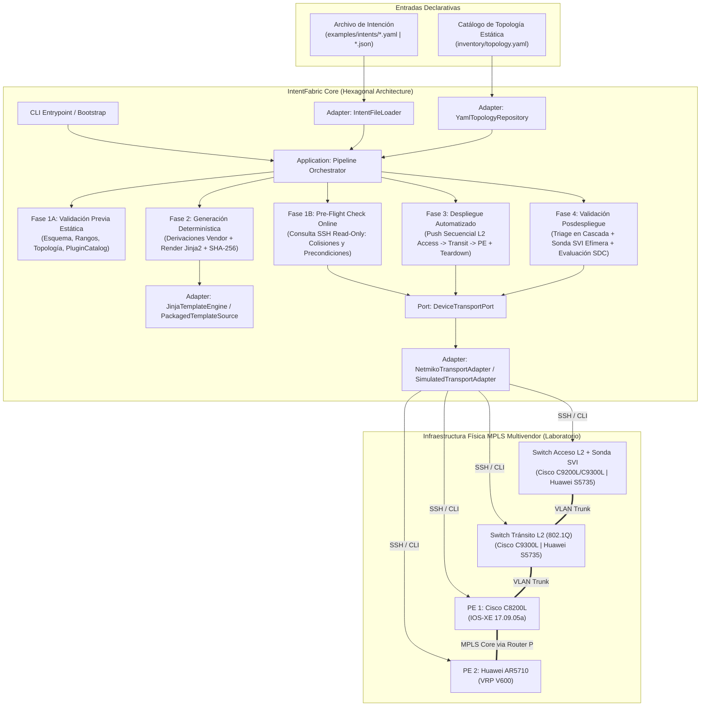

# IntentFabric — Contexto Maestro de Arquitectura (SSOT de Diseño)

**Alcance de este documento:** Este archivo es la fuente de verdad de diseño macro. Se utiliza **exclusivamente** durante sesiones de descubrimiento y redacción de especificaciones (`docs/adr/ADR-00X.md`). **Regla de aislamiento:** Los agentes en rol de *Implementación* o *Revisión* NO leen este documento; se rigen únicamente por `AGENTS.md` y la Parte B del ADR activo. Toda regla de negocio o contrato aquí descrito que aplique a una tarea debe traducirse explícitamente en las secciones 7, 8 y 9 del ADR correspondiente.

---

## 1. Problema y Propósito Arquitectónico

* **Problema y limitaciones a resolver:** El aprovisionamiento manual de servicios corporativos (DIA, L3VPN y L2VPN) sobre infraestructuras de transporte MPLS y agregación L2 multivendor (Cisco IOS-XE y Huawei VRP) requiere traducir manualmente una misma especificación de servicio a sintaxis CLI propietarias heterogéneas. Esto incrementa el tiempo operativo, el riesgo de errores humanos (sintaxis, colisión de VLAN/IP/VRF, omisión de trunking en switches de tránsito) y carece de validación determinística previa y posterior al cambio sin depender de modelos de lenguaje probabilísticos (LLMs) ni requerir acceso a equipos de borde de cliente (CE).

* **Solución arquitectónica adoptada:** Framework modular en Python (`IntentFabric`) diseñado bajo Arquitectura Hexagonal (Puertos y Adaptadores) y un pipeline determinista de ciclo cerrado en cuatro fases secuenciales: (1) Validación Previa Híbrida (Offline Estática + Pre-Flight Check Online de solo lectura), (2) Generación Determinística (Jinja2 + derivaciones matemáticas puras desacopladas por vendor y topología estática), (3) Despliegue Automatizado (CLI-over-SSH vía Netmiko/Simulated) y (4) Validación Posdespliegue mediante *Triage en Cascada* (Core MP-BGP/LDP, Continuidad LLDP, Auditoría MAC L2, Sonda SVI Efímera en el switch de acceso y validación multicapa en PEs).

* **Actores / Consumidores:** Ingenieros/Analistas de Operaciones de Red (NOC / Provisioning Carrier) que interactúan mediante la interfaz de línea de comandos (`intentfabric CLI`) consumiendo archivos declarativos de intención (`.json` / `.yaml`) y el catálogo estático de topología (`inventory/topology.yaml`); y el arnés de evaluación experimental para recolección de métricas de tesis.

---

## 2. Atributos de Calidad y Restricciones del Proyecto

### 2.1 Jerarquía de Atributos de Calidad (Trade-offs)

1. **Determinismo y Reproducibilidad [Prioridad Crítica]:** Cero dependencia de LLMs o heurísticas probabilísticas en el motor. Toda función de validación estática, derivación matemática, resolución de topología y renderizado Jinja2 debe ser pura ($f(x, \text{topo}) = y$), garantizando salidas idénticas bit a bit (UTF-8, saltos de línea `\n` y hash SHA-256 verificable contra Golden Configs).

2. **Seguridad Operativa Carrier-Grade (Pre/Post Validation & Fail-Fast) [Prioridad Crítica]:** Ningún comando de configuración se emite hacia la red si falla la validación estática o si el *Pre-Flight Check* detecta colisiones de estado (VLAN o subinterfaz ocupada) o ausencia de precondiciones (VRF base, política QoS, LLDP o BGP inactivo). La validación posterior no asume éxito por retorno de código SSH, sino por contraste del `ExpectedState` frente al `ObservedState`.

3. **Extensibilidad y Mantenibilidad (Desacoplamiento Multivendor) [Prioridad Alta]:** Cumplimiento del principio Abierto/Cerrado (OCP) e Inversión de Dependencias. El núcleo (`domain/` y `application/`) y los plugins (`services/<s>` y `vendors/<v>`) dependen exclusivamente de la biblioteca estándar de Python; las librerías de terceros (`jinja2`, `pyyaml`, `netmiko`, `textfsm`) quedan estrictamente confinadas en `adapters/`, verificado mediante análisis estático de AST (`test_architecture.py`).

4. **Auditabilidad y Trazabilidad Experimental [Prioridad Alta]:** Registro estructurado inmutable de cada ejecución (tiempos por fase y total, hash de configuración generada, comandos enviados, salidas crudas recibidas, clasificación taxonómica de errores y cálculo de *State Compliance* `SDC`).

### 2.2 Restricciones Duras (Laboratorio / Entorno / Negocio)

* **Tiempo / Rendimiento objetivo:** Entrega del MVP funcional completo (código al 100% de las 4 fases + suite de pruebas offline/simuladas y golden files) antes de la evaluación parcial TI2 (2–8 de noviembre de 2026), y campaña experimental completa antes de TI3 (30 de noviembre – 6 de diciembre de 2026).

* **Presupuesto y fricción:** Costo $0 en software (herramientas Open Source bajo licencia permisiva). Prohibición estricta de incluir plantillas propietarias, direccionamiento IP público o datos reales de operadores comerciales en el repositorio público (`JohaoAndree/IntentFabric`) para garantizar confidencialidad y Turnitin ≤ 15%.

* **Entorno anfitrión base:** Estación de trabajo Windows 11 con entorno virtual aislado, `Python 3.14.2` (`requires-python >= 3.13`), dependencias bloqueadas en `requirements.lock` y normalización `eol=lf` en `.gitattributes`.

* **Hardware y Topología Física del Laboratorio (Universidad de Lima):**
* **Routers PE / P (Core MPLS):** Routers Cisco Catalyst `C8200L-1N-4T` (`IOS XE 17.09.05a`, licencia `network-advantage_10M` activa, interfaces `GigabitEthernet0/0/x` que truncan a `Gi0/0/x.<vlan>` en `show ip interface brief`) y Routers Huawei `AR5710-S8T2XE` (`VRP V600` / `VRPv8`, pendiente desbloqueo de credenciales de consola en laboratorio).

* **Switches de Agregación / Acceso (Transporte L2):** Switches Cisco Catalyst `C9300L-24T-4G` (`IOS XE 17.18.04`, `network-advantage` activa), Cisco `C9200L` y Switches Huawei `S5735-L24P4XE` (`VRP V200`). Operan exclusivamente conmutando VLANs en Capa 2 (802.1Q trunking) entre el puerto de demarcación del cliente y el PE, con capacidad de instanciar una interfaz SVI efímera (`interface Vlan<id>` / `interface Vlanif<id>`) exclusivamente durante la Fase 4 de validación.

* **Frontera de Demarcación (Sin CE):** No se emplean laptops ni routers CE en el alcance del framework. El underlay MPLS (OSPFv2 Área 0, LDP en enlaces PE-P-PE, sesiones MP-iBGP `vpnv4` y `l2vpn evpn` entre Loopbacks de PEs, VRF de Internet para DIA y `lldp run` / `lldp enable` global) constituye la línea base preconfigurada (Day-0).

---

## 3. Arquitectura Macro y Topología del Sistema

### 3.1 Stack Tecnológico Base

* **Core / Motor:** Python 3.14.2 (stdlib pura en `domain/`, `application/`, `services/`, `vendors/`), `argparse` para la CLI nativa.

* **Adaptadores y Librerías Externas:** `Jinja2 3.1.6` (motor de plantillas determinista con `StrictUndefined`), `PyYAML 6.0.3` (carga de intenciones YAML y `inventory/topology.yaml`), `Netmiko 4.8.0` + `Paramiko 5.0.0` (transporte SSH para drivers `cisco_xe`, `huawei` y `huawei_vrpv8`), `pytest 9.1.1` (suite de pruebas unitarias, de contrato, de arquitectura y golden files).

### 3.2 Diagrama de Topología y Flujo de Interacción

---

## 4. Contratos de Componentes y Reglas de Dominio

### 4.1 Reglas de Negocio / Dominio Inviolables

* **Regla 1 (Orden Inmutable del Pipeline):** El ciclo de ejecución respeta siempre la secuencia: `Fase 1 (Validación Previa: 1A Offline + 1B Pre-Flight Online)` $\rightarrow$ `Fase 2 (Generación Determinística)` $\rightarrow$ `Fase 3 (Despliegue)` $\rightarrow$ `Fase 4 (Validación Posdespliegue)`. Cualquier fallo en 1A o 1B aborta la ejecución antes de emitir cambios (`Fail-Fast`).

* **Regla 2 (Desacoplamiento Intención vs. Topología):** Los archivos de intención declaran únicamente parámetros del servicio y referencian los nodos o puntos de demarcación por su `hostname` lógico (o ruta nominal). Las direcciones `management_ip`, el `vendor`, el `driver`/`variant` de sistema operativo, los roles y los puertos troncales de interconexión entre switches residen en `inventory/topology.yaml`. *(Nota de compatibilidad: si ADR-003 se mantiene temporalmente o se evoluciona en ADR-007, el resolvedor de topología debe permitir enriquecer la intención desde `inventory/topology.yaml` sin exponer detalles de gestión en nuevas intenciones)*.
* **Regla 3 (Estandarización Matemática de QoS y Escalado por Vendor):** Queda prohibida cualquier fórmula arbitraria en base 1024 o con porcentajes de sobreventa no declarados (`1.05`, `10% CIR`). El cálculo de ancho de banda se rige por el estándar de transmisión IEEE/ITU-T en base decimal ($1\text{ Mbps} = 1\,000\text{ kbps} = 1\,000\,000\text{ bps}$). En servicios garantizados (DIA/L3VPN), por defecto $\text{CIR} = \text{PIR} = \text{Bandwidth}$ (salvo que el intent especifique explícitamente `cir_mbps` y `pir_mbps`). La conversión de escala se delega al contexto de cada fabricante: **bps** para Cisco IOS-XE (`police rate <bps> bps`) y **kbps** para Huawei VRP (`qos car cir <kbps> pir <kbps>`).

* **Regla 4 (Normalización Canónica de Interfaces):** Dado que Cisco IOS-XE trunca los nombres en salidas operativas (ej. `GigabitEthernet0/0/1.999` aparece como `Gi0/0/1.999` en `show ip interface brief`), toda comparación entre el estado esperado y el estado observado debe pasar por una función pura de normalización de nombres de interfaz (`normalize_interface_name`).

* **Regla 5 (Sonda SVI Efímera y Limpieza Obligatoria en Fase 4):** Para validar el plano de datos L3 y poblar las tablas MAC en la cadena de switches L2 sin emplear un CE físico (en DIA y L3VPN), la Fase 4 crea una interfaz SVI temporal (`interface Vlan<id>` en Cisco / `interface Vlanif<id>` en Huawei) en el switch de acceso con la IP `.2` de la subred WAN `/30`, ejecuta el `ping` hacia la IP `.1` (Gateway en el PE), verifica la tabla MAC y **elimina obligatoriamente la SVI** (`no interface Vlan<id>` / `undo interface Vlanif<id>`) dentro de un bloque `finally` garantizado antes de cerrar la fase.

* **Regla 6 (Validación Multicapa y Estado Dual en L3VPN):** Las plantillas BGP de L3VPN en el PE deben incluir `redistribute connected` bajo la familia `ipv4 vrf <vrf_name>`. El cumplimiento del estado esperado (`SDC = 1`) para L3VPN exige simultáneamente: (a) subinterfaz WAN en estado `up/up`, (b) ping exitoso desde la Sonda SVI efímera, (c) prefijo WAN local aprendido vía MP-BGP en la tabla VRF del PE remoto (`show bgp vpnv4 unicast vrf ...` / `display ip routing-table vpn-instance ...`), y (d) estado de sesión eBGP PE-CE evaluado en lógica dual: `OPERATIONAL` (si `Established`) o `READY_FOR_SERVICE` (si `Active`/`Idle` por ausencia física del CE teniendo los pasos a, b y c en `True`).

* **Regla 7 (Variantes de Señalización en L2VPN y Modo Transaccional Huawei):** El modelo de intención de L2VPN es agnóstico al protocolo de señalización del pseudowire. El catálogo de plantillas resuelve mediante `TemplateKey.variant` tanto `evpn_vpws` (MP-BGP EVPN Tipo-1 / VPWS) como el fallback `martini_ldp` (`xconnect` en Cisco / `mpls l2vc` en Huawei). Asimismo, el adaptador de transporte soporta tanto ejecución inmediata (`cisco_xe`, `huawei` VRPv5 en S5735) como confirmación transaccional mediante comando `commit` (`huawei_vrpv8` / V600 en AR5710).

### 4.2 Componentes Clave y Contratos (Inputs / Outputs)

1. **Dominio (`src/intentfabric/domain/`):** Modelos inmutables `ServiceIntent`, `DiaIntent`, `L3VpnIntent`, `L2VpnIntent`, `AccessHop`, `TransitHop` y `ProviderEdgeHop`; topología (`TopologyCatalog`, `TopologyNode`, `TopologyLink`), `VendorDefinition` y `TemplateKey`. `derivations.py` e `interfaces.py` contienen las derivaciones puras y la normalización. Los resultados se expresan mediante `ValidationReport`, `ServiceGenerationPlan`, `ServiceDeploymentReport`, `PostValidationReport` y `ExecutionRecord`; `ExpectedState` se deriva mediante `build_expected_state` en `domain/post_validation.py`. Las excepciones parten de `IntentFabricError`.

2. **Plugins (`src/intentfabric/services/` y `src/intentfabric/vendors/`):** `dia/`, `l3vpn/` y `l2vpn/` contienen `intent_parser.py`, `validator.py` y `context_builder.py`: convierten entradas estructuradas en intenciones, validan semántica y construyen contextos por salto. `cisco/` y `huawei/` declaran `VENDOR_DEFINITION`, sus constructores de contexto QoS y las plantillas `provision`/`teardown` por rol y variante.

3. **Aplicación (`src/intentfabric/application/`):** `PluginCatalog` registra parsers, validadores, contextos y fabricantes; `TopologyPathResolver` resuelve rutas L2 → PE. Los puertos son `ServiceIntentParser`, `TemplateSource`, `TemplateRendererPort`, `TopologyRepositoryPort`, `PreFlightCheckerPort`, `DeviceTransportPort` y `ExecutionLoggerPort`. `PreValidationService` produce `ValidationReport` e integra `OnlinePreFlightChecker`; `DeterministicGeneratorService` produce `ServiceGenerationPlan`; `DeploymentService` produce `ServiceDeploymentReport`; `PostValidationTriageService` produce `PostValidationReport`. Los parsers operativos residen en `preflight_online.py` y `post_validation.py`. `PipelineOrchestrator` coordina los seis casos de uso y devuelve `ExecutionRecord`.

4. **Adaptadores (`src/intentfabric/adapters/`):** `intent_file_loader.py` expone `load_intent_mapping` para JSON/YAML; `yaml_topology_repository.py`, `YamlTopologyRepository`; `packaged_template_source.py`, `PackagedTemplateSource`; `jinja_renderer.py`, `JinjaTemplateRenderer`. `netmiko_transport.py` y `simulated_transport.py` implementan `NetmikoTransportAdapter` y `SimulatedTransportAdapter`. `execution_logger.py` implementa `FileExecutionLogger`: reemplaza el JSON completo y anexa métricas CSV en UTF-8/LF.

5. **Composición y CLI (`src/intentfabric/bootstrap.py` y `src/intentfabric/cli.py`):** `bootstrap.py` conecta catálogo, inventario, servicios, transportes y logger. `cli.py` expone `build_argument_parser` y `main`; el entrypoint `intentfabric` de `pyproject.toml` ofrece `validate`, `generate`, `deploy`, `verify`, `run` y `teardown`.

---

## 5. Alcance por Etapas (Control de Scope para Parte B)

* **Estado del proyecto:** MVP implementado hasta ADR-012; etapas E1–E4 completadas.

* **`E1` completada (Corte Vertical Fundacional y Determinismo Offline DIA):**
* Consolidación de la arquitectura hexagonal (ADR-001), entorno y bloqueo de dependencias (ADR-002), modelo de intención DIA (ADR-003), catálogo de plugins (ADR-004), validación previa estática y contrato de Pre-Flight (ADR-005), y motor de generación determinista Jinja2 con Golden Configs para DIA en Cisco IOS-XE y Huawei VRP corrigiendo la conversión de QoS a base 1000 estándar (ADR-006).

* **Cierre del MVP para TI2 (`E2`–`E4` completadas — Topología, 3 Servicios y Ciclo Cerrado de 4 Fases):**
* **`E2` completada (Topología y Servicios MPLS):** Catálogo estático `inventory/topology.yaml`, `TopologyPathResolver` y normalizador de interfaces (ADR-007); modelos de intención, validación y plantillas Golden para L3VPN con BGP + `redistribute connected` (ADR-008) y L2VPN con soporte dual `evpn_vpws` / `martini_ldp` y plantillas de retiro `teardown` para limpieza de laboratorio (ADR-009).

* **`E3` completada (Transporte, Pre-Flight Online y Despliegue):** `DeviceTransportPort`, `NetmikoTransportAdapter` con `commit` para `huawei_vrpv8` y `SimulatedTransportAdapter`; Pre-Flight online de solo lectura (Fase 1B) y `DeploymentService` (Fase 3) con corte Fail-Fast y resultados parciales para `provision`/`teardown` (ADR-010).

* **`E4` completada (Validación Posdespliegue, Orquestador y CLI):** Parsers deterministas y `PostValidationTriageService` con Sonda SVI Efímera para DIA/L3VPN, limpieza en `finally`, comprobación de circuitos L2VPN y estados `OPERATIONAL`/`READY_FOR_SERVICE` (ADR-011); `PipelineOrchestrator`, `ExecutionRecord` (tiempos por fase/total, hash, SDC y errores), `ExecutionLoggerPort` con `FileExecutionLogger` JSON/CSV e interfaz CLI `intentfabric` (`validate`, `generate`, `deploy`, `verify`, `run`, `teardown`) (ADR-012).

* **Fuera de Alcance del MVP (`E5+` / Iteraciones Futuras):**
* *Rollback transaccional compensatorio ante fallo parcial a mitad de comando* (diferido por recomendación del asesor de arquitectura; el MVP utiliza plantillas de retiro `teardown` de servicio completo y comandos de restauración de línea base entre pruebas).
* Aprovisionamiento automatizado del *Underlay / Core MPLS Día-0* (OSPF, LDP base, creación inicial de sesiones MP-iBGP entre Loopbacks).
* Configuración automatizada de equipos de cliente (`CE`), interfaces gráficas (Web UI), ejecución multiusuario concurrente o uso de YANG/NETCONF/gNMI.

---

## 6. Hoja de Ruta y Grafo de ADRs

Implementación completada de ADR-001 a ADR-012 (E1–E4). Los estados reflejan la aprobación; ADR-003 conserva su sustitución parcial por ADR-007.

| ID | Etapa | Título | Estado | Depende de | Alcance de Implementación (Resumen Parte B) |
| --- | --- | --- | --- | --- | --- |
| **ADR-001** | E1 | Arquitectura hexagonal sobre el pipeline | Accepted | — | Estructura de paquetes en `src/intentfabric/`, fronteras de dependencias y validación estática por AST en `test_architecture.py`.|
| **ADR-002** | E1 | Entorno de ejecución, empaquetado y bloqueo de dependencias | Accepted | ADR-001 | Configuración de `pyproject.toml` (`Python >= 3.13`), extras `dev`/`ssh`, `requirements.lock` y `scripts/check_env.py`.|
| **ADR-003** | E1 | Modelo de intención estructurada para el servicio DIA (v1) | Partially Superseded por ADR-007 | ADR-001 | Esquema JSON/YAML de DIA, parser estricto en `services/dia/intent_parser.py`, modelos en `domain/intent.py` y derivaciones iniciales.|
| **ADR-004** | E1 | Contrato de extensión para servicios y fabricantes | Accepted | ADR-001, ADR-003 | `VendorDefinition`, `TemplateKey`, puerto `TemplateSource`, `PluginCatalog`, `PackagedTemplateSource` y registro en `bootstrap.py`.|
| **ADR-005** | E1 | Validación previa de intenciones (Reglas semánticas y contrato Pre-Flight) | Accepted | ADR-003, ADR-004 | Modelos `ValidationIssue`/`ValidationReport`, validador semántico offline (prefijos, rangos VLAN, soporte en catálogo) y puerto `PreFlightCheckerPort`.|
| **ADR-006** | E1 | Motor de generación determinista, ajuste QoS estándar y Golden Configs DIA | Accepted | ADR-004, ADR-005 | Estandarización de cálculo QoS en base 1000 (bps Cisco / kbps Huawei), adaptador Jinja2 (`StrictUndefined`, SHA-256) y plantillas + Golden Files DIA (`provision`/`teardown`).|
| **ADR-007** | E2 | Catálogo de topología estática (`inventory/`) y normalización de interfaces | Accepted | ADR-005, ADR-006 | Esquema `inventory/topology.yaml`, adaptador `YamlTopologyRepository`, resolvedor de rutas L2->PE y función `normalize_interface_name` (`Gi0/0/1.x` $\leftrightarrow$ `GigabitEthernet0/0/1.x`). |
| **ADR-008** | E2 | Extensión del servicio L3VPN (Modelo, BGP `redistribute connected` y Golden Configs) | Accepted | ADR-006, ADR-007 | Parser de intención L3VPN (VRF, RD, RT, BGP PE-CE, QoS), plantillas Cisco IOS-XE y Huawei VRP y pruebas contra Golden Files.|
| **ADR-009** | E2 | Extensión del servicio L2VPN con soporte dual (`evpn_vpws` / `martini_ldp`) | Accepted | ADR-006, ADR-007 | Parser de intención L2VPN punto a punto, plantillas por variante (`evpn_vpws` y fallback `martini_ldp`) para Cisco/Huawei y pruebas contra Golden Files.|
| **ADR-010** | E3 | Transporte de dispositivos (Netmiko/Simulado), Pre-Flight Online y Despliegue | Accepted | ADR-007, ADR-008, ADR-009 | `DeviceTransportPort`, `NetmikoTransportAdapter` (`commit` en `huawei_vrpv8`), `SimulatedTransportAdapter`, Pre-Flight de solo lectura y despliegue secuencial Fail-Fast con resultados parciales.|
| **ADR-011** | E4 | Validación posdespliegue: Parsers deterministas, Triage en Cascada y Sonda SVI | Accepted | ADR-010 | Parsers de `show`/`display`, triage (interfaz PE, LLDP, VLAN/MAC y control del servicio), Sonda SVI DIA/L3VPN con limpieza en `finally`, circuitos L2VPN y `SDC` con estados `OPERATIONAL`/`READY_FOR_SERVICE`.|
| **ADR-012** | E4 | Orquestador del Pipeline de 4 Fases, Registro Experimental y CLI `intentfabric` | Accepted | ADR-011 | `PipelineOrchestrator`, `ExecutionRecord` (tiempos por fase/total, hash, errores, `SDC`), `ExecutionLoggerPort` con `FileExecutionLogger` JSON/CSV y CLI `argparse` (`validate`, `generate`, `deploy`, `verify`, `run`, `teardown`).|

---

## 7. Registro de Evolución del Contexto Maestro

* **27-10-2026:** Creación de la línea base arquitectónica consolidada tras auditoría cruzada de los artefactos N1 (Ficha, Artículo, Informe Ejecutivo, Repositorio commit `2a138ec0`) y diagnóstico presencial en el laboratorio de la Universidad de Lima sobre routers Cisco C8200L (`IOS XE 17.09.05a`) y switches Cisco C9300L (`IOS XE 17.18.04`). Se formaliza el orden de las 4 fases, el desacoplamiento de `inventory/topology.yaml`, la conversión QoS en base 1000 por vendor, la validación posdespliegue mediante *Triage en Cascada* con Sonda SVI Efímera, la evaluación dual de L3VPN (`OPERATIONAL` / `READY_FOR_SERVICE`) y el soporte de variantes `evpn_vpws` / `martini_ldp` en L2VPN.

* **30-10-2026:** Cierre documental de E1–E4 hasta ADR-012: README reescrito y avance/hoja de ruta sincronizados en `caa1e8f`; ADR-003 conserva `Partially Superseded por ADR-007`. Se actualiza la sección 4.2 con los componentes reales, la ubicación de parsers operativos y `build_expected_state`, `FileExecutionLogger` y los seis subcomandos de la CLI.
